# Smart Lamp Demo — POSIX Firmware, Secure OTA and Observability

Public demo of a **smart lamp** with **FreeRTOS firmware simulated on POSIX**, **signed and encrypted OTA updates**, a **Modbus TCP LED driver**, a **REST + WebSocket backend** and a **user dashboard + simulation panel**.

> Demo project. The firmware runs as a Linux process (FreeRTOS POSIX port), not on a real MCU. The security properties that are preserved and those that cannot be simulated are documented in [`docs/threat-model.md`](docs/threat-model.md).
>
> **The essentials:** `cp .env.example .env && docker compose up --build` and open
> `http://localhost:3000`. Sim panel: `http://localhost:3000/sim.html?pin=2025`.
> Dashboard in English by default; `?lang=es` switches it to Spanish.
>
> **▶ Try the live demo:** <https://feyk1.github.io/SmartLamp/>
> Dashboard + Simulation Panel (PIN `2025`), no installation.
>
> **📚 Read the documentation online:** <https://feyk1.github.io/SmartLamp/docs/>
> The MkDocs site is the recommended way to read the user manual, architecture,
> OTA, security, deployment and ADRs.

**▶ Live demo:** <https://feyk1.github.io/SmartLamp/> · **[📚 Docs](https://feyk1.github.io/SmartLamp/docs/)** · **[📐 Architecture](docs/01-general-architecture.md)** · **[🧭 Decisions (ADR)](docs/adr/)** · **[🧪 Tests](#tests-and-quality)** · **[🚀 Deployment](docs/deployment.md)**

## Contents

- [Demo and 5-minute tour](#demo-and-5-minute-tour)
- [User manual](#user-manual)
- [Local assistant](#local-assistant)
- [Architecture](#architecture)
- [Running it locally](#running-it-locally)
- [What it demonstrates](#what-it-demonstrates)
- [Secure OTA](#ota-update)
- [Faults and recovery](#faults-with-real-effects)
- [Security and fidelity](#security-properties-preserved-vs-simulated)
- [Tests and quality](#tests-and-quality)
- [Documentation](#documentation)
- [Deployment](#deployment)
- [Common issues](#common-issues)
- [License](#license)

---

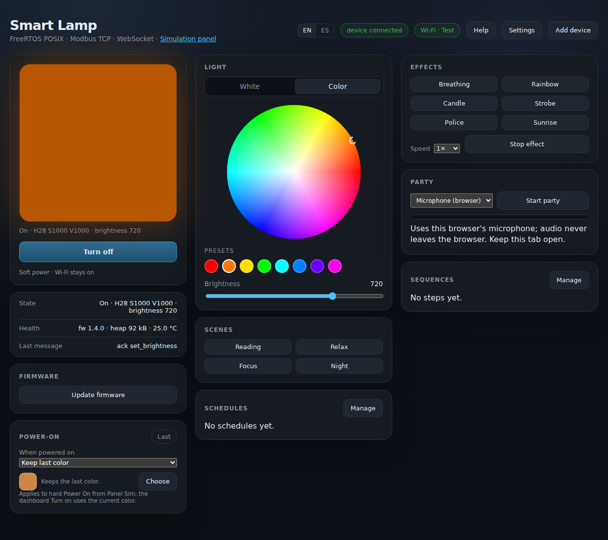

*Real run with `docker compose up`: color mode, presets, scenes and effects.
The UI is in English by default and switches to Spanish with the selector or
`?lang=es`. [Sim panel](docs/assets/sim-panel.png).*

---

## Demo and 5-minute tour

1. **Dashboard:** turn it on, switch between white and color, try a scene and an
   effect; the real state arrives over WebSocket.
2. **Sim panel:** sign in with PIN `2025`, open **Modbus** and write a register;
   open **Device** to see the supervisor and the timeline.
3. **Faults:** inject `led_overtemp_warn` (derate to 50 %) and then
   `led_overtemp` (output off + latch); try **Clear faults**.
4. **OTA:** under **Firmware** you'll see `Current: vX · slot A|B`; a newer
   artifact switches slots and a downgrade is rejected with an explanation.
5. **Pairing:** under **Device**, do 3 hard Power Off/On cycles and use
   **Add device** in the dashboard.

If you only want to review the code, jump to [Code review path](#code-review-path).

---

## User manual

The step-by-step guide is in [`docs/manual/README.md`](docs/manual/README.md).
It covers the dashboard, pairing, scenes, sequences, schedules, faults, OTA, the
Sim panel and common issues. Each page has requirements, steps, expected result
and typical errors.

Shortcuts:

- [Getting started](docs/manual/00-getting-started.md)
- [Pairing](docs/manual/02-pairing.md)
- [Faults](docs/manual/06-faults.md)
- [OTA and slots](docs/manual/07-ota-slots.md)
- [Common issues](docs/manual/09-troubleshooting.md)
- [Controls reference](docs/manual/10-controls-reference.md)
- [Local assistant](docs/manual/11-assistant.md)

### Local assistant

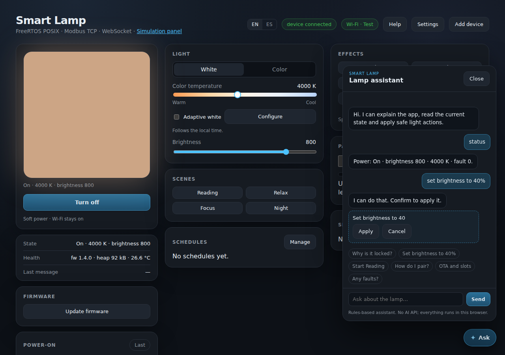

The **Ask** button opens a client-side assistant. It explains the app, reads the
current state (power, brightness, Wi-Fi, fault, version/slot) and proposes safe
light actions with an **Apply** confirmation. It has no model, no API key and no
per-request cost; the knowledge base is generated from this manual. OTA, factory
reset and credentials stay manual.

---

## What it demonstrates

| Area | Evidence |
| :--- | :--- |
| **RTOS firmware** | FreeRTOS POSIX port, tasks, priorities, mutexes and stack/heap metrics |
| **Non-volatile memory** | `flash.bin` with `mmap`, A/B partitions, metadata, double-buffered config |
| **Bootloader** | Ed25519 + AES-256-GCM verification, anti-downgrade, rollback, `execve` |
| **OTA** | CI pipeline that signs and encrypts, independent verification, 3 deployment modes (legit, corrupt, downgrade) |
| **Protocols** | Modbus TCP (firmware↔driver), REST+TLS and WebSocket+TLS (firmware↔backend) |
| **Backend** | FastAPI, ephemeral instance orchestrator with a Fly Machines adapter |
| **DevOps** | GitHub Actions (build, package, verify, deploy), Docker, reference Fly.io deployment with ephemeral instances |
| **Effects and sequences** | Six driver effects (breathing, rainbow, candle, strobe, police, sunrise) + a user sequence editor (up to 8 colors, duration, fade and speed) |
| **Party mode** | Beat from the browser microphone or a simulated beat; level meter and color/brightness over WebSocket |
| **Scheduling** | One-shot/recurring schedules that capture the current light or off state, **gradual sunrise**, SQLite persistence, retries, adaptive white and persisted driver state |
| **Simulated onboarding** | Pairing with 3 cycles, blinking, fake BLE scan, simulated Wi-Fi, encrypted credentials, whitelist/faults and a Network tab |
| **Observability** | RTOS metrics, state timeline, live logs, OTA events and faults with derate/trip/latch |
| **Security** | JWT, `device_token`, rate limiting, documented threat model |
| **Local assistant** | Rule-based, client-side explanations, diagnostics and safe light actions; no model, API key or cost |
| **Documentation** | 9 design documents (00–08) + 10 ADRs + threat model + key management + auth + deployment guide, built with MkDocs |

## Architecture


*Editable source: [`docs/diagrams/architecture.mmd`](docs/diagrams/architecture.mmd).*
Full details in [`docs/01-general-architecture.md`](docs/01-general-architecture.md).

## Stack

| Layer | Technology |
| :--- | :--- |
| **Firmware** | C99, FreeRTOS (POSIX port), CMake, GCC, `libmodbus`, `libsodium`, `mbedTLS` (all vendored) |
| **LED driver** | C, `libmodbus`, sequence animation at 20 Hz |
| **Backend** | Python 3.12 (3.11+ compatible), FastAPI, WebSocket, `httpx`, Fly Machines adapter |
| **Frontend** | Vanilla JS with no npm build, Canvas, Web Audio and native WebSocket |
| **Infra** | Docker, GitHub Actions, GitHub Pages; Fly.io reference |

## Repository structure

```text
.
├── README.md
├── docs/              # Complete design, ADRs, threat model
├── firmware/          # FreeRTOS POSIX, bootloader, supervisor, HAL
├── driver/            # Simulated LED driver with Modbus TCP
├── backend/           # FastAPI + WS + orchestrator
├── web/               # User dashboard + simulation panel
├── tools/             # package_ota.py, verify_ota.py, generate_keys.sh
├── infra/             # Orchestrator and instance Dockerfiles
├── keys/              # ota_public.pem (public)
├── .github/workflows/ # CI/CD
├── fly.toml           # orchestrator deployment
└── docker-compose.yml
```

## Running it locally

```bash
git clone <repo> && cd smart-lamp-demo
cp .env.example .env      # local demo configuration

# Starts backend, Modbus driver, firmware and dashboard
docker compose up --build

# Dashboard:  http://localhost:3000
# Backend:    http://localhost:8080/docs
# Modbus:     localhost:5020
```

Expected: `backend`, `driver`, `firmware` and `web` running, and
`curl http://localhost:8080/health` returning `{"status":"ok"}`. This path is
verified end-to-end with `docker compose down` + `docker compose up --build`.

The dashboard creates (or reuses) the instance and keeps a heartbeat every 30 s.
If the dashboard sends no heartbeat for **2 min**, the backend deletes the
instance and its Machine. Device telemetry does not extend that deadline.

Local security: **JWT** sessions (HS256) for the dashboard, an opaque
`device_token` for the firmware, rate limiting (device/IP/PIN) and configurable
CORS. The dashboard WebSocket uses a **single-use, short-lived ticket** (30 s); the
JWT is not placed in the URL. The local demo still runs over HTTP; on Fly.io TLS
terminates at the edge.

**Language:** the dashboard and Simulation Panel are in **English by default**
and Spanish; the EN/ES selector is saved in the browser and `?lang=es` forces the
language. **Logs, API errors and code comments** are in English. The UI includes white mode (2000–6500 K), an HSV color
wheel with presets, scenes, the driver effects (breathing, rainbow, candle,
strobe, police, sunrise), its own sequence editor (up to 8 colors, duration,
fade and speed), a party mode that reacts to the browser microphone (or a
simulated beat if permission is denied), schedules/scheduled scenes, simulated
onboarding and adaptive white based on local time. The **Schedules** and
**Sequences** cards show a summary and open a **Manage** dialog; sequences can
be reordered by dragging the handle, with arrows for keyboard and mobile. The
**Help** button opens a quick guide in both panels. The driver remembers its
last state across restarts (`driver_state.bin`).

Simulation panel: `http://localhost:3000/sim.html` (demo PIN `2025`, also
bilingual).
It lets you read/write driver registers, inject faults, deploy OTA in three modes
(legit/corrupt/downgrade), power off/on/reset the device, enter/exit the
bootloader, perform a factory reset and watch the timeline and live events. Panel
screenshot: [`docs/assets/sim-panel.png`](docs/assets/sim-panel.png).

### User sequences

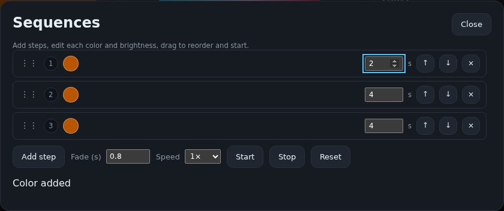

Add steps (up to 8) with the current color, but each step has its own **color and
brightness picker inside the dialog**, so there's no need to close and reopen
it to change the color. Adjust the duration, the fade (`Fade`, 0.8 s by
default) and the speed (0.5×–2×); reorder steps by dragging the handle or with
the arrows, or remove them. “Start” uploads the sequence to the driver over
Modbus with CRC-16 and sends `start_sequence` to the firmware; “Stop” stops it.
The sequence is saved in the browser, not in the device flash.

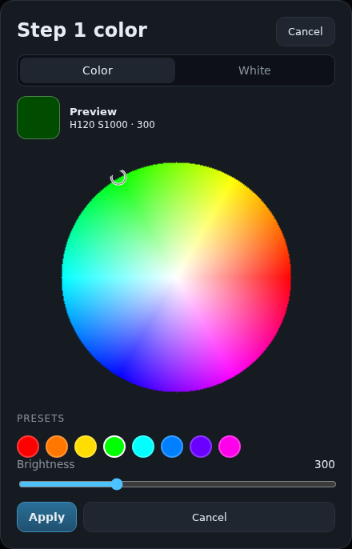

The color/white picker is the same visual control as in the main panel (HSV
wheel, white/CCT mode, brightness and presets) and is shared between sequences
and schedules. It includes a **preview** of the effective color and brightness,
and the step/schedule swatches dim according to brightness.

### Schedules

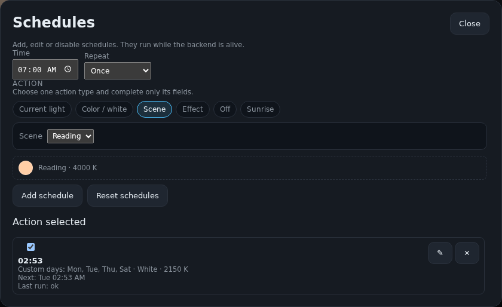

The card shows the next run; **Manage** opens the editor. You can choose
**color + brightness**, **white/CCT**, **scene** or **effect + speed** inside the
dialog, as well as capture the current light, turn off or schedule a sunrise.
The list lets you enable/disable, edit and delete entries; schedules live in the
backend and run while the orchestrator is awake.

### Power-on behavior

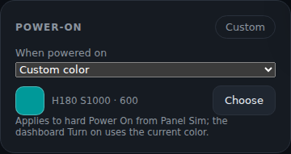

The **Power-on** card configures what the lamp does on a **hard Power On** (Sim
panel): keep the last color, go to a default warm white (3000 K at 70 %) or turn
on with a custom color/CCT and brightness, chosen with the shared picker. The
policy persists per `device_token`. The dashboard's soft **Turn on** does not
apply it: it keeps the current color.

### Faults with real effects

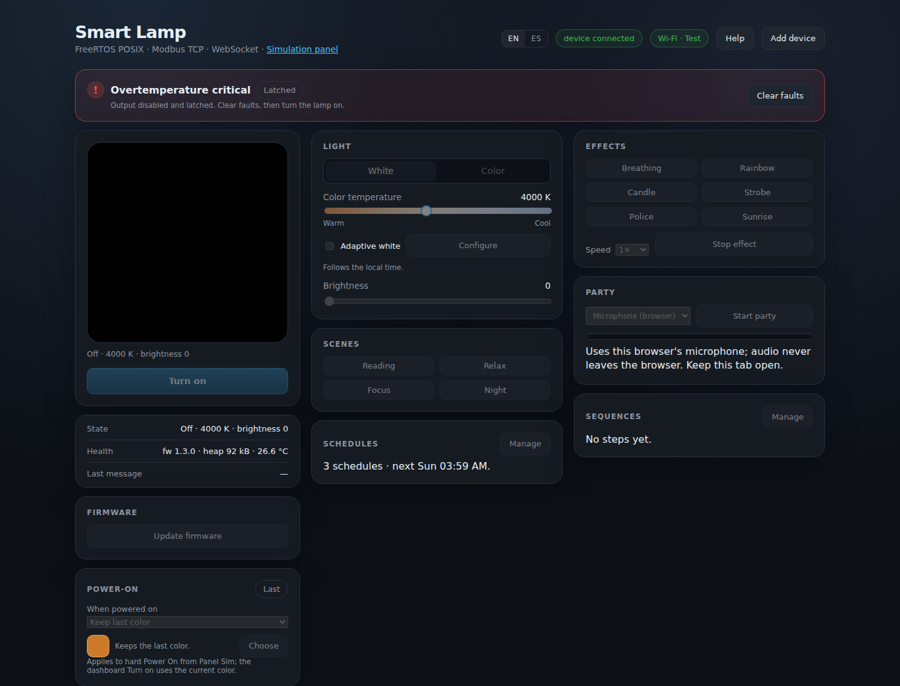

An **overtemperature warning** limits brightness to 50 % and restores it when the
condition clears. A **critical** fault, an **overcurrent** or an **open LED**
turns the output off, stops the sequence and stays latched: power/start are
blocked until you press **Clear faults**, and then you have to turn the lamp back
on. The dashboard shows the banner and the Sim panel indicates the effect of each
fault; simulated faults also increment the diagnostic counter.

A **corrupt configuration** enters safe mode: defaults, output off and
save/load/power blocked until you clear it and save again. If the **heartbeat**
is lost, the driver turns the output off and restores the target when the
firmware comes back, unless there is a latch or safe mode. The Sim panel adds a
history with the origin, severity and effect of each fault, plus **Clear
history**.

The Firmware tab shows `Current: vX · slot A|B`, whether each artifact is newer
or older, and the real result of the deployment. A downgrade is rejected by
anti-downgrade and the panel explains it instead of leaving a restart with no
context. **Settings** (dashboard) lets you reset local settings/schedules and
clear the history; the Sim panel **factory reset** also clears flash, power-on
and history, and the open dashboard resynchronizes.


*Editable source: [`docs/diagrams/fault-state.mmd`](docs/diagrams/fault-state.mmd).*

### Simulated onboarding

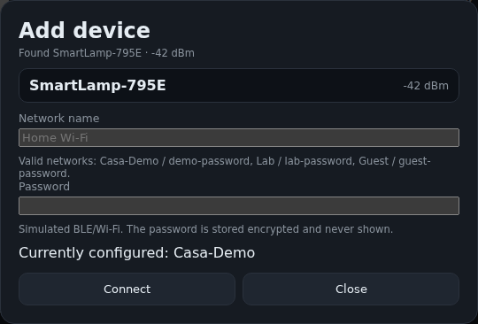

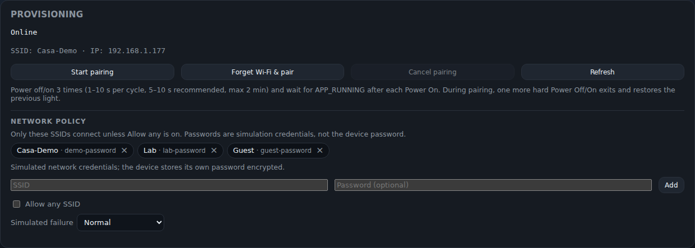

Turn the lamp off and on **three times** with **Power Off/On in the Sim panel**
(hard power), waiting 1–10 s between off and on (5–10 s recommended, 2 min max in
total) and **waiting for `APP_RUNNING` after each power-on**, or press Start
pairing there. The dashboard's **Turn off** is a soft power off and does not
count. After the third power-on it enters pairing; one more cycle cancels it. The
lamp blinks white, shows up as `SmartLamp-XXXX` in the scan and the wizard asks
for the SSID and password. The dashboard **only scans**: it cannot force pairing,
just like a real lamp. Sim panel → Network shows progress (`1/3`, `2/3`) and lets
you cancel pairing. The Wi-Fi connection is simulated: the SSID, IP and the
password **encrypted with AES-256-GCM** are stored per `device_token`; the
password is never returned, logged or sent to the firmware. The Sim panel has a
**Network** tab with state, SSID/IP, start pairing, cancel and forget Wi-Fi.
When you re-enter pairing, the configured network is kept until a new connect
replaces it; only “Forget Wi-Fi & pair” forgets it.

While there is no Wi-Fi (`provisioned`, `pairing` or `connecting`), the main
panel shows the live focus state but **blocks the controls**; only “Add device”
remains available. The network badge shows `No Wi-Fi`, `Pairing`, `Connecting`
or `Wi-Fi · SSID`. A hard Power Off/On during pairing exits the mode and
restores the previous light without erasing the network.

New instances start online with `Casa-Demo`. Sim panel → Network lets you edit
the whitelist (`Casa-Demo`, `Lab`, `Guest`), enable “Allow any” and simulate
faults (wrong password, unknown network, timeout). The wizard shows the valid
networks and translates those errors.

Demo credentials: `Casa-Demo` / `demo-password`, `Lab` / `lab-password` and
`Guest` / `guest-password`. They are shown in Network and in Add device; they are
simulation credentials, not the encrypted password the device stores.

### Party mode

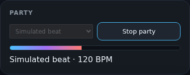

The browser analyzes the microphone with Web Audio (`getUserMedia` +
`AnalyserNode`), detects beats and sends color/brightness to the firmware over
WebSocket at ~8 Hz. The audio never leaves the browser; only hue and brightness
travel. If there is no microphone or permission is denied, it uses a simulated
beat at 120 BPM. It requires the tab to stay open, because the POSIX device has
no microphone of its own.

### OTA update

```bash
# 1. Build with another version and signed/encrypted packaging
cmake -B build-ota -G Ninja -DFW_VERSION_MINOR=1
cmake --build build-ota --target firmware
set -a; . ./.env; set +a
python3 tools/package_ota.py --input build-ota/bin/firmware \
    --version 1.1.0 --output firmware/releases/1.1.0.ota
python3 tools/verify_ota.py --input firmware/releases/1.1.0.ota \
    --active-version 1.0.3

# 2. Deploy to an instance (or the “Update firmware” button)
curl -X POST http://localhost:8080/api/v1/instances/<id>/ota \
    -H 'Content-Type: application/json' -d '{"version":"1.1.0"}'
```

The firmware downloads the artifact to staging, restarts into the bootloader,
which verifies Ed25519 + AES-256-GCM + SHA-256 and anti-downgrade, applies it to
the inactive slot and boots the new version. If the app does not confirm within
~3 s, the next boot rolls back. Artifacts live in `firmware/releases/` (not
committed).

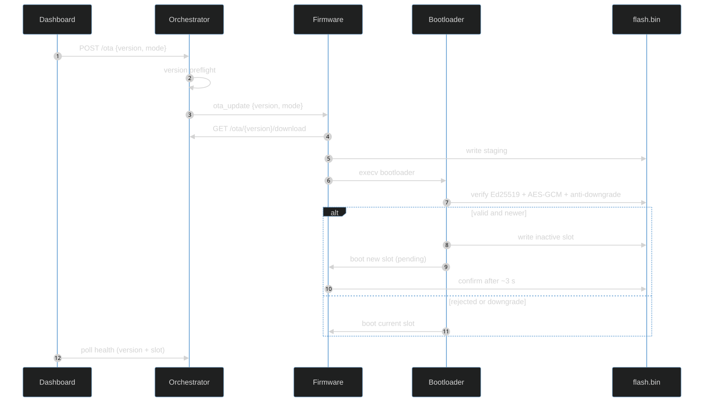

*Editable source: [`docs/diagrams/ota-flow.mmd`](docs/diagrams/ota-flow.mmd).*

## CI/CD

| Workflow | Trigger | What it does |
| :--- | :--- | :--- |
| `ci.yml` | push/PR to `main` | yamllint + markdownlint, MkDocs strict build, firmware build, `ctest` + coverage (≥70 %), pytest + ruff + mypy, OTA self-test, cppcheck and Docker image builds |
| `release-firmware.yml` | tag `v*` | builds with the tag version → signed/encrypted `.ota` → independent verification → Release + Pages |
| `deploy-pages.yml` | push to `main` (web/docs) | publishes the dashboard and the MkDocs documentation to GitHub Pages |
| `deploy-orchestrator.yml` | tag `v*` or manual | `fly deploy` of the orchestrator (requires `FLY_API_TOKEN`) |
| `deploy-instance-image.yml` | tag `v*` or manual | publishes `lamp-instance-base` to the Fly registry |

**Secrets** (environment `release`, with required reviewers):
`OTA_SIGNING_KEY` and `OTA_AES_KEY`. **Repository variable**:
`PUBLIC_ORCHESTRATOR_URL` (the URL the dashboard uses on Pages). Deployment to
Fly.io uses the `production` environment with `FLY_API_TOKEN`, and the
orchestrator receives `FLY_ORG_TOKEN` as a runtime secret.

Tags follow `vX.Y.Z`; the release builds the firmware with that version and
`tools/package_ota.py` signs the artifact. To reproduce CI locally:

```bash
cmake -B build-test -G Ninja -DBUILD_TESTS=ON && cmake --build build-test
(cd build-test && ctest --output-on-failure)
(cd backend && pytest --cov=src --cov-fail-under=70)
python3 tools/test_ota.py
```

See [`docs/deployment.md`](docs/deployment.md) for the step-by-step guide and
[`docs/06-deployment.md`](docs/06-deployment.md) for the design.

## Key architectural decisions

| Decision | Rejected alternative | Reason | ADR |
| :--- | :--- | :--- | :--- |
| FreeRTOS POSIX port | Bare-metal on QEMU | Lower learning curve, native execution, no emulation | [ADR-001](docs/adr/adr-001-freertos-posix-port.md) |
| `mmap` over a file for flash | Text file / SQLite | Fidelity to memory-mapped memory; allows `execve` from it | [ADR-002](docs/adr/adr-002-mmap-flash.md) |
| `execve` for stage changes | `fork` + `exec` | The PID persists, simulating a CPU control handover | [ADR-003](docs/adr/adr-003-execve-transitions.md) |
| Supervisor as PMIC | Control from the orchestrator | Isolates power responsibility; decouples from the control plane | [ADR-004](docs/adr/adr-004-supervisor-pmic.md) |
| Modbus TCP for the LED driver | REST between firmware and driver | Real industrial protocol, low latency, clear register map | [ADR-005](docs/adr/adr-005-modbus-driver-led.md) |
| Hybrid REST+WS with backend | REST only or MQTT only | WS for commands (latency), REST for telemetry (testability) | [ADR-006](docs/adr/adr-006-rest-ws-hybrid.md) |
| Ephemeral Fly App per visit | A single Machine with N processes | Real isolation per microVM, scale-to-zero per instance | [ADR-007](docs/adr/adr-007-ephemeral-fly-app.md) |
| Binaries on Pages, not Releases | Releases only | CORS: Release assets do not send CORS headers | [ADR-008](docs/adr/adr-008-binaries-on-pages.md) |
| Ed25519 + AES-256-GCM | RSA + AES-CBC + SHA | Lightweight, single pass, modern standard | [ADR-009](docs/adr/adr-009-ed25519-aes-gcm.md) |
| JWT dashboard + opaque firmware token | JWT for both | Firmware in C without JWT parsing; `device_token` never exposed to the browser | [ADR-010](docs/adr/adr-010-jwt-vs-opaque-token.md) |

## Security properties: preserved vs. simulated

| Property | On real hardware | On POSIX | Fidelity |
| :--- | :--- | :--- | :---: |
| Image signature (Ed25519) | Bootloader | POSIX bootloader | **High** |
| Image encryption (AES-256-GCM) | Bootloader | POSIX bootloader | **High** |
| Anti-downgrade | OTP/flash | `flash.bin` | **High** |
| A/B slots + rollback | Flash partitions | Partitions in `flash.bin` | **High** |
| Hardware watchdog | SoC WDT | Task + `SIGTERM` | **Medium** |
| RDP (Read-Out Protection) | Hardware register | **Not simulable** | **None** |
| SoC Secure Boot | Boot ROM | **Not simulable** | **None** |
| Executed RAM protection | MPU | **Not simulable** | **None** |
| Debug port lockout | JTAG/SWD | **Not simulable** | **None** |

Full details and rationale in [`docs/threat-model.md`](docs/threat-model.md) §8.

## Documentation

**Read it online:** <https://feyk1.github.io/SmartLamp/docs/>

The Markdown documentation builds with **MkDocs Material** and is published
under `/docs/` on GitHub Pages, alongside the dashboard.

```bash
python3 -m venv .venv-docs
. .venv-docs/bin/activate
pip install -r requirements-docs.txt
mkdocs serve          # http://127.0.0.1:8000/
mkdocs build --strict  # validation
```

### Design

| Document | Contents |
| :--- | :--- |
| [`00-vision-and-scope.md`](docs/00-vision-and-scope.md) | Goal, scope, out of scope, success criteria |
| [`01-general-architecture.md`](docs/01-general-architecture.md) | Components, layers, flows, data model |
| [`02-communications.md`](docs/02-communications.md) | REST + WS, endpoints, schemas, rate limiting |
| [`03-modbus-register-map.md`](docs/03-modbus-register-map.md) | Complete register map (coils, holding, input, discrete) |
| [`04-ota-and-image-security.md`](docs/04-ota-and-image-security.md) | `.ota` format, Ed25519, AES-GCM, anti-downgrade, pipeline |
| [`05-ci-cd.md`](docs/05-ci-cd.md) | Workflows, jobs, quality gates, secret management |
| [`06-deployment.md`](docs/06-deployment.md) | Fly.io, Pages, costs, simplified alternative |
| [`07-dashboards-ux.md`](docs/07-dashboards-ux.md) | User Panel and Simulation Panel, flows, frontend stack |
| [`manual/`](docs/manual/README.md) | Step-by-step user manual, organized by task |
| [`08-security-and-threat-model.md`](docs/08-security-and-threat-model.md) | Security executive summary, auth, rate limiting |
| [`README.md`](docs/README.md) | Public documentation index and reading paths |

### Supporting documents

| Document | Contents |
| :--- | :--- |
| [`key-management.md`](docs/key-management.md) | Key inventory, generation, rotation, HSM as a next step |
| [`threat-model.md`](docs/threat-model.md) | STRIDE, attack trees, preserved vs. simulated properties |
| [`auth.md`](docs/auth.md) | Permission matrix, token flows, implementation |
| [`deployment.md`](docs/deployment.md) | Generic deployment steps and the Fly.io + Pages reference |

### ADRs (Architecture Decision Records)

| ADR | Decision |
| :--- | :--- |
| [ADR-001](docs/adr/adr-001-freertos-posix-port.md) | FreeRTOS POSIX port as the runtime environment |
| [ADR-002](docs/adr/adr-002-mmap-flash.md) | `mmap` over a file to simulate flash |
| [ADR-003](docs/adr/adr-003-execve-transitions.md) | `execve` to simulate the bootloader↔app jump |
| [ADR-004](docs/adr/adr-004-supervisor-pmic.md) | Supervisor as PMIC and reset controller |
| [ADR-005](docs/adr/adr-005-modbus-driver-led.md) | Modbus TCP between firmware and LED driver |
| [ADR-006](docs/adr/adr-006-rest-ws-hybrid.md) | Hybrid REST + WebSocket between firmware and backend |
| [ADR-007](docs/adr/adr-007-ephemeral-fly-app.md) | Ephemeral Fly App per visit |
| [ADR-008](docs/adr/adr-008-binaries-on-pages.md) | `.ota` binaries served from Pages, not Releases |
| [ADR-009](docs/adr/adr-009-ed25519-aes-gcm.md) | Ed25519 + AES-256-GCM for signing and encryption |
| [ADR-010](docs/adr/adr-010-jwt-vs-opaque-token.md) | JWT for the dashboard + opaque token for the firmware |

## Project status

✅ **Public demo deployed.**

| Area | State |
| :--- | :--- |
| Local demo: POSIX firmware, LED driver, WS backend, dashboard | ✅ End-to-end |
| Telemetry, OTA, CI/CD | ✅ Implemented and tested |
| Simulation Panel, fault handling, security | ✅ Implemented and tested |
| Public deployment (orchestrator, Pages) | ✅ Live at `feyk1.github.io/SmartLamp` and `lamp-demo-orchestrator.fly.dev` |

## Costs and limits

- **Fly.io trial:** 2 hours of runtime or 7 days (whichever comes first), max 10 Machines.
- **Post-trial:** ~$2/month: the orchestrator stays awake (for schedules) and instances destroy themselves; without schedules it can go back to scale-to-zero.
- **GitHub Pages:** free, 1 GB limit per site.
- **GitHub Actions:** free minutes are enough for the pipeline.

Details in [`docs/06-deployment.md`](docs/06-deployment.md) §7.

## Code review path

Short path to understand the project without reading everything:

1. Look at this README and the [architecture diagram](docs/assets/architecture.svg).
2. Read [`docs/01-general-architecture.md`](docs/01-general-architecture.md) and
   [`docs/04-ota-and-image-security.md`](docs/04-ota-and-image-security.md).
3. Review the critical code:
   - [`firmware/src/bootloader/`](firmware/src/bootloader/)
   - [`firmware/src/comms/modbus_client.c`](firmware/src/comms/modbus_client.c)
   - [`driver/src/register_map.c`](driver/src/register_map.c)
   - [`backend/src/ws/gateway.py`](backend/src/ws/gateway.py)
4. Run `ctest` and `pytest` (see [Tests and quality](#tests-and-quality)).
5. Open the Sim panel and try OTA + faults: it's the most demonstrative part.

The ADRs are the source of truth for decisions; if a proposal contradicts them,
it's worth discussing before implementing it.

## Tests and quality

```bash
# Firmware + driver
cmake -B build-test -G Ninja -DBUILD_TESTS=ON
cmake --build build-test
(cd build-test && ctest --output-on-failure)

# Backend
cd backend
pip install -e ".[test,dev]"
pytest --cov=src --cov-fail-under=70
ruff check src tests
mypy src

# Documentation
pip install -r requirements-docs.txt
mkdocs build --strict
```

Current status: **123 backend tests**, **11 C suites** (43 driver cases),
backend coverage ~84 %, ruff/mypy clean and CI with build, ctest, pytest, OTA
self-test, cppcheck, MkDocs and Docker. The workflows are in
[`.github/workflows/`](.github/workflows/).

### Editor setup (VS Code)

C/C++ go-to-definition uses a compilation database:

```bash
cmake -B build-test -G Ninja -DBUILD_TESTS=ON \
  -DCMAKE_EXPORT_COMPILE_COMMANDS=ON
cp .vscode/settings.json.example .vscode/settings.json
```

The sample points C/C++ at `build-test/compile_commands.json` and Pylance at
`backend/.venv/bin/python`, with `backend` on the analysis path. Reload the VS
Code window after copying it. `jsconfig.json` covers the frontend sources.

## Deployment

The local demo does not need any cloud account. To publish:

1. Orchestrator on a Docker host; the repository includes a Fly.io reference (`fly.toml`).
2. Instance image (`infra/instance/Dockerfile`).
3. Dashboard, docs and `.ota` on any static host; the reference uses GitHub Pages.

The full guide, with secrets, volumes, CORS, TLS and cleanup, is in
[`docs/deployment.md`](docs/deployment.md) and the design in
[`docs/06-deployment.md`](docs/06-deployment.md).

## Common issues

| Symptom | Likely cause | Fix |
| :--- | :--- | :--- |
| The dashboard does not connect | Backend down or CORS | `curl :8080/health`; check `DASHBOARD_ORIGINS` |
| The device does not appear | Firmware/driver not started | `docker compose ps`; logs from `firmware` and `driver` |
| The control is locked | No Wi-Fi, stale state or an active fault | Check the banner and network badge; clear faults |
| Pairing does not progress | You used soft power or cycles outside 1–10 s | Use hard Power Off/On and wait for `APP_RUNNING` |
| The downgrade “does nothing” | Anti-downgrade rejects it | That's correct: use a newer version to change slots |
| History persists after a factory reset | Older panel version | **Clear history** or an updated factory reset |

## External references

- [FreeRTOS POSIX port](https://www.freertos.org/FreeRTOS-simulator-for-Linux.html)
- [Fly Machines API](https://fly.io/docs/machines/api/)
- [MCUboot image format](https://docs.mcuboot.com/design.html)
- [Ed25519 (RFC 8032)](https://datatracker.ietf.org/doc/html/rfc8032)
- [AES-GCM (NIST SP 800-38D)](https://csrc.nist.gov/publications/detail/sp/800-38d/final)
- [Modbus Application Protocol](https://modbus.org/docs/Modbus_Application_Protocol_V1_1b3.pdf)
- [JWT Best Current Practices (RFC 8725)](https://datatracker.ietf.org/doc/html/rfc8725)

## License

MIT for the project code (see [`LICENSE`](LICENSE)). Vendored dependencies keep
their licenses: libmodbus is **LGPL-2.1+** and is linked dynamically; libsodium is
**ISC** and mbedTLS is **Apache-2.0** (both static); FreeRTOS and Unity are MIT.
See [`THIRD_PARTY_LICENSES.md`](THIRD_PARTY_LICENSES.md).
