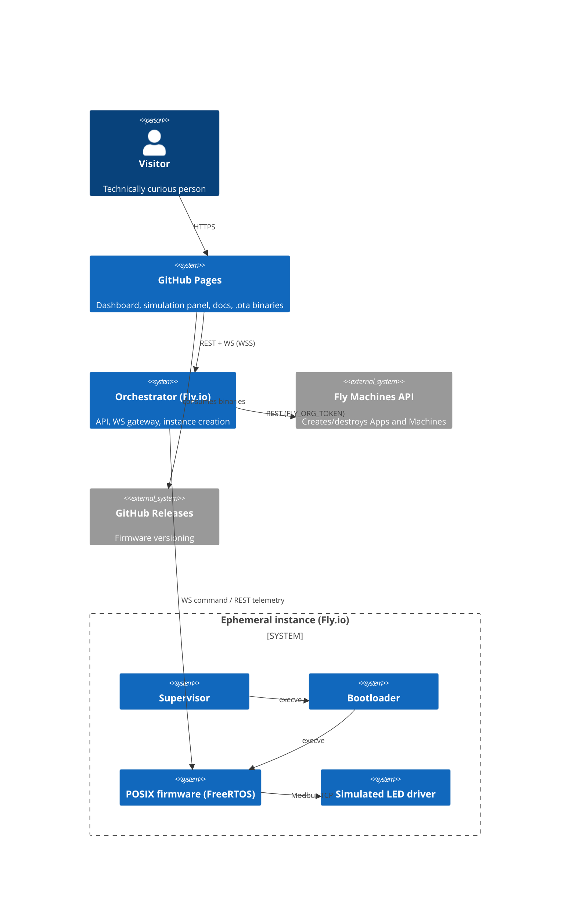
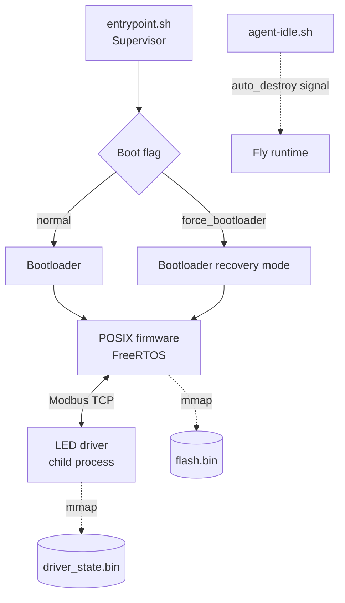
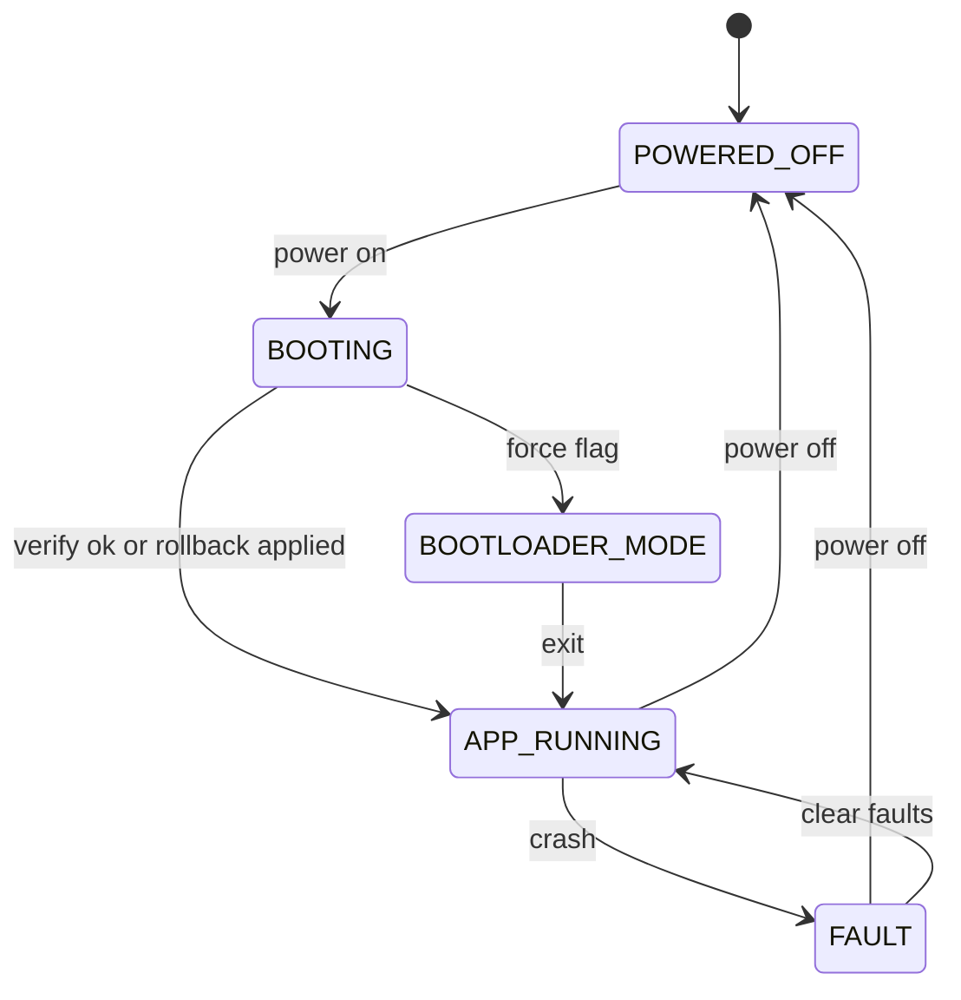
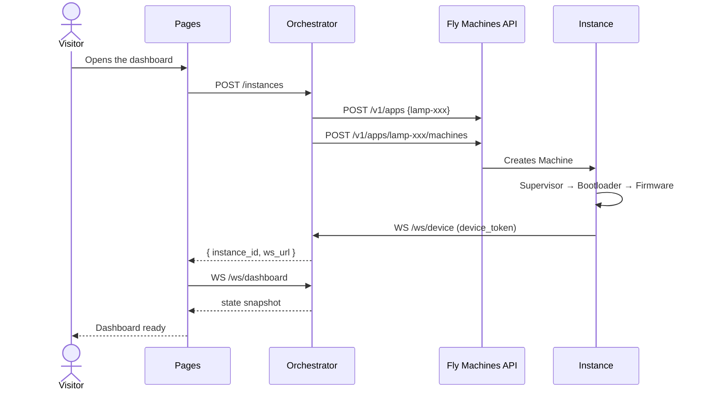
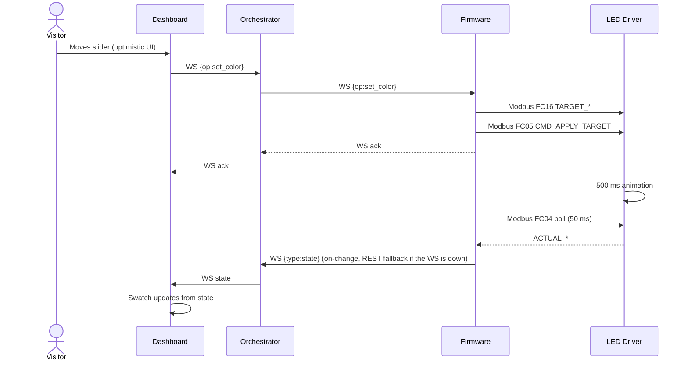
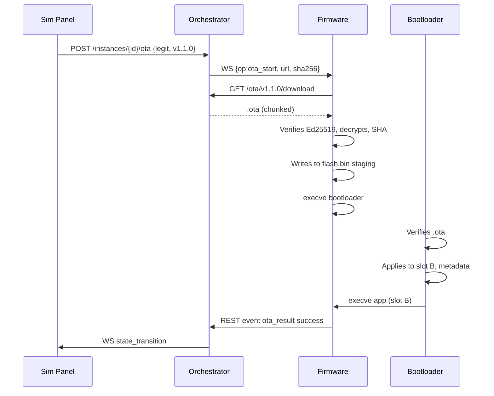
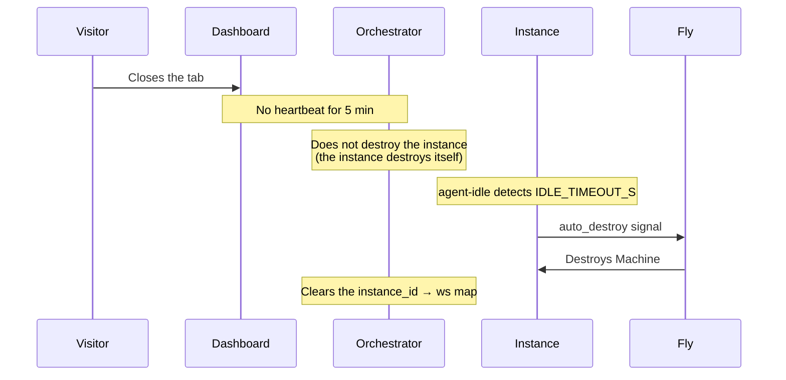
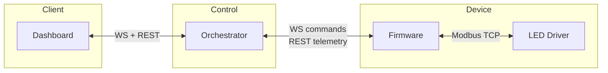

# 01 — General architecture

## 1. Context view



## 2. The three planes

### 2.1 Static plane (GitHub Pages)

Public content, no secrets:

- Dashboard (`/index.html`).
- Simulation Panel (`/sim.html`, PIN protected).
- Documentation site (`/docs/`, built with MkDocs).
- `.ota` binaries in `/firmware/<version>/` (served from the same origin to avoid CORS).

**Characteristic:** permanent, free, no backend. All the JavaScript runs in the visitor's browser.

### 2.2 Control plane (Fly.io — orchestrator)

A dedicated Fly App with `auto_stop_machines = "off"` and `min_machines_running = 1` because schedules run in the backend.

| Responsibility | Detail |
| :--- | :--- |
| `POST /instances` | Creates an ephemeral Fly App + Machine via the Machines API |
| `GET /instances/{id}` | Instance info |
| `DELETE /instances/{id}` | Destroys the App (cascades to the Machine and volume, if any) |
| WS `/ws/dashboard` | Receives from the dashboard, routes to the firmware, relays responses |
| WS `/ws/device` | Receives from the firmware, validates `device_token`, routes to the dashboard |
| REST `/telemetry/*` | Persists (in memory or SQLite) firmware telemetry |
| `POST /instances/{id}/ota` | Serves the `.ota` in legit/corrupt/downgrade mode |

**Scaling:** the orchestrator stays awake for schedules (~$2.19/month); instances remain ephemeral. Without schedules it can return to `suspend` / `0`.

### 2.3 Instance plane (Fly.io — one App per visit)

Created on demand with:

- Name: `lamp-<uuid>`.
- Its own App-scoped DNS name on the organization 6PN (`lamp-<uuid>.internal`).
- One Machine with `auto_destroy: true`.
- `IDLE_TIMEOUT_S=300` for self-destruction.

Container contents:



**Isolation:**

- One Firecracker microVM per Machine.
- App-scoped DNS on the organization 6PN; private ports are not exposed publicly.
- `flash.bin` on an ephemeral rootfs, destroyed with the Machine.
- Unique `device_token` per instance.

## 3. Internal components

### 3.1 Supervisor

The container's `ENTRYPOINT` process. Models the PMIC + reset controller + power management.

| Action | Implementation |
| :--- | :--- |
| Power ON | `execve` to the bootloader |
| Power OFF | `SIGTERM` to the child process, state `POWERED_OFF` |
| Reset | `SIGTERM` + `execve` to the bootloader |
| Enter bootloader | Writes `force_bootloader = true` to metadata and `execve` to the bootloader |
| Factory reset | Erases `flash.bin` and recreates the partitions, then `execve` to the bootloader |

**Communication with the orchestrator:** internal line-based TCP control channel
(port 5022, private network; see ADR-004). It listens for `POWER_ON`,
`POWER_OFF`, `RESET`, `ENTER_BOOTLOADER`, `FACTORY_RESET` and `STATUS`; the
backend exposes it over REST/WS.

### 3.2 Bootloader

Standalone C program. Invoked by the supervisor or by the firmware (`execve`).

**Responsibilities:**

1. Read the A/B metadata from `flash.bin` (two records with CRC32: active slot, pending, confirmed, versions).
2. If the force-bootloader flag is set, enter recovery and wait for `POWER_ON`.
3. If `pending_confirmation` is set without `confirmed`, **roll back** to the previous slot.
4. If staging contains a valid `.ota`, verify it (magic, version, hardware, anti-downgrade, AAD, Ed25519, AES-GCM, SHA-256), write the decrypted payload to the inactive slot and mark it pending.
5. If the active slot is not bootable, try the previous slot and then provision slot A from the factory app.
6. `execve` to the binary of the active slot.

**Fault codes** (written to `DIAG_FAULT_CODE` and reported by telemetry):

| Code | Meaning |
| :---: | :--- |
| 8 | Invalid signature |
| 9 | Downgrade blocked |
| 10 | SHA mismatch |
| 11 | Incompatible hardware |
| 12 | Unknown format |
| 13 | Rollback executed |

### 3.3 POSIX firmware

Main process. Built on the FreeRTOS POSIX port.

**Tasks:**

All `xTaskCreate` calls use `TASK_STACK_WORDS = 4096` words (32 KiB on
x86-64); the timer daemon uses `configTIMER_TASK_STACK_DEPTH = 8192` words
(64 KiB). Priorities are the numeric FreeRTOS priorities (`configMAX_PRIORITIES`
is 7). The health payload uses the short task names.

| Task | Name | Priority | Stack | Period | Function |
| :--- | :--- | :---: | :---: | :--- | :--- |
| `vLightPollTask` | `light` | 4 | 32 KiB | 50 ms | Modbus read of the actual state (30001-30009) |
| `vControlTask` | `control` | 3 | 32 KiB | 100 ms | Control tick and periodic log; LED transitions run in the driver |
| `vWatchdogTask` | `watchdog` | 3 | 32 KiB | 200 ms | Driver status/fault/heartbeat monitoring |
| `vCommsTask` | `comms` | 2 | 32 KiB | on-change | WS recv, ack sending, command dispatch |
| `vHeartbeatTask` | `heartbeat` | 2 | 32 KiB | 1 s | Modbus write of the counter to 40041 |
| `vMonitorTask` | `monitor` | 1 | 32 KiB | 5 s | RTOS heap and task high-water log |
| `vDiagPollTask` | `diag` | 1 | 32 KiB | 1 s | Modbus read of diagnostics and serial (30011-30026, 30032-30043) |
| `vTelemetryTask` | `telemetry` | 1 | 32 KiB | 30 s / on-change | REST health/events; WS state (REST fallback) |
| `vCommandPollTask` | `commands` | 1 | 32 KiB | 500 ms idle / 1 s | REST command fallback |
| `vConfirmTask` | `confirm` | 1 | 32 KiB | once, 3 s | Confirms the slot if Modbus is up; then self-deletes |
| `vOtaTask` | `ota` | 1 | 32 KiB | 500 ms | Downloads a requested `.ota` to staging |
| *(scheduler)* | `IDLE` | 0 | 32 KiB | idle | FreeRTOS idle task |
| *(scheduler)* | `Tmr Svc` | 6 | 64 KiB | timer | FreeRTOS timer daemon |

**State machine:** the supervisor tracks the process lifecycle; OTA verification happens in the bootloader and never becomes a supervisor state.



**Memory footprint (POSIX demo, x86-64):**

These are measured process values, not MCU SRAM. The POSIX port reserves large
virtual areas for pthread stacks and glibc arenas (`VmSize` can be hundreds of
MB), but only touched pages count toward RSS. The meaningful MCU-like numbers
are the FreeRTOS heap and the task stacks.

| Process | Peak RSS (`VmHWM`) | Threads | Notes |
| :--- | ---: | ---: | :--- |
| `supervisor` | 1.7 MB | 1 | Plain C; PID 1 in the instance; spawns the app/bootloader |
| `firmware` app | 3.1 MB | 13 | FreeRTOS POSIX; 512 KiB heap; 13 OS threads at the sample |
| `driver` | 1.8 MB | 4 | pthreads, not an RTOS; main + animation + watchdog + one Modbus client |
| `bootloader` | 1.7 MB idle / 3.3 MB max staged `.ota` | 1 | Transient; `artifact + payload` ≈ 416 KiB at the staging limit |

The `firmware` app uses `configTOTAL_HEAP_SIZE = 512 KiB`. The health payload
reports `mem.free_heap` and `mem.min_free_heap`; at the sample:

- current free heap: **94,456 B** (~92 KiB), used **429,832 B** (~420 KiB);
- historical minimum free heap: **60,512 B** (~59 KiB), so the worst observed
  heap use is **463,776 B** (~453 KiB).
- The transient `confirm` task adds 32 KiB during the first 3 s; it self-deletes
  after confirming, which is why the free heap rises afterwards.

Per-task stack use (allocated − minimum-free high-water mark, in bytes):

| Task | Allocated | Free HWM | Peak used |
| :--- | ---: | ---: | ---: |
| `IDLE` | 32 KiB | 23,864 | 8,904 |
| `Tmr Svc` | 64 KiB | 60,616 | 4,920 |
| `commands` | 32 KiB | 27,792 | 4,976 |
| `comms` | 32 KiB | 11,880 | 20,888 |
| `control` | 32 KiB | 25,720 | 7,048 |
| `diag` | 32 KiB | 27,360 | 5,408 |
| `heartbeat` | 32 KiB | 27,496 | 5,272 |
| `light` | 32 KiB | 9,992 | 22,776 |
| `monitor` | 32 KiB | 25,072 | 7,696 |
| `ota` | 32 KiB | 27,904 | 4,864 |
| `telemetry` | 32 KiB | 9,672 | 23,096 |
| `watchdog` | 32 KiB | 27,392 | 5,376 |
| `confirm` | 32 KiB | — | transient; self-deletes after confirmation |

The values come from `GET /instances/{id}` → `health.tasks` (minimum free
stack in bytes) and `health.mem` (`free_heap`/`min_free_heap`). They vary
slightly with the workload. To reproduce the process numbers:

```bash
docker top lamp-firmware -eo pid,ppid,comm,rss,vsz
grep -E 'VmHWM|VmRSS|VmData|VmStk' /proc/<pid>/status
```

For the bootloader, `/usr/bin/time -v` with a maximum-size staged `.ota`
(212,784 B payload) gives the 3.3 MB peak; without staging it is 1.7 MB. See
[`04 — OTA`](04-ota-and-image-security.md#7-flash-layout-and-bootloader) for
the RAM buffers.

**Why the POSIX numbers are high.** The app is linked against glibc and loads
libsodium, mbedTLS, cJSON and libmodbus dynamically; every FreeRTOS task is a
pthread with an 8 MB virtual stack (only touched pages count toward RSS);
`flash.bin` is mmap'd; and the FreeRTOS heap is 512 KiB. None of that exists on
a 32-bit MCU. The RSS also includes the loader, shared libraries, page
alignment and per-thread guard pages. On an MCU, code lives in flash, the RTOS
uses static allocation and task stacks are measured in hundreds of bytes to a
few KiB.

**MCU estimate (order of magnitude, not measured).** Assumptions: 32-bit MCU,
FreeRTOS, lwIP, no POSIX/glibc, static allocation, code in flash and no TLS.

> `TASK_STACK_WORDS` is in **words**, not bytes. On x86-64 `StackType_t` is
> 8 B (`4096` words = 32 KiB); on a 32-bit MCU it is 4 B (`4096` words = 16 KiB).
> The current stacks are POSIX-generous; a real port would tune each task to
> roughly 0.5–3 KiB.

| Component | POSIX peak | MCU estimate (tuned) | As-is on 32-bit MCU |
| :--- | ---: | ---: | ---: |
| Firmware app | 3.1 MB RSS | **64–96 KiB RAM**, 96–128 KiB flash | ~240–280 KiB RAM (4096-word stacks) |
| LED driver | 1.8 MB RSS | **24–40 KiB RAM**, 64–96 KiB flash | not applicable (pthread port) |
| Bootloader | 1.7–3.3 MB RSS | **8–16 KiB RAM**, 32–48 KiB flash | ~512 KiB RAM if it holds artifact + payload |
| Supervisor | 1.7 MB RSS | not applicable (real role: PMIC/board controller) | — |

The 64–96 KiB app estimate includes ~22 KiB of tuned task stacks, ~5 KiB of
TCBs and mutexes, 16–32 KiB of lwIP buffers, 8–12 KiB of static data and a
16–32 KiB heap. The driver estimate is dominated by lwIP and the Modbus
buffers. The bootloader estimate assumes a streaming/incremental SHA-512,
Ed25519 verification and AES-GCM with 2–4 KiB buffers; the current design
holds the whole artifact (up to 208 KiB) and the whole payload (up to
208 KiB), which would need ~512 KiB RAM.

These are estimates to set expectations, not measurements. Actual values
depend on the compiler, optimization, lwIP configuration, crypto
implementation and the chosen MCU.

### 3.4 Simulated LED driver

Separate process (child of the supervisor). Modbus TCP server.

**Responsibilities:**

- Run sequences locally at 20 Hz.
- Keep target (holding) and actual (input) separate.
- Heartbeat watchdog: if `HEARTBEAT_COUNTER` does not change within `CFG_HEARTBEAT_TIMEOUT_S`, turns the LED off.
- Internal REST API (`/sim/inject_fault`) so the Simulation Panel can inject faults.

**Threads (pthreads, not an RTOS):**

| Thread | Period | Function |
| :--- | :--- | :--- |
| `main` | — | Modbus TCP listener; accepts connections and spawns a client thread |
| `animation` | 20 Hz | `register_map_tick(50)`, transitions and sequence output |
| `watchdog` | 1 s | Heartbeat timeout check; turns the LED off if lost |
| `client` | per connection | Serves FC01/02/03/04/05/06/16 for the firmware or the Simulation Panel |

The driver links `libmodbus` and uses the platform default pthread stack
(8 MB virtual per thread); only touched pages count toward RSS. The measured
driver is **1.8 MB RSS with 4 threads**. There is no per-thread high-water
counter equivalent to FreeRTOS `usStackHighWaterMark`.

**Why it is a separate process:**

- It models the real hardware (an MCU dedicated to the LED).
- A failure in the driver cannot take the firmware down.
- It isolates sequence execution from the business logic.

### 3.5 Backend

FastAPI with these main modules:

| Module | Responsibility |
| :--- | :--- |
| `api/instances.py` | Instance CRUD, Fly Machines API orchestration |
| `telemetry/router.py` | Reception and caching of REST telemetry |
| `ws/gateway.py` | Dashboard and device WS management, routing |
| `auth/` | JWT, `device_token`, rate limiting |
| `orchestrator/machines_api.py` | Fly Machines API client |
| `schedules/`, `sequences/` | Scheduled actions and sequence upload |
| `ota/`, `provisioning/`, `sim/`, `power_on/` | OTA artifacts, onboarding, Simulation Panel and startup policy |

**Persistence:** in memory (dictionary) for the demo. If the orchestrator restarts, the ephemeral instances stay alive but the orchestrator loses track of them; this is accepted as a limitation (or SQLite on persistent disk is used if there is time).

### 3.6 Dashboards

Two static pages, both connecting to the orchestrator:

- `/index.html` → User Panel (dashboard).
- `/sim.html` → Simulation Panel (requires PIN).

**No business logic.** Only:

- Render state.
- Send commands over WS.
- Reconcile after reconnection.

## 4. Key flows

### 4.1 Starting the demo



### 4.2 Color change



### 4.3 Legitimate OTA



### 4.4 End of the instance



**Important:** the orchestrator **does not destroy** the instance. The instance destroys itself. The orchestrator only cleans up its map.

## 5. Key architectural decisions

| Decision | Discarded alternative | Reason | ADR |
| :--- | :--- | :--- | :--- |
| FreeRTOS POSIX port | Bare metal on QEMU | Lower learning curve, native execution, no emulation | ADR-001 |
| `mmap` over a file for flash | Text file / SQLite | Fidelity to mapped memory; allows `execve` from it | ADR-002 |
| `execve` for stage switching | `fork` + `exec` | The PID persists, simulating transfer of CPU control | ADR-003 |
| Supervisor as PMIC | Control from the orchestrator | Isolates the power responsibility; decouples it from the control plane | ADR-004 |
| Modbus TCP for the LED driver | REST between firmware and driver | Real industrial protocol, low latency, clear register map | ADR-005 |
| Hybrid REST+WS with the backend | REST only or MQTT only | WS for commands (latency), REST for telemetry (testability) | ADR-006 |
| Ephemeral Fly App per visit | A single Machine with N processes | Real isolation per microVM, scale-to-zero per instance | ADR-007 |
| Binaries on Pages, not on Releases | Releases only | CORS: Releases assets do not send CORS headers | ADR-008 |
| Ed25519 + AES-256-GCM | RSA + AES-CBC + SHA | Lightweight, single pass, modern standard | ADR-009 |
| JWT for the dashboard, opaque token for the firmware | JWT for both | Firmware in C without JWT parsing; `device_token` never exposed to the browser | ADR-010 |

## 6. Communication model



**Rule:** no connection is initiated by the backend. Both the dashboard and the firmware are **outbound clients**. This is NAT-friendly and matches the model of a real product.

Full detail in [`02-communications.md`](02-communications.md).

## 7. Data model

### 7.1 `flash.bin` — 1 MB mapped

| Offset | Size | Region |
| :--- | :--- | :--- |
| 0x00000 | 64 KB | Bootloader |
| 0x10000 | 352 KB | Slot A |
| 0x68000 | 352 KB | Slot B |
| 0xC0000 | 16 KB | Metadata (active slot, pending, confirmed, version) |
| 0xC4000 | 16 KB | Configuration (reserved; current driver config in `driver_state.bin`) |
| 0xC8000 | 208 KB | `.ota` staging |
| 0xFC000 | 16 KB | Reserved / padding |

The layout is exactly **1 MiB**: 64 KB bootloader + 2×352 KB slots + 16 KB
metadata + 16 KB configuration + 208 KB staging + 16 KB reserved. The slots
are 352 KB because the current app is ~145–149 KB and the extra room covers
debug builds, future growth and rollback. Staging is the remaining 208 KB; it
holds the **encrypted** `.ota`, not a slot. The `.ota` overhead is 208 B
(128 B header + 16 B GCM tag + 64 B Ed25519 signature), so the maximum
stageable payload is **212,784 B (~207.8 KB)**. An image larger than that is
rejected with `FAULT 12` even if it would fit in a 352 KB slot; this is the
deliberate 1 MiB trade-off documented in ADR-002. The `0xC4000` configuration
region is reserved for a future on-flash configuration; the current driver
configuration lives in `driver_state.bin`, not in `flash.bin`.

### 7.2 Orchestrator in-memory state

```python
{
  "instance_id": "inst-8f2a",
  "app_name": "lamp-8f2a",
  "machine_id": "m-...",
  "device_token": "dtk_...",
  "created_at": "2026-11-18T10:30:00Z",
  "ttl_s": 3600,
  "last_heartbeat": "2026-11-18T10:32:11Z",
  "ws_dashboard": <WebSocket>,
  "ws_device": <WebSocket>,
  "last_state": {...},
  "events": [...]
}
```

## 8. Observability

| Source | Destination | Frequency |
| :--- | :--- | :--- |
| RTOS metrics (stack HWM, heap) | `POST /telemetry/health` → sim panel | 30 s |
| Device state | WS `state` → dashboard (REST `POST /telemetry/state` fallback) | on-change |
| State transitions | WS event → sim panel timeline | immediate |
| OTA progress | WS event → sim panel | per phase |
| Faults | WS event + `POST /telemetry/events` | immediate |
| Firmware logs | stdout → captured by Fly → `/sim/logs` | on-line |
| Orchestrator logs | Fly logs | continuous |

**User dashboard** shows only: state, color, the fault banner and the **Update firmware** button/Last message.

**Simulation panel** shows everything: timeline, metrics, OTA with cryptographic detail, logs, faults with code.

## 9. External dependencies

| Dependency | Use | Risk |
| :--- | :--- | :--- |
| Fly.io | Orchestrator + instance hosting | Trial expires; local plan B |
| GitHub Pages | Static hosting | No risk |
| GitHub Actions | CI/CD | Free minutes are enough |
| `libmodbus` | Modbus in C | Mature, stable |
| `libsodium` | Ed25519 | Mature, stable |
| `mbedtls` or `openssl` | AES-GCM | Pick one; `mbedtls` is lighter |
| FastAPI | Backend | Mature |
| Chart.js / uPlot | Charts | Lightweight |

## 10. References

- [FreeRTOS POSIX port](https://www.freertos.org/FreeRTOS-simulator-for-Linux.html)
- [Fly Machines API](https://fly.io/docs/machines/api/)
- [MCUboot image format](https://docs.mcuboot.com/design.html)
- [Ed25519 (RFC 8032)](https://datatracker.ietf.org/doc/html/rfc8032)
- [AES-GCM (NIST SP 800-38D)](https://csrc.nist.gov/publications/detail/sp/800-38d/final)
- [Modbus Application Protocol](https://modbus.org/docs/Modbus_Application_Protocol_V1_1b3.pdf)
