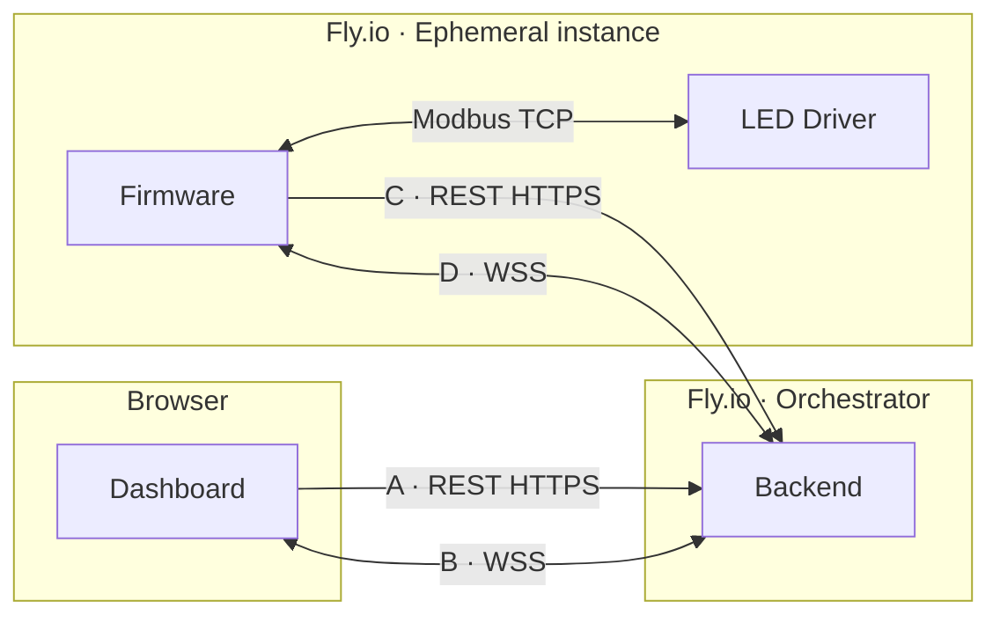
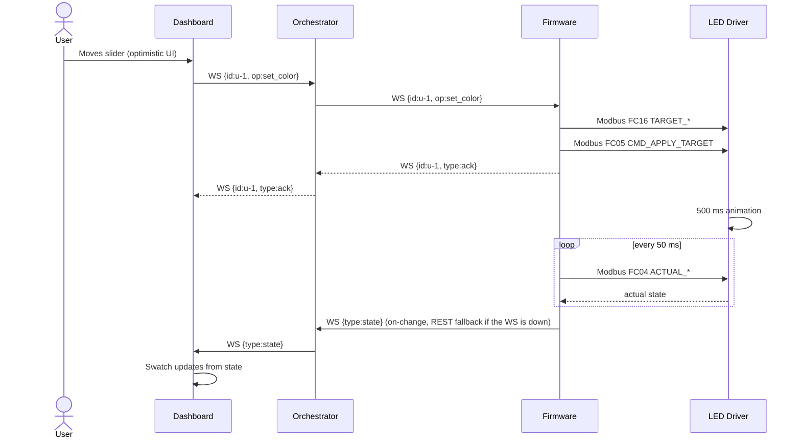
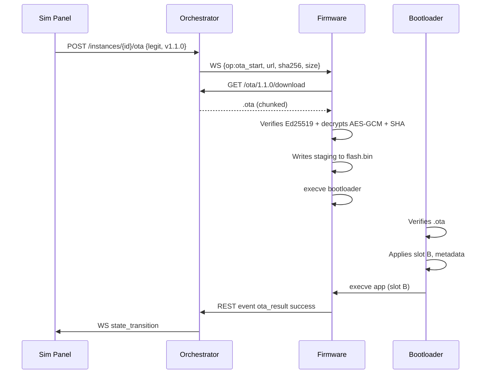
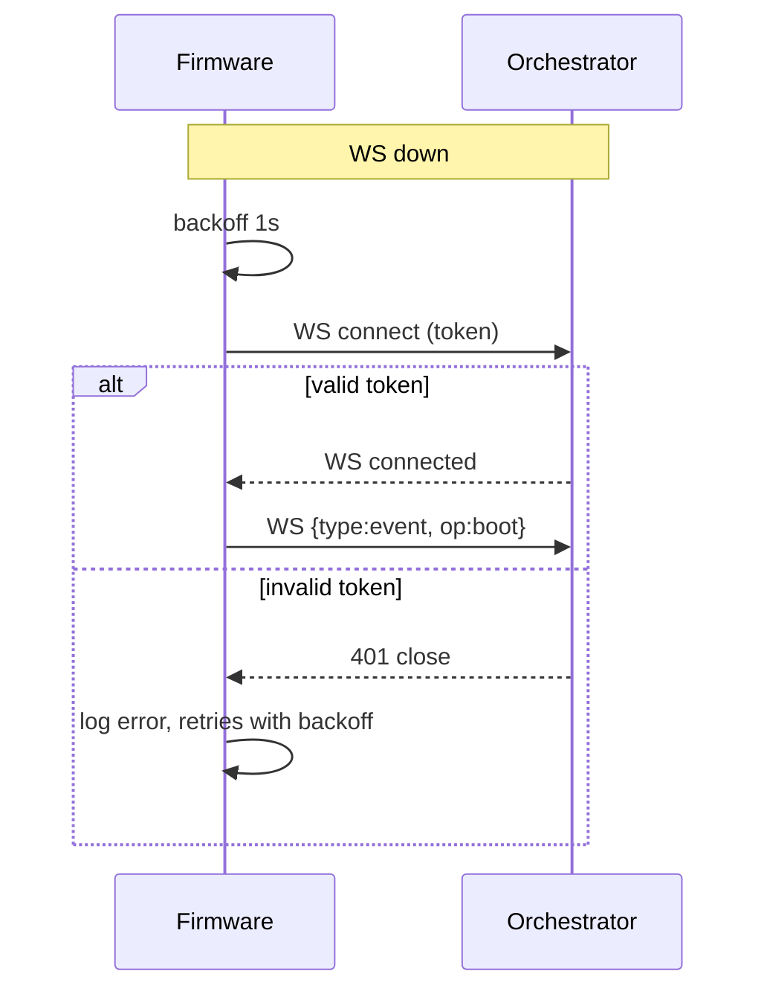

# 02 — Communications

## 1. Principles

| Principle | Implication |
| :--- | :--- |
| **The backend never initiates connections** | Dashboard and firmware are always outbound clients (NAT-friendly) |
| **REST to report/query; WS to command/notify** | Each protocol does what it does best |
| **REST is effectively one-directional** | Firmware→backend (telemetry) and dashboard→backend (queries). There is no backend→firmware REST |
| **The firmware never exposes ports** | There is no HTTP server on the device |
| **Uniform message envelope over WS** | `{id, type, op, payload, ts}` for every message |
| **Explicit versioning** | `/api/v1` in REST; `format_version` in `.ota`; unknown ops ignored over WS |

## 2. Channel map

| Channel | Client | Server | Protocol | Transport | Effective direction |
| :--- | :--- | :--- | :--- | :--- | :--- |
| **A** | Dashboard | Backend | REST | HTTPS | Dashboard → Backend |
| **B** | Dashboard | Backend | WebSocket | WSS | Bidirectional after handshake |
| **C** | Firmware | Backend | REST | HTTPS | Firmware → Backend |
| **D** | Firmware | Backend | WebSocket | WSS | Bidirectional after handshake |



## 3. Channel A — Backend REST (dashboard → backend)

**Base URL:** `https://lamp-demo-orchestrator.fly.dev/api/v1`
**Auth:** `Authorization: Bearer <session_token>` (JWT HS256)

### 3.1 Instances

| Method | Route | Description | Role |
| :--- | :--- | :--- | :--- |
| `POST` | `/instances` | Creates a new instance | user, sim |
| `GET` | `/instances/{id}` | Instance info | user, sim |
| `DELETE` | `/instances/{id}` | Destroys the instance (graceful) | user, sim |
| `POST` | `/instances/{id}/heartbeat` | Renews the TTL (every 30 s) | user, sim |
| `POST` | `/instances/{id}/ws-ticket` | Single-use ticket for the WS (30 s) | user, sim |

**Request `POST /instances`:**
```json
{ "profile": "lamp-v1", "ttl_s": 3600 }
```

**Response `201`:**
```json
{
  "id": "inst-8f2a",
  "created_at": "2026-11-18T10:30:00Z",
  "ttl_s": 3600,
  "ws_dashboard_url": "wss://.../ws/dashboard?instance=inst-8f2a",
  "session_token": "eyJhbGciOiJIUzI1NiIs...",
  "firmware_versions": ["1.0.3", "1.1.0"]
}
```

> The `device_token` does **not** appear in this response: the orchestrator injects it directly into the ephemeral Machine. The dashboard WS exchanges the `session_token` for an ephemeral ticket at `POST /instances/{id}/ws-ticket`; the JWT does not travel in the WebSocket URL.

### 3.2 Lifecycle

| Method | Route | Body | Role |
| :--- | :--- | :--- | :--- |
| `POST` | `/instances/{id}/sim/power` | `{action: "on"\|"off"\|"reset"\|"factory_reset", confirm?}` | sim |
| `POST` | `/instances/{id}/sim/bootloader` | `{action: "enter"\|"exit"}` | sim |
| `POST` | `/instances/{id}/sim/reboot` | — | sim |
| `POST` | `/instances/{id}/faults/clear` | — | user, sim |
| `DELETE` | `/instances/{id}/faults/history` | — | user, sim |

The dashboard's soft `Turn on/off` is a **WS command** (`set_power`), not REST.
Hard power, reset, bootloader and factory reset are Simulation Panel endpoints.

### 3.3 State and logs

| Method | Route | Description | Role |
| :--- | :--- | :--- | :--- |
| `GET` | `/instances/{id}` | Instance info: `state`, `health`, `device_online`, `serial` | user, sim |
| `GET` | `/instances/{id}/state` | Last cached state | user, sim |
| `GET` | `/instances/{id}/sim/logs?limit=` | Event/log history (default 100, max 500) | sim |

There is **no** `state/history`, `events` or `metrics` REST endpoint. Events are
kept in memory on the instance and replayed over the dashboard WS; the
Simulation Panel reads them through `/sim/logs`. RTOS metrics travel in
`POST /telemetry/health` (heap, stack HWM) and are shown in the Sim Device tab.

### 3.4 Firmware and OTA

| Method | Route | Body | Role |
| :--- | :--- | :--- | :--- |
| `GET` | `/ota/latest` | — | user, sim |
| `GET` | `/ota/versions` | — | user, sim |
| `POST` | `/instances/{id}/ota` | `{version, mode}` | user, sim |
| `GET` | `/ota/check?current=` | — | device |
| `GET` | `/ota/{version}/download` | — | device |

`mode` ∈ `{"legit", "corrupt", "downgrade"}`. The backend compares the requested
version with `fw_version` from the last health report:

- `legit` requires a **newer** version; otherwise `409 OTA_NOT_NEWER`.
- `downgrade` requires an **older** version; otherwise `409 OTA_NOT_OLDER`.
- `corrupt` performs no preflight: the bootloader rejects the signature and keeps
  the current slot.

The Sim Panel shows `Current: vX · slot A|B` and, after the reboot, if the
health report has not changed in ~18 s, explains that the bootloader rejected the
image (anti-downgrade or signature). A slot change is only visible with a valid
newer artifact.

There are **no** `/firmware` or `/firmware/{version}` backend routes. The static
Pages build publishes `firmware/<version>/firmware.ota` as a release asset; the
orchestrator serves the artifacts from `OTA_DIR` through `/ota/*`.

Example `GET /ota/versions`:

```json
{
  "versions": [
    { "version": "1.4.0", "size": 149128 },
    { "version": "1.3.0", "size": 149128 }
  ]
}
```

### 3.5 Simulation Panel

| Method | Route | Body | Role |
| :--- | :--- | :--- | :--- |
| `POST` | `/instances/{id}/sim/session` | `{pin}` | — |
| `POST` | `/instances/{id}/sim/fault` | `{type, duration_s}` | sim |
| `POST` | `/instances/{id}/sim/faults/clear` | — | sim |
| `DELETE` | `/instances/{id}/faults/history` | — | user, sim |
| `POST` | `/instances/{id}/sim/modbus/write` | `{kind, addr, value, apply}` | sim |
| `GET` | `/instances/{id}/sim/modbus/read?kind=&addr=&count=` | — | sim |
| `GET` | `/instances/{id}/sim/modbus/snapshot` | — | sim |
| `GET` | `/instances/{id}/sim/registers` | — | sim |
| `GET` | `/instances/{id}/sim/logs?limit=` | — | sim |
| `POST` | `/instances/{id}/sim/reboot` | — | sim |
| `POST` | `/instances/{id}/sim/power` | `{action: on\|off\|reset\|factory_reset, confirm}` | sim |
| `POST` | `/instances/{id}/sim/bootloader` | `{action: enter\|exit}` | sim |
| `GET` | `/instances/{id}/sim/power` | — | sim |

**Implementation:** in-memory rate limiting over a fixed window:
50 req/s per `device_token` (`/telemetry`, `/commands`, `/ota`), 5 req/s per
IP when creating instances, and 5 PIN attempts/min per IP. When exceeded, the
server returns `429` with `Retry-After` and the `RATE_LIMITED` envelope. Dashboard
sessions use JWT (see `docs/auth.md`).

**Implementation:** the supervisor maintains a line-based TCP
channel (5022) with `POWER_ON/OFF`, `RESET`, `ENTER_BOOTLOADER`,
`FACTORY_RESET` and `STATUS`; the backend translates it into the `/power` and
`/bootloader` endpoints. Factory reset requires `confirm: true`; it erases
`flash.bin`, the driver state, the schedules, the power-on policy, the cached
health/state and the instance's fault history.

**Implementation:** the PIN (`SIM_PIN`, demo `2025`) is exchanged for
a per-instance `sim_token`; the rest of the `/sim/*` endpoints require
`X-Sim-Token`. Faults are injected by writing the driver's `HOLDING_SIM_*`
registers (40046-40048); `ws_drop` closes the device WebSocket. The panel lives
at `/sim.html`.

### 3.6 Error format

```json
{
  "error": {
    "code": "INSTANCE_NOT_FOUND",
    "message": "Instance inst-8f2a does not exist or expired",
    "request_id": "req-9c1b"
  }
}
```

Codes: `UNAUTHORIZED`, `FORBIDDEN`, `INSTANCE_NOT_FOUND`, `INSTANCE_EXPIRED`, `INVALID_STATE`, `INVALID_PARAM`, `RATE_LIMITED`, `INTERNAL`, `UNKNOWN_NETWORK`, `INVALID_PASSWORD`, `WIFI_TIMEOUT`, `INVALID_NETWORK`, `INVALID_FAILURE`.

HTTP codes: `400` (param/network), `401` (auth), `403` (role/password), `404` (does not exist), `408` (timeout), `409` (state), `429` (rate), `500` (internal).

### 3.7 Onboarding and credentials

| Method | Route | Body | Role |
| :--- | :--- | :--- | :--- |
| `GET` | `/instances/{id}/provisioning` | — | user, sim |
| `GET` | `/instances/{id}/provisioning/scan` | — | user, sim |
| `POST` | `/instances/{id}/provisioning/start` | — | sim |
| `POST` | `/instances/{id}/provisioning/connect` | `{ssid, password}` | user, sim |
| `POST` | `/instances/{id}/provisioning/cancel` | — | sim |
| `POST` | `/instances/{id}/provisioning/reset` | — | sim |
| `GET` | `/instances/{id}/provisioning/policy` | — | user, sim |
| `PUT` | `/instances/{id}/provisioning/policy` | `{networks, passwords, allow_any, failure}` | sim |

- States: `provisioned`, `pairing`, `connecting`, `online`.
- `connect` validates the whitelist/`allow_any`, the password configured for
  each network (if any) and the simulated failures `wrong_password`,
  `unknown_network` and `timeout`.
- The demo credentials (`Casa-Demo`/`demo-password`, `Lab`/`lab-password`,
  `Guest`/`guest-password`) are shown in the Sim Panel; they are simulation
  configuration, not the device's encrypted password.
- SSID, IP and encrypted password (AES-256-GCM, key `PROVISIONING_KEY` or
  derived from `JWT_SECRET`) are stored per `device_token` in
  `/data/provisioning.db`. The password is never returned or logged.
- New instances seed `Casa-Demo`; `reset` leaves a tombstone so it is not
  seeded again after a restart.

### 3.8 Faults and recovery

| Method | Route | Body | Role |
| :--- | :--- | :--- | :--- |
| `POST` | `/instances/{id}/faults/clear` | — | user, sim |
| `DELETE` | `/instances/{id}/faults/history` | — | user, sim |

Clears the simulated injection (`SIM_FAULT_*`) and runs `CMD_CLEAR_FAULTS` on the
driver. Critical faults (overtemperature, overcurrent, open LED) latch, turn the
output off and block power/start until they are cleared. The overtemperature
warning limits brightness to 50 %.

A corrupt configuration enters **safe mode** (`STATUS_CONFIG_SAFE_MODE`,
10013): defaults, output off and save/load/power/start blocked. Clearing the
fault leaves safe mode, but the file stays corrupt until a valid configuration is
saved or a factory reset is performed.

The heartbeat watchdog turns the output off and preserves the target; when the
firmware writes the counter again, the driver restores the target unless there is
a latch or a configuration in safe mode. If the device WS drops, commands are
queued and the firmware retrieves them over REST
(`GET /commands/pending`).

`DELETE /faults/history` deletes only the fault events (`fault`, `sim_fault`,
`sim_faults_cleared`); it preserves the rest of the log and emits
`fault_history_cleared`. Factory reset also clears this history from the Sim
Panel; the dashboard can do it from **Settings** and reset its local settings
without touching the lamp.

### 3.9 Power-on behavior

| Method | Route | Body | Role |
| :--- | :--- | :--- | :--- |
| `GET` | `/instances/{id}/power-on` | — | user, sim |
| `PUT` | `/instances/{id}/power-on` | `{mode, state}` | user, sim |

- `mode`: `last`, `default` or `custom`.
- `default` uses 3000 K at 70 %; `custom` carries `{mode: cct|color, cct|h/s/v, brightness}`.
- It is stored per `device_token` in `/data/provisioning.db` and applied after a
  **hard Power On**; it does not interfere with pairing/connecting.

## 4. Channel C — Firmware REST (firmware → backend)

**Base URL:** `https://lamp-demo-orchestrator.fly.dev/api/v1/device`
**Auth:** `Authorization: Bearer <device_token>` (opaque token, 32 B hex)

### 4.1 Telemetry

| Method | Route | Frequency | Description |
| :--- | :--- | :--- | :--- |
| `POST` | `/telemetry/health` | 30 s | Uptime, heap, stack HWM, temp, RSSI, version |
| `POST` | `/telemetry/state` | on-change + deadband | Actual state (color, brightness, mode, sequence) |
| `POST` | `/telemetry/events` | immediate/batch | Boot, transitions, faults, OTA progress |

**`POST /telemetry/health`:**
```json
{
  "device_id": "lamp-8f2a",
  "ts": "2026-11-18T10:32:00Z",
  "uptime_s": 3600,
  "fw_version": "1.0.3",
  "slot": "A",
  "mem": { "free_heap": 41230, "min_free_heap": 38100 },
  "tasks": { "control": 512, "light_poll": 1024, "comms": 2048 },
  "led_temp_c": 42.5,
  "power_estimate_w": 6.2,
  "rssi": -58,
  "hw_rev": 1,
  "serial": "SL-1-LA-2647-8F2A036D"
}
```

**`POST /telemetry/state`** (on-change with deadband):
```json
{
  "device_id": "lamp-8f2a",
  "ts": "2026-11-18T10:32:11.250Z",
  "state": {
    "power": true,
    "mode": "sequence",
    "brightness": 600,
    "color": { "h": 32, "s": 850, "v": 600 },
    "sequence": { "id": 1, "step": 14, "speed": 1500 }
  },
  "previous": { "color": { "h": 32, "s": 850, "v": 590 } }
}
```

**`POST /telemetry/events`** (batch):
```json
{
  "device_id": "lamp-8f2a",
  "events": [
    { "ts": "…", "type": "boot", "detail": { "slot": "A", "cause": "power_on" } },
    { "ts": "…", "type": "state_transition", "detail": { "from": "BOOTING", "to": "APP_RUNNING" } },
    { "ts": "…", "type": "fault", "detail": { "code": 2, "severity": "critical", "temp_c": 85.0 } },
    { "ts": "…", "type": "ota_result", "detail": { "version": "1.1.0", "result": "success" } },
    { "ts": "…", "type": "rollback", "detail": { "from": "1.1.0", "to": "1.0.3", "reason": "no_boot_confirmation" } }
  ]
}
```

Response: `204 No Content`. The firmware does not wait for a response on success.

### 4.2 OTA

| Method | Route | Description |
| :--- | :--- | :--- |
| `GET` | `/ota/check?current=1.0.3` | Is there a pending version? (device token) |
| `GET` | `/ota/{version}/download` | Downloads the `.ota` (device token) |
| `GET` | `/ota/latest` | Latest available version (dashboard) |
| `POST` | `/instances/{id}/ota` | Triggers `ota_update` on the device |

**`GET /ota/check` response:**
```json
{ "available": true, "version": "1.1.0", "size": 152672,
  "sha256": "…", "url": "/api/v1/ota/1.1.0/download" }
```

**Implementation:** the artifacts live in `OTA_DIR`
(`firmware/releases` locally, `/data/ota` in Docker). The firmware downloads over
HTTP, streaming directly to the staging partition, restarts into the bootloader
(`execv`) and the bootloader verifies, applies to the inactive slot and boots. The
dashboard uses `POST /instances/{id}/ota` with the version from `/ota/latest`.

### 4.3 Command fallback

| Method | Route | Description |
| :--- | :--- | :--- |
| `GET` | `/commands/pending` | **Only if the WS is down.** Returns queued commands. |

```json
{
  "commands": [
    { "id": "c-1", "op": "set_color", "payload": { "h": 32, "s": 850, "v": 600 } }
  ]
}
```

The firmware confirms with `POST /commands/{id}/ack` or `POST /commands/{id}/nack`.

> This channel is a **safety net**; the main path is WS.

#### 4.3.1 Implementation

- The backend queues the command when the device WS is unavailable and waits for the REST ack with the same `id` (command timeout of 2 s).
- The queue is **at-most-once**: `GET /commands/pending` drains it; if the firmware dies between delivery and ack, the command is lost (acceptable for a safety net).
- When the WS reconnects, the gateway delivers any commands that were still queued.
- The firmware polls `/commands/pending` every 1 s **only** while the WS is down.

## 5. Channel D — Firmware WebSocket ↔ Backend

**URL:** `wss://lamp-demo-orchestrator.fly.dev/ws/device?token=<device_token>`

One persistent connection per instance. If it drops, the firmware reconnects with **exponential backoff** (1s, 2s, 4s, 8s, 16s, max 30s; no jitter).

### 5.1 Message envelope

```json
{
  "id": "uuid-v4",
  "type": "command|ack|nack|event|ping|pong",
  "op": "optional string",
  "payload": {},
  "ts": "ISO8601"
}
```

### 5.2 Commands (backend → firmware)

| `op` | `payload` | Notes |
| :--- | :--- | :--- |
| `set_power` | `{on: bool}` | |
| `set_brightness` | `{value: 0-1000}` | 0.1% |
| `set_color` | `{h, s, v, transition_ms?}` | |
| `set_color_temperature` | `{kelvin}` | |
| `set_mode` | `{mode: "manual"\|"cct"\|"sequence"\|"scene"}` | |
| `activate_scene` | `{scene_id}` | |
| `start_sequence` | `{id, speed?, direction?, loop?}` | |
| `stop_sequence` | `{}` | |
| `ota_start` | `{version, url, sha256, size}` | |
| `ota_abort` | `{}` | |
| `reboot` | `{reason}` | |
| `power_off` | `{}` | |
| `enter_bootloader` | `{}` | |
| `factory_reset` | `{confirm: true}` | |
| `request_state` | `{}` | The firmware responds over REST |
| `run_selftest` | `{}` | Result over REST |
| `clear_faults` | `{}` | |
| `inject_fault` | `{type, severity}` | **Sim panel only** |

### 5.3 Firmware responses

**Ack:**
```json
{ "id": "c-1", "type": "ack", "op": "set_power", "payload": { "applied_at": "…" }, "ts": "…" }
```

**Nack:**
```json
{ "id": "c-1", "type": "nack", "op": "set_power",
  "payload": { "code": "INVALID_STATE", "message": "device in FAULT" }, "ts": "…" }
```

Nack codes: `INVALID_PARAM`, `INVALID_STATE`, `BUSY`, `OTA_IN_PROGRESS`, `NOT_SUPPORTED`, `INTERNAL`.

### 5.4 Urgent events (firmware → backend)

Only for what the user must see **immediately**:

| `op` | `payload` |
| :--- | :--- |
| `state_transition` | `{from, to}` |
| `fault` | `{code, severity, detail}` |
| `ota_progress` | `{version, phase, pct}` |
| `ota_result` | `{version, result}` |
| `boot` | `{slot, cause}` |

**Rule:** low-frequency or batchable events → REST. Events the user must see in <1 s → WS.

### 5.5 Keepalive

- The server sends `{"type":"ping"}` every **20 s**.
- The client replies `{"type":"pong"}`.
- If the server receives no pong for **2 cycles (40 s)**, it closes the connection.
- The firmware reconnects with backoff.

## 6. Channel B — Dashboard WebSocket ↔ Backend

**URL:** `wss://lamp-demo-orchestrator.fly.dev/ws/dashboard?instance=<id>&ticket=<ticket>`
**Auth:** single-use ticket (`WS_TICKET_TTL_S`, 30 s) obtained with
`POST /api/v1/instances/{id}/ws-ticket` and the JWT in `Authorization`. The
`session` query-string parameter remains as a fallback for tests/compatibility.

One connection per tab. The backend supports *fan-out* to multiple tabs.

### 6.1 Subscription on connect

```json
{
  "type": "subscribe",
  "channels": ["state", "events", "metrics", "ota"],
  "since": "2026-11-18T10:30:00Z"
}
```

The backend replies with:
1. A **snapshot** of the last known state.
2. **Missed events** since `since` (if applicable).
3. A **live stream** from that moment on.

### 6.2 Sending commands (dashboard → backend → firmware)

```json
{ "id": "u-1", "type": "command", "op": "set_color", "payload": { "h": 32, "s": 850, "v": 600 } }
```

The backend:
1. Validates the `session_token` and authorization over `instance_id`.
2. Sends over the device WS.
3. Waits for the firmware ack/nack (2 s timeout).
4. Relays to the dashboard **with the same `id`**.

On timeout: `{ "id": "u-1", "type": "nack", "payload": { "code": "TIMEOUT" } }`.

### 6.3 Receiving state

```json
{ "type": "state", "payload": { "power": true, "color": { "h": 32, "s": 850, "v": 600 } }, "ts": "…" }
```

The dashboard applies each `state` message directly; there is no client-side interpolation loop.

### 6.4 Heartbeat and expiration

- The dashboard sends `{"type":"heartbeat"}` every **30 s** over WS. `POST /instances/{id}/heartbeat` exists for REST clients but the dashboard does not call it.
- If there is no heartbeat for **5 min**, the backend cleans up its map. The instance destroys itself through its own `agent-idle`.
- The user can reconnect within the TTL using `sessionStorage` (`instance_id`, `session_token`).

## 7. Criterion: command or telemetry?

| Question | Yes → | Channel |
| :--- | :--- | :--- |
| Does the backend initiate the action and the firmware must obey? | Yes | **Command (WS)** |
| Does the firmware report something that already happened or changed? | Yes | **Telemetry (REST)** |
| Does it need <1 s latency and immediate confirmation? | Yes | **Command (WS)** |
| Does it tolerate seconds of delay or can it be batched? | Yes | **Telemetry (REST)** |
| Is it a sequence of events the backend must store? | Yes | **Telemetry (REST)** |

## 8. Authentication and rate limiting

### 8.1 Tokens

| Channel | Token | Type | TTL | Issued by |
| :--- | :--- | :--- | :--- | :--- |
| A, B (dashboard) | `session_token` | JWT HS256 | 1 h | `POST /instances` |
| C, D (firmware) | `device_token` | Opaque 32 B hex | Instance lifetime | Orchestrator when creating the Machine |

**`session_token` claims:**
```json
{ "sub": "sess-abc", "instance_id": "inst-8f2a", "role": "user|sim",
  "iat": 1705312200, "exp": 1705315800, "jti": "uuid" }
```

### 8.2 Rate limiting

| Endpoint | Limit | Window | Action |
| :--- | :--- | :--- | :--- |
| `POST /instances` per IP | 5 | 1 h | `429` + `Retry-After` |
| `POST /instances` global | 50 | 1 h | `429` |
| Global concurrent instances | 10 | — | `503` "demo saturated" |
| WS commands per session | 50 | 1 s | Connection closed |
| `POST /telemetry/*` per device | 100 | 1 s | `429` |
| `GET /ota/*/download` per IP | 20 | 1 h | `429` |

## 9. Versioning

| Layer | Mechanism | Compatibility |
| :--- | :--- | :--- |
| REST | `/api/v1` in the URL | Breaking changes → `/api/v2` |
| WS commands | `op` field with namespacing (`command.v2.*` if needed) | The firmware ignores unknown ops |
| `.ota` | `format_version` in the header | The bootloader rejects if `format_version` > supported |
| Telemetry | New optional fields; the backend tolerates their absence | Additive |

## 10. Sequence diagrams

### 10.1 End-to-end color change



### 10.2 OTA



### 10.3 Firmware reconnection



## 11. Summary table

| Category | Channel | Direction | Frequency |
| :--- | :--- | :--- | :--- |
| Power, color, brightness, scene, sequence | WS command | Backend → Firmware | On demand |
| OTA start/abort, reboot, power off, bootloader | WS command | Backend → Firmware | On demand |
| Diagnostics (selftest, clear faults, request state) | WS command | Backend → Firmware | On demand |
| Command ack/nack | WS response | Firmware → Backend | Per command |
| System health | REST telemetry | Firmware → Backend | 30 s |
| Actual state | REST telemetry | Firmware → Backend | on-change + deadband |
| Events (boot, fault, ota) | REST telemetry + WS event | Firmware → Backend | immediate |
| Last state query | REST GET | Dashboard → Backend | On open |
| Create/list/destroy instance | REST | Dashboard → Backend | On demand |
| Fault injection | REST sim | Dashboard → Backend | On demand |
| `.ota` download | REST GET | Firmware → Backend | Per OTA |
