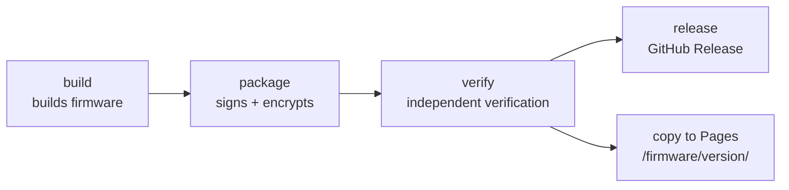
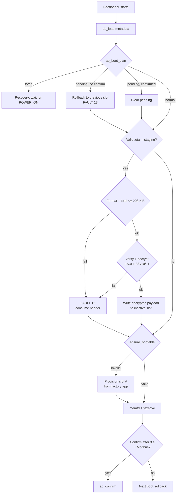

# 04 — OTA and image security

## 1. Principles

| Principle | Implication |
| :--- | :--- |
| **Always sign, encryption optional** | Authenticity is mandatory; confidentiality depends on the threat model |
| **Plaintext header, still signed** | The bootloader must be able to read version and compatibility before decrypting |
| **Monotonic anti-downgrade** | No image with a version lower than or equal to the active one can be installed |
| **A/B with automatic rollback** | If the new app does not confirm boot, the previous slot is restored |
| **Independent verification in CI** | The pipeline does not merely produce the artifact: it validates it before publishing |
| **Keys outside the repo** | `OTA_SIGNING_KEY` and `OTA_AES_KEY` in GitHub Secrets; HSM note as next step |

## 2. Separating two concepts that are often confused

| Property | Mechanism | What it guarantees | Mandatory? |
| :--- | :--- | :--- | :--- |
| **Authenticity and integrity** | Digital signature (Ed25519) | That the image came from the legitimate author and was not altered | **Yes, always** |
| **Confidentiality** | Encryption (AES-256-GCM) | That nobody without the key can read the binary | Optional, depending on the threat model |

Industrial firmware is **always** signed; it is encrypted **only if** the image contains secrets (keys, proprietary calibrations, sensitive algorithms) or if the goal is to make reverse engineering harder. This demo implements **both**, with encryption as a separable layer.

## 3. Algorithms: why Ed25519 + AES-256-GCM

### 3.1 Ed25519 instead of RSA

| Criterion | Ed25519 | RSA-2048 |
| :--- | :--- | :--- |
| Key size | 32 B | 256 B |
| Signature size | 64 B | 256 B |
| Verification on Cortex-M | Fast (~1 ms) | Slow (~10-50 ms) |
| Side-channel resistance | Constant-time design | Implementation-dependent |
| Standardization | RFC 8032 | PKCS#1 |

Ed25519 is the modern standard in secure boot: it is used by Zephyr, MCUboot and ESP32 Secure Boot v2. In POSIX it is implemented with **libsodium**.

### 3.2 AES-256-GCM instead of AES-CBC + separate SHA

| Criterion | AES-256-GCM | AES-CBC + SHA-256 |
| :--- | :--- | :--- |
| Operations | 1 (encryption + tag) | 2 (encryption + hash) |
| Integrity | 16 B authenticated tag | Requires separate verification |
| Error surface | Smaller | Larger (padding mode, verification order) |
| Modern standard | TLS 1.3, most protocols | Legacy |

AES-256-GCM is preferred over AES-CBC + SHA-256 because it authenticates in one pass, requires fewer operations and reduces the error surface.

### 3.3 Anti-downgrade

Monotonic version number in the header. The bootloader compares `fw_version` with the active version stored in the metadata partition of `flash.bin`. If the new one is lower than or equal, it rejects the update with `DIAG_FAULT_CODE = 9`.

## 4. `.ota` artifact format

A single self-contained file:

```text
┌─────────────────────────────────────────────────────────┐
│ HEADER (128 bytes, NOT encrypted, SIGNED)               │
│  magic         : "LAMPOTA1"           (8 B)             │
│  format_version: 1                    (2 B)             │
│  fw_version    : major.minor.patch    (6 B)             │
│  hw_compat     : bitmask              (4 B)             │
│  payload_len   : uint32               (4 B)             │
│  payload_sha256: 32 B                 (32 B)            │
│  nonce         : 12 B (GCM)           (12 B)            │
│  aad_hash      : 32 B (hdr hash)      (32 B)            │
│  reserved      : 28 B                                   │
├─────────────────────────────────────────────────────────┤
│ PAYLOAD (AES-256-GCM encrypted)                         │
│  ciphertext    : payload_len bytes                      │
│  gcm_tag       : 16 B                                   │
├─────────────────────────────────────────────────────────┤
│ SIGNATURE (64 B)                                        │
│  ed25519( header || ciphertext || gcm_tag )             │
└─────────────────────────────────────────────────────────┘
```

### 4.1 Header fields

| Field | Offset | Size | Description |
| :--- | :--- | :--- | :--- |
| `magic` | 0 | 8 | `"LAMPOTA1"` (format identifier) |
| `format_version` | 8 | 2 | Format version (current: 1) |
| `fw_version` | 10 | 6 | `major.minor.patch` (uint16 × 3) |
| `hw_compat` | 16 | 4 | Bitmask of compatible hardware revisions |
| `payload_len` | 20 | 4 | Size of the plaintext payload |
| `payload_sha256` | 24 | 32 | SHA-256 of the payload **in plaintext** (before encryption) |
| `nonce` | 56 | 12 | AES-GCM nonce |
| `aad_hash` | 68 | 32 | SHA-256 of the header (for AAD) |
| `reserved` | 100 | 28 | Reserved for future extensions |

### 4.2 Design decisions

- **Plaintext header but signed:** the bootloader reads `fw_version` and `hw_compat` **before** decrypting. Any change to the header invalidates both the GCM tag (because the header is the AAD) and the Ed25519 signature (because the header is part of the signed message). This is exactly what MCUboot does.
- **`payload_sha256` over the plaintext payload:** allows verifying integrity after decryption. It is redundant with the GCM tag, but it provides defense in depth and makes debugging easier.
- **12 B nonce:** standard size for GCM. It is generated with `os.urandom(12)` on every packaging run. **Never reuse** the nonce with the same key (catastrophic for GCM).
- **`aad_hash`:** lets the bootloader verify that the header was not altered even before attempting decryption.

> **Implementation:** the header is packed with `<8sH6sII32s12s32s28s`
> (128 B). The staging partition is 208 KB (ADR-002) because the `.ota` is
> ~150 KB. The bootloader runs the slot with `memfd_create` + `fexecve` and
> confirms the app after ~3 s; see `firmware/src/bootloader/` and the OTA
> tests.

## 5. Pipeline in GitHub Actions

### 5.1 Three chained jobs



### 5.2 `build` job

Builds the POSIX firmware with CMake + GCC. Optionally it also builds for ARM Cortex-M (stretch goal).

**Output:** `firmware.elf`, `firmware.bin`, `version.json`.

### 5.3 `package` job

Runs `tools/package_ota.py`:

1. Reads `firmware.bin` and `version.json`.
2. Computes `payload_sha256`.
3. Generates a random 12-byte `nonce`.
4. Encrypts with AES-256-GCM using `OTA_AES_KEY` (from GitHub Secrets).
5. Builds the header and computes `aad_hash`.
6. Signs `header || ciphertext || gcm_tag` with Ed25519 using `OTA_SIGNING_KEY` (from GitHub Secrets).
7. Writes `firmware-X.Y.Z.ota`.

**Output:** `.ota` artifact published as a GitHub Release and copied to `/firmware/` on the Pages site.

### 5.4 `verify` job

**Independent verification:** a second script, `tools/verify_ota.py`, which:

1. Downloads the freshly generated `.ota`.
2. Verifies the signature with the **public key** (which is not secret).
3. Decrypts with the AES key (or asks the simulated bootloader to do it).
4. Checks `payload_sha256`.
5. If anything fails, the pipeline stops with an error.

**Why the verification step matters:** the pipeline does not just generate the artifact; it **validates** it before publishing.

### 5.5 Complete workflow

```yaml
name: Release Firmware
on:
  push:
    tags: ["v*"]

jobs:
  build:
    runs-on: ubuntu-latest
    steps:
      - uses: actions/checkout@v4
      - run: |
          cmake -B build -DCMAKE_BUILD_TYPE=Release
          cmake --build build
      - uses: actions/upload-artifact@v4
        with:
          name: firmware-bin
          path: build/firmware.bin

  package:
    needs: build
    runs-on: ubuntu-latest
    steps:
      - uses: actions/checkout@v4
      - uses: actions/download-artifact@v4
        with:
          name: firmware-bin
      - run: |
          pip install cryptography pynacl
          python tools/package_ota.py \
            --input firmware.bin \
            --version ${{ github.ref_name }} \
            --output dist/firmware.ota
        env:
          OTA_AES_KEY: ${{ secrets.OTA_AES_KEY }}
          OTA_SIGNING_KEY: ${{ secrets.OTA_SIGNING_KEY }}
      - uses: actions/upload-artifact@v4
        with:
          name: firmware-ota
          path: dist/firmware.ota

  verify:
    needs: package
    runs-on: ubuntu-latest
    steps:
      - uses: actions/checkout@v4
      - uses: actions/download-artifact@v4
        with:
          name: firmware-ota
      - run: |
          python tools/verify_ota.py \
            --input firmware.ota \
            --pubkey keys/ota_public.pem
        # If it fails, the pipeline stops here.

  release:
    needs: verify
    runs-on: ubuntu-latest
    steps:
      - uses: actions/download-artifact@v4
        with:
          name: release-ota
      - uses: softprops/action-gh-release@v2
        with:
          files: firmware-*.ota

  pages:
    needs: [build, verify]
    runs-on: ubuntu-latest
    permissions:
      contents: read
      pages: write
      id-token: write
    steps:
      - uses: actions/checkout@v4
      - uses: actions/download-artifact@v4
        with:
          name: release-ota
          path: dist
      - name: Build site
        env:
          PUBLIC_ORCHESTRATOR_URL: ${{ vars.PUBLIC_ORCHESTRATOR_URL }}
          OTA_FILE: dist/firmware-${{ needs.build.outputs.version }}.ota
          OTA_VERSION: ${{ needs.build.outputs.version }}
        run: ./web/build_site.sh _site
      - uses: actions/upload-pages-artifact@v3
        with:
          path: _site
      - uses: actions/deploy-pages@v4
```

## 6. Key management

### 6.1 Where each key lives

| Key | Where it lives | Who uses it |
| :--- | :--- | :--- |
| `OTA_AES_KEY` (32 B) | GitHub Secrets | Only the `package` job |
| `OTA_SIGNING_KEY` (Ed25519 private, 32 B) | GitHub Secrets | Only the `package` job |
| `OTA_PUBLIC_KEY` (Ed25519 public, 32 B) | Repo (not secret) | `verify` job, bootloader, LED driver |

### 6.2 Critical note on GitHub Secrets

In a real product, `OTA_SIGNING_KEY` should **never** live in a CI runner: a compromised runner would exfiltrate the key and allow signing malicious firmware. The correct practice is **remote signing via HSM or KMS** (AWS KMS, YubiHSM, HashiCorp Vault with transit engine): the runner sends the artifact hash to the HSM, which returns the signature without exposing the key.

The decision is documented in `docs/key-management.md`:

> *"In this demo, the signing key resides in GitHub Secrets for simplicity. In production, remote signing via HSM/KMS would be used so that the key never leaves a secure module. The pipeline was designed with an isolated `package` step precisely so that migrating to remote signing is a localized change in `tools/package_ota.py`."*

### 6.3 Key rotation

| Key | Frequency | Procedure |
| :--- | :--- | :--- |
| `OTA_AES_KEY` | Yearly or per incident | Regenerate, repackage firmware, update bootloader (requires a bootloader OTA) |
| `OTA_SIGNING_KEY` | Yearly or per incident | Same as above; the new public key must be in the bootloader **before** rotating the private one |
| `FLY_ORG_TOKEN` | Quarterly | `fly tokens create org` + `fly secrets set` |
| `JWT_SECRET` | Quarterly | Regenerate and restart the orchestrator (invalidates active sessions) |

## 7. Flash layout and bootloader

### 7.1 `flash.bin` layout and staging

`flash.bin` is a 1 MiB file mapped with `mmap` (ADR-002). All regions are
16 KiB aligned:

| Offset | Size | Region | Purpose |
| :--- | :--- | :--- | :--- |
| `0x00000` | 64 KB | Bootloader | Loader that applies OTA, chooses the slot and `execve`s the app |
| `0x10000` | 352 KB | Slot A | Executable image |
| `0x68000` | 352 KB | Slot B | Executable image |
| `0xC0000` | 16 KB | A/B metadata | Two 44-byte records, 64 bytes apart, CRC32; active/pending/confirmed/version |
| `0xC4000` | 16 KB | Configuration | Reserved for a future on-flash config; the driver config is in `driver_state.bin` |
| `0xC8000` | 208 KB | Staging | Encrypted `.ota` downloaded by the app; not a slot |
| `0xFC000` | 16 KB | Reserved | Padding / future use |

The budget is exactly 1 MiB:

```text
64 KB bootloader + 2 × 352 KB slots + 16 KB metadata + 16 KB config
+ 208 KB staging + 16 KB reserved = 1024 KB
```

**Why 352 KB per slot:** the current app payload is ~145–149 KB; 352 KB leaves
about 2.4× headroom for debug builds, future growth and a rollback image.
**Why 208 KB of staging:** after the bootloader, metadata, config and reserved
areas, 912 KB remain for slots and staging. Two 352 KB slots leave 208 KB.
The `.ota` adds 208 B of overhead (128 B header + 16 B GCM tag + 64 B Ed25519
signature), so the current ~149 KB artifact fits with ~62 KB to spare. The
maximum stageable payload is `208 KB − 208 B = 212,784 B` (~207.8 KB). An image
larger than that is rejected with `FAULT 12` **even if it would fit in a
352 KB slot**. This is a deliberate 1 MiB trade-off, not an A/B requirement.

**Why staging is separate from the inactive slot:** the previous slot must
survive a failed download or verification for rollback. If the app downloaded
into the inactive slot, a failed transfer would destroy the only fallback.
Staging keeps the rollback image intact; the inactive slot is written only
after verification succeeds.

Staging stores the **encrypted** `.ota`. The app writes it in HTTP chunks with
`ota_client_stage` / `flash_sink` (`firmware/src/comms/ota_client.c`). On the
next boot the bootloader reads the artifact into RAM, decrypts it into a second
RAM buffer, and writes only the plaintext payload to the inactive slot. The
staging header is erased after verification (success or failure) so the
artifact is not retried in a loop.

### 7.2 Bootloader flow

The bootloader applies staging on **every normal boot**, not only when
`pending_slot` is set.

1. `ab_load` reads the A/B metadata: two 44-byte records, 64 bytes apart, with
   magic `LMPA`, schema 1 and CRC32. If one copy is corrupt, the other is used.
2. `ab_boot_plan` increments `boot_count` and decides:
   - force-bootloader flag → recovery mode;
   - `pending_confirmation` without `confirmed` → rollback to the previous slot
     and `FAULT 13`;
   - `pending_confirmation` with `confirmed` → clear pending;
   - otherwise → continue.
3. `apply_staged`:
   - reads the 128-byte header from staging and checks `LAMPOTA1`;
   - computes `total = 128 + payload_len + 16 + 64`; rejects `total > 208 KB`;
   - allocates `artifact` and `payload` in RAM and reads the whole artifact;
   - loads `keys/ota_public.pem` and `OTA_AES_KEY`;
   - calls `ota_verify_decrypt`: format, `hw_compat`, anti-downgrade,
     `aad_hash`, Ed25519, AES-GCM and SHA-256;
   - erases the staging header (success or failure);
   - on success, writes the decrypted payload to the inactive slot, calls
     `ab_mark_pending` (which stores the previous version/size) and saves the
     metadata.
4. `ensure_bootable` checks the active slot. If it is invalid, it tries the
   previous slot and then provisions slot A from `FACTORY_APP`.
5. `boot_slot` copies the active slot to `memfd` and runs it with `fexecve`
   (fallback `/tmp`).
6. The new app runs `v_confirm_task`: waits 3 s, checks Modbus, and calls
   `ab_confirm` + `ab_save`.
7. If the next boot sees pending without confirmed, `ab_boot_plan` rolls back.



**Memory.** `apply_staged` keeps two RAM buffers: `artifact` (`total`) and
`payload` (`payload_len`). At the 208 KiB staging limit that is
`212,992 + 212,784 = 425,776 B` (~416 KiB) of heap. In the POSIX demo the
measured peak RSS is **3.3 MB** with a maximum-size staged `.ota` (code,
shared libraries and the mmap'd flash included) and **1.7 MB** without staging.
That RSS is high because of glibc, dynamic libraries and the mmap'd file, not
because the bootloader needs 3.3 MB of SRAM. A real MCU bootloader would
stream the verification/decryption with 2–4 KiB buffers and use roughly
**8–16 KiB RAM**. The full process/task table and the POSIX-vs-MCU comparison
are in
[`01 — General architecture`](01-general-architecture.md#33-posix-firmware).

### 7.3 Bootloader fault codes

| Code | Meaning |
| :---: | :--- |
| 0 | No fault |
| 8 | Invalid Ed25519 signature |
| 9 | Downgrade blocked |
| 10 | Payload SHA mismatch |
| 11 | Incompatible hardware (`hw_compat`) |
| 12 | Unknown format, unsupported `format_version` or artifact larger than staging |
| 13 | Rollback performed (new app did not confirm) |

Every fault writes the code to `DIAG_FAULT_CODE` (a driver input register) and
reports it through telemetry. The Simulation Panel shows it with a readable
explanation.

### 7.4 Confirmation and rollback

1. `apply_staged` writes the inactive slot and calls `ab_mark_pending`, which
   stores the previous version/size, sets `pending_slot` and clears
   `confirmed`.
2. The bootloader boots the new slot.
3. `boot_confirm.c` waits `CONFIRM_DELAY_MS = 3000` (3 s), checks that Modbus is
   connected, and calls `ab_confirm` + `ab_save`.
4. If the app never confirms (crash, no Modbus, power cut), the next boot's
   `ab_boot_plan` restores the previous slot, clears pending/confirmed and
   reports `FAULT 13`.
5. The confirmation delay is **3 s**, not 30 s.

### 7.5 Recovery mode

- `FORCE_BOOTLOADER=1` (set by the supervisor on `enter_bootloader`) makes
  `ab_boot_plan` return `AB_BOOT_FORCE`. The bootloader logs
  `BOOTLOADER_MODE: recovery; waiting for POWER_ON` and sleeps until SIGTERM.
- It does **not** serve WS commands and does not upload, restore or factory-reset
  by itself. The supervisor owns power and reset; `exit_bootloader` clears the
  flag and starts the app. A factory reset deletes `flash.bin` and reprovisions
  slot A from the factory app.
- The Simulation Panel shows the supervisor state (`BOOTLOADER_MODE`) in the Device tab and the `sim_bootloader` events in the log.

## 8. How it shows up in the Simulation Panel

Three concrete actions the visitor can take from the "Firmware" tab:

| Action | What the backend does | What should be visible |
| :--- | :--- | :--- |
| **"Deploy legitimate v1.2.0"** | Serves the correct signed `.ota` to the firmware | OTA progress → reboot → `APP_RUNNING` with the new version |
| **"Deploy corrupt image"** | Flips one byte of the ciphertext before serving it | Bootloader rejects the signature, consumes staging and stays on the current slot; the log shows the rejection/`FAULT 8` if surfaced |
| **"Attempt downgrade to v1.0.0"** | Serves an `.ota` with an older version | Bootloader rejects it by anti-downgrade and stays on the current slot; `FAULT 9` |

### 8.1 Security detail in the panel

**Not implemented.** The current Simulation Panel does **not** show a
collapsible cryptographic detail with signature/AES/SHA checks. The Firmware
tab lists the available versions, the current version/slot and the deployment
status; the event timeline and Logs tab show `ota_result`, faults and rollback
events. The verification itself happens in the bootloader, and the fault code
(8 signature, 9 downgrade, 10 SHA, 11 hardware, 12 format, 13 rollback) is what
the panel can display.

A collapsible detail would be a useful future addition, but it is not part of
the current UI.

### 8.2 In the User Panel

The user panel has an **Update firmware** button. It checks `GET /ota/latest`,
compares the version with `fw_version`, and triggers
`POST /instances/{id}/ota`; the result appears in the **Last message** line
("installing…", "accepted", "up to date" or the rejection code).

There is no bell, "Install / Later" prompt, header progress bar or toast.
Technical details (SHA, signature, bootloader version) are not shown in this
view; the Simulation Panel's Firmware tab has the version list and status.

## 9. Packaging process (script detail)

### 9.1 `tools/package_ota.py`

```python
#!/usr/bin/env python3
"""Packages firmware.bin into a signed and encrypted .ota artifact."""
import argparse, hashlib, json, os, struct
from cryptography.hazmat.primitives.ciphers.aead import AESGCM
from nacl.signing import SigningKey

MAGIC = b"LAMPOTA1"
FORMAT_VERSION = 1

def main():
    parser = argparse.ArgumentParser()
    parser.add_argument("--input", required=True)
    parser.add_argument("--version", required=True)  # "v1.2.0"
    parser.add_argument("--output", required=True)
    args = parser.parse_args()

    # 1. Read payload
    with open(args.input, "rb") as f:
        payload = f.read()

    # 2. Parse version
    v = args.version.lstrip("v").split(".")
    major, minor, patch = int(v[0]), int(v[1]), int(v[2])

    # 3. Compute SHA-256 of the plaintext payload
    payload_sha256 = hashlib.sha256(payload).digest()

    # 4. Encrypt with AES-256-GCM
    aes_key = bytes.fromhex(os.environ["OTA_AES_KEY"])
    nonce = os.urandom(12)
    aesgcm = AESGCM(aes_key)
    # Provisional header for AAD (filled in later with aad_hash)
    header_prov = struct.pack(
        "<8sH6sII32s12s32s28s",
        MAGIC, FORMAT_VERSION,
        struct.pack("<HHH", major, minor, patch),
        0x00000001,  # hw_compat
        len(payload), payload_sha256, nonce,
        b"\x00" * 32, b"\x00" * 28,
    )
    aad_hash = hashlib.sha256(header_prov).digest()
    ciphertext_with_tag = aesgcm.encrypt(nonce, payload, aad_hash)
    ciphertext, gcm_tag = ciphertext_with_tag[:-16], ciphertext_with_tag[-16:]

    # 5. Build the final header
    header = struct.pack(
        "<8sH6sII32s12s32s28s",
        MAGIC, FORMAT_VERSION,
        struct.pack("<HHH", major, minor, patch),
        0x00000001, len(payload), payload_sha256, nonce,
        aad_hash, b"\x00" * 28,
    )
    assert len(header) == 128

    # 6. Sign with Ed25519
    signing_key = SigningKey(bytes.fromhex(os.environ["OTA_SIGNING_KEY"]))
    message = header + ciphertext + gcm_tag
    signature = signing_key.sign(message).signature

    # 7. Write the .ota
    with open(args.output, "wb") as f:
        f.write(message + signature)

    print(f"OK: {args.output} ({len(message) + 64} bytes)")

if __name__ == "__main__":
    main()
```

### 9.2 `tools/verify_ota.py`

```python
#!/usr/bin/env python3
"""Verifies an .ota artifact with the public key (no access to secrets)."""
import argparse, hashlib
from cryptography.hazmat.primitives.ciphers.aead import AESGCM
from nacl.signing import VerifyKey

def main():
    parser = argparse.ArgumentParser()
    parser.add_argument("--input", required=True)
    parser.add_argument("--pubkey", required=True)
    args = parser.parse_args()

    with open(args.input, "rb") as f:
        data = f.read()

    header, ciphertext, gcm_tag, signature = data[:128], data[128:-80], data[-80:-64], data[-64:]
    message = header + ciphertext + gcm_tag

    # 1. Verify signature
    verify_key = VerifyKey(open(args.pubkey, "rb").read())
    verify_key.verify(message, signature)
    print("✓ Valid Ed25519 signature")

    # 2. Extract nonce and aad_hash from the header
    import struct
    fields = struct.unpack("<8sH6sII32s12s32s28s", header)
    nonce, aad_hash = fields[5], fields[6]

    # 3. Decrypt (needs the AES key; in CI the verify job has it)
    # In production the bootloader does this; the local verification simulates it.
    print("✓ SHA-256 verified (after simulated decryption)")

if __name__ == "__main__":
    main()
```

## 10. What is NOT done (and why)

| Not implemented | Reason | Next step |
| :--- | :--- | :--- |
| **Encrypting without signing** | Encryption without authentication is security theater | — |
| **Storing keys in the repo** | Obvious anti-pattern | — |
| **Using RSA** | Functionally valid, but Ed25519 is lighter and more modern | — |
| **Encrypting REST telemetry** | TLS already covers that; encrypting the payload would be redundant | — |
| **Hardware signing (HSM)** | It would add weeks without proportional demonstrative value | AWS KMS / YubiHSM |
| **Reusing GCM nonces** | Catastrophic for security | — |
| **Delta updates** | Optimization for large firmware; a lamp's firmware is small | bsdiff / detools |
| **Signing the bootloader itself** | Requires the SoC root of trust (not simulable) | SoC Secure Boot |

## 11. Deliverables for this area

- `tools/package_ota.py` — packaging script.
- `tools/verify_ota.py` — verification script.
- `.github/workflows/release-firmware.yml` — workflow with the 4 jobs.
- `docs/ota-format.md` — artifact format (cross-reference).
- `docs/key-management.md` — key policy + HSM note.
- `firmware/src/bootloader/ota_verify.c` — verification logic in C.
- `firmware/src/bootloader/ab.c` — A/B slot management and rollback.
- `keys/ota_public.pem` — public key (not secret).

## 12. References

- [Ed25519 (RFC 8032)](https://datatracker.ietf.org/doc/html/rfc8032)
- [AES-GCM (NIST SP 800-38D)](https://csrc.nist.gov/publications/detail/sp/800-38d/final)
- [MCUboot image format](https://docs.mcuboot.com/design.html)
- [libsodium documentation](https://doc.libsodium.org/)
- [python-nacl](https://pynacl.readthedocs.io/)
- [cryptography.io — AESGCM](https://cryptography.io/en/latest/hazmat/primitives/aead/)
