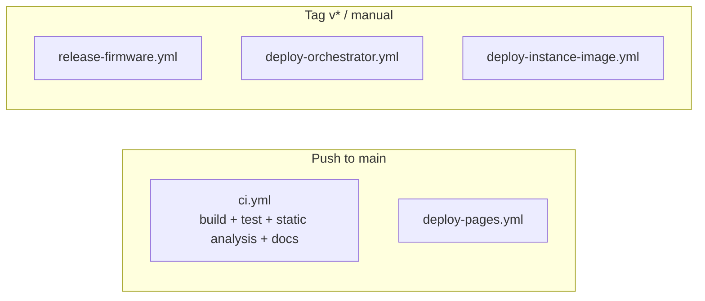
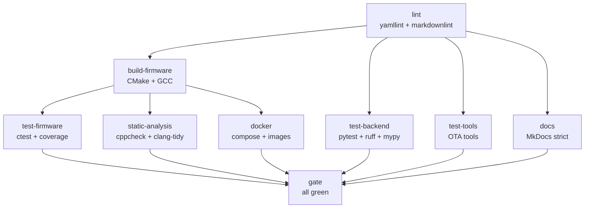
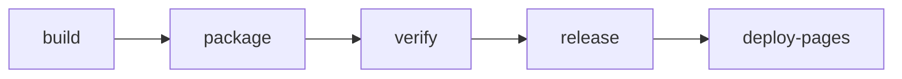
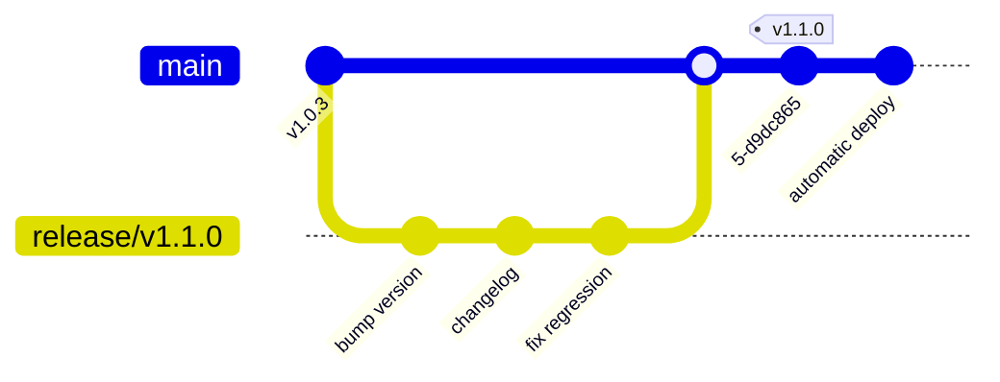

# 05 — CI/CD

## 1. Principles

| Principle | Implication |
| :--- | :--- |
| **Everything that is published is verified** | The pipeline does not merely produce artifacts: it validates them before publishing them |
| **Jobs isolated by responsibility** | `build`, `package`, `verify`, `release` as separate jobs with explicit dependencies |
| **Minimal secrets per job** | Only `package` has access to signing/encryption keys; `verify` only uses the public key |
| **Reproducibility** | Deterministic builds where possible; pinned toolchain versions |
| **Fast feedback** | Jobs that fail fastest go first; aggressive dependency caching |
| **Fail-fast on security** | If `verify` fails, `release` does not run and nothing is published |

## 2. Repository workflows

| Workflow | File | Trigger | Purpose |
| :--- | :--- | :--- | :--- |
| **CI** | `ci.yml` | Push to `main`, PR to `main` | Build + tests + static analysis + docs (quality gate) |
| **Release Firmware** | `release-firmware.yml` | Tag `v*` | Build → package → verify → GitHub Release + Pages (dashboard + docs) |
| **Deploy Orchestrator** | `deploy-orchestrator.yml` | Tag `v*` or manual | `flyctl deploy` to the orchestrator |
| **Deploy Instance Image** | `deploy-instance-image.yml` | Tag `v*` or manual | Build and push the base image |
| **Deploy Pages** | `deploy-pages.yml` | Push to `main` (changes in `web/`, `docs/` or MkDocs config) or manual | Build the dashboard and docs, deploy Pages |

### 2.1 Dependency diagram



## 3. `ci.yml` workflow — Quality gate

It runs on **every push to `main` and every PR**. It is the gate that blocks merges if anything fails.

### 3.1 Jobs



### 3.2 `lint` job

```yaml
lint:
  runs-on: ubuntu-latest
  steps:
    - uses: actions/checkout@v4
    - uses: ibiqlik/action-yamllint@v3
      with:
        config_file: .yamllint.yml
    - uses: DavidAnson/markdownlint-cli2-action@v16
      with:
        globs: |
          README.md
          docs/**/*.md
          firmware/README.md
```

### 3.3 `build-firmware` job

```yaml
build-firmware:
  runs-on: ubuntu-latest
  steps:
    - uses: actions/checkout@v4
    - name: Install dependencies
      run: |
        sudo apt-get update
        sudo apt-get install -y cmake ninja-build gcc
    - name: Configure
      run: cmake -B build -G Ninja -DCMAKE_BUILD_TYPE=Release
    - name: Build
      run: cmake --build build
    - uses: actions/upload-artifact@v4
      with:
        name: firmware-bin
        path: |
          build/bin/firmware
          build/bin/bootloader
          build/bin/supervisor
```

### 3.4 `test-firmware` job

```yaml
test-firmware:
  runs-on: ubuntu-latest
  steps:
    - uses: actions/checkout@v4
    - name: Install toolchain
      run: |
        sudo apt-get update
        sudo apt-get install -y cmake ninja-build gcc
    - name: Unit tests
      run: |
        cmake -B build-test -G Ninja -DBUILD_TESTS=ON
        cmake --build build-test
        cd build-test && ctest --output-on-failure
    - name: Coverage
      run: |
        cmake -B build-cov -G Ninja -DBUILD_TESTS=ON \
          -DCMAKE_C_FLAGS="--coverage -O0"
        cmake --build build-cov
        (cd build-cov && ctest --output-on-failure)
        pip install gcovr
        gcovr -r . build-cov --fail-under-line 70 --print-summary
```

**Minimum required coverage:** 70% in logic modules (`flash/`,
`bootloader/` and `comms/` with unit tests). It is measured with `gcovr` on
`build-cov`; `ws_client`, `modbus_client`, the FreeRTOS tasks and the
bootloader `main.c` are validated by E2E.

### 3.5 `static-analysis` job

```yaml
static-analysis:
  runs-on: ubuntu-latest
  steps:
    - uses: actions/checkout@v4
    - name: Cppcheck firmware
      run: |
        cppcheck --enable=warning,performance,portability --inline-suppr \
          --suppress=missingIncludeSystem --error-exitcode=1 \
          -I firmware/include firmware/src
    - name: Cppcheck driver
      run: |
        cppcheck --enable=warning,performance,portability --inline-suppr \
          --suppress=missingIncludeSystem --error-exitcode=1 \
          -I driver/include driver/src
    - name: clang-tidy (informational, PR only)
      if: github.event_name == 'pull_request'
      continue-on-error: true
      run: |
        git diff --name-only "origin/${{ github.base_ref }}...HEAD" -- '*.c' | \
          xargs -r clang-tidy -p build --warnings-as-errors='*'
```

**Cppcheck rule:** `--error-exitcode=1` makes the pipeline fail if there are warnings. False positives are suppressed with `// cppcheck-suppress` **and a comment justifying** the suppression.

> **Implementation:** cppcheck is the blocking gate (firmware and
> driver, verified locally without warnings). clang-tidy remains an
> **informational** step (`continue-on-error`) until the code warnings are
> cleaned up; it only runs on PRs and on the modified `.c` files.

### 3.6 `test-backend` job

```yaml
test-backend:
  runs-on: ubuntu-latest
  steps:
    - uses: actions/checkout@v4
    - uses: actions/setup-python@v5
      with:
        python-version: "3.12"
        cache: pip
    - run: pip install -e "./backend[test,dev]"
    - run: cd backend && pytest --cov=src --cov-fail-under=70
    - run: ruff check backend/src backend/tests
    - run: mypy backend/src
```

### 3.7 `docs` job

```yaml
docs:
  runs-on: ubuntu-latest
  steps:
    - uses: actions/checkout@v4
    - uses: actions/setup-python@v5
      with:
        python-version: "3.12"
        cache: pip
        cache-dependency-path: requirements-docs.txt
    - run: pip install -r requirements-docs.txt
    - run: mkdocs build --strict
```

### 3.8 `gate` job — CI closure

```yaml
gate:
  needs:
    - lint
    - build-firmware
    - test-firmware
    - test-backend
    - test-tools
    - static-analysis
    - docs
    - docker
  runs-on: ubuntu-latest
  steps:
    - run: echo "All checks passed"
```

**GitHub configuration:** the branch protection rule for `main` requires `gate` to be green to allow a merge.

## 4. `release-firmware.yml` workflow — Firmware release

It runs **only on `v*` tags** (for example `v1.1.0`). It follows the design detailed in [`04-ota-and-image-security.md`](04-ota-and-image-security.md).

### 4.1 Jobs and dependencies



### 4.2 `build` job

Identical to `ci.yml/build-firmware`, but with `-DCMAKE_BUILD_TYPE=Release` and without tests (the tests already ran in the CI for the commit). It adds a step to generate `version.json`:

```yaml
- name: Generate version.json
  run: |
    cat > version.json <<EOF
    { "version": "${{ github.ref_name }}", "commit": "${{ github.sha }}", "date": "$(date -u +%FT%TZ)" }
    EOF
```

### 4.3 `package` job

**Only this job has access to `OTA_AES_KEY` and `OTA_SIGNING_KEY`.**

```yaml
package:
  needs: build
  runs-on: ubuntu-latest
  environment: release  # requires manual approval
  steps:
    - uses: actions/checkout@v4
    - uses: actions/download-artifact@v4
      with:
        name: firmware-bin
    - run: |
        pip install cryptography pynacl
        python tools/package_ota.py \
          --input firmware.bin \
          --version ${{ github.ref_name }} \
          --output dist/firmware.ota
      env:
        OTA_AES_KEY: ${{ secrets.OTA_AES_KEY }}
        OTA_SIGNING_KEY: ${{ secrets.OTA_SIGNING_KEY }}
    - uses: actions/upload-artifact@v4
      with:
        name: firmware-ota
        path: dist/firmware.ota
```

**Note:** `environment: release` allows configuring **required reviewers** in GitHub, so a reviewer must approve the job before it runs. This models a release gate in production.

### 4.4 `verify` job

**It has no access to signing secrets.** It only uses the public key from the repo.

```yaml
verify:
  needs: [build, package]
  runs-on: ubuntu-latest
  steps:
    - uses: actions/checkout@v4
    - uses: actions/download-artifact@v4
      with:
        name: firmware-ota
    - run: |
        pip install cryptography pynacl
        python tools/verify_ota.py \
          --input firmware.ota \
          --pubkey keys/ota_public.pem
```

If `verify` fails, `release` does not run and **nothing is published**.

### 4.5 `release` and `pages` jobs

The `release` job uploads the signed `.ota` to GitHub Releases. A separate
`pages` job builds the static site with `web/build_site.sh _site`, which copies
the artifact into `_site/firmware/<version>/`, builds the MkDocs site into
`_site/docs/`, and deploys `_site`.

```yaml
release:
  needs: [build, verify]
  runs-on: ubuntu-latest
  permissions:
    contents: write
  steps:
    - uses: actions/download-artifact@v4
      with:
        name: release-ota
    - uses: softprops/action-gh-release@v2
      with:
        files: firmware-*.ota
        generate_release_notes: true

pages:
  needs: [build, verify]
  runs-on: ubuntu-latest
  permissions:
    contents: read
    pages: write
    id-token: write
  environment:
    name: github-pages
    url: ${{ steps.deployment.outputs.page_url }}
  steps:
    - uses: actions/checkout@v4
    - uses: actions/download-artifact@v4
      with:
        name: release-ota
        path: dist
    - name: Build site
      env:
        PUBLIC_ORCHESTRATOR_URL: ${{ vars.PUBLIC_ORCHESTRATOR_URL }}
        OTA_FILE: dist/firmware-${{ needs.build.outputs.version }}.ota
        OTA_VERSION: ${{ needs.build.outputs.version }}
      run: ./web/build_site.sh _site
    - uses: actions/upload-pages-artifact@v3
      with:
        path: _site
    - id: deployment
      uses: actions/deploy-pages@v4
```

## 5. `deploy-orchestrator.yml` workflow

It runs on a **tag `v*`** or manual dispatch, not on every push to `main`.

```yaml
name: Deploy orchestrator
on:
  workflow_dispatch:
  push:
    tags: ["v*"]
jobs:
  deploy:
    runs-on: ubuntu-latest
    environment: production
    steps:
      - uses: actions/checkout@v4
      - uses: superfly/flyctl-actions/setup-flyctl@master
      - name: Deploy
        run: flyctl deploy --remote-only --config fly.toml
        env:
          FLY_API_TOKEN: ${{ secrets.FLY_API_TOKEN }}
```

The workflow does **not** run an automatic post-deploy smoke test. After it
finishes, check `/health` manually.

## 6. `deploy-instance-image.yml` workflow

It runs on a **tag `v*`** or manual dispatch. It builds
`infra/instance/Dockerfile` and pushes the base image:

```yaml
name: Deploy instance image
on:
  workflow_dispatch:
  push:
    tags: ["v*"]
env:
  IMAGE: registry.fly.io/lamp-instance-base
jobs:
  image:
    runs-on: ubuntu-latest
    steps:
      - uses: actions/checkout@v4
      - uses: superfly/flyctl-actions/setup-flyctl@master
      - run: flyctl auth docker
        env:
          FLY_API_TOKEN: ${{ secrets.FLY_API_TOKEN }}
      - run: |
          docker build -f infra/instance/Dockerfile \
            -t "$IMAGE:${{ github.sha }}" -t "$IMAGE:latest" .
          docker push "$IMAGE:${{ github.sha }}"
          docker push "$IMAGE:latest"
```

**Important:** this publishes the base image used by the orchestrator to create
ephemeral instances. It does not create instances.

## 7. `deploy-pages.yml` workflow

It runs on a push to `main` that modifies `web/`, `docs/`, `mkdocs.yml` or
`requirements-docs.txt`, or manual dispatch. It builds the static dashboard,
builds the MkDocs site into `_site/docs/` and deploys `_site`; there is no npm
build step.

```yaml
name: Deploy Pages
on:
  push:
    branches: [main]
    paths:
      - "web/**"
      - "docs/**"
      - "mkdocs.yml"
      - "requirements-docs.txt"
  workflow_dispatch:
permissions:
  contents: read
  pages: write
  id-token: write
jobs:
  deploy:
    runs-on: ubuntu-latest
    environment:
      name: github-pages
      url: ${{ steps.deployment.outputs.page_url }}
    steps:
      - uses: actions/checkout@v4
      - name: Build site
        env:
          PUBLIC_ORCHESTRATOR_URL: ${{ vars.PUBLIC_ORCHESTRATOR_URL }}
        run: ./web/build_site.sh _site
      - uses: actions/setup-python@v5
        with:
          python-version: "3.12"
          cache: pip
          cache-dependency-path: requirements-docs.txt
      - run: pip install -r requirements-docs.txt
      - name: Build docs
        env:
          DOCS_SITE_URL: https://${{ github.repository_owner }}.github.io/${{ github.event.repository.name }}/docs/
        run: mkdocs build --strict --site-dir _site/docs
      - uses: actions/upload-pages-artifact@v3
        with:
          path: _site
      - id: deployment
        uses: actions/deploy-pages@v4
```

## 8. Secret management in GitHub

### 8.1 Repository secrets

| Secret | Used by | Rotation |
| :--- | :--- | :--- |
| `OTA_AES_KEY` | `package` | Yearly or per incident |
| `OTA_SIGNING_KEY` | `package` | Yearly or per incident |
| `FLY_API_TOKEN` | `deploy-orchestrator`, `deploy-instance` | Quarterly |

### 8.2 `release` environment secrets

Configured in **Settings → Environments → release**. They allow required reviewers:

| Secret | Description |
| :--- | :--- |
| `OTA_AES_KEY` | Only available in jobs of the `release` environment |
| `OTA_SIGNING_KEY` | Same |

**Advantage:** even if a malicious workflow in a PR tried to access the secrets, it could not do so without manual approval of the environment. It is a defense layer against supply chain attacks.

### 8.3 Repository variables (not secret)

| Variable | Value | Use |
| :--- | :--- | :--- |
| `FLY_ORCHESTRATOR_APP` | `lamp-demo-orchestrator` | Smoke test URL |
| `FLY_INSTANCE_BASE_APP` | `lamp-instance-base` | Base App for instances |
| `OTA_PUBLIC_KEY_PATH` | `keys/ota_public.pem` | `verify` job |

## 9. Caching and optimization

| Resource | Strategy | Estimated saving |
| :--- | :--- | :--- |
| Python dependencies | `actions/setup-python@v5` with `cache: pip` | ~30 s per job |
| Node dependencies | `actions/setup-node@v4` with `cache: npm` | ~20 s per job |
| CMake build | Not cached (small builds) | — |
| Docker layers | `flyctl deploy --remote-only` with registry cache | ~1 min per deploy |

**Expected duration of each workflow:**

| Workflow | Duration |
| :--- | :--- |
| `ci.yml` | 3-5 min |
| `release-firmware.yml` | 4-6 min |
| `deploy-orchestrator.yml` | 2-3 min |
| `deploy-instance-image.yml` | 3-4 min |
| `deploy-pages.yml` | 1-2 min |

## 10. Branch strategy

```text
main          ← development and integration branch
  │
  ├── feat/xxx    ← features (PR to main, green gate)
  ├── fix/xxx     ← fixes (PR to main, green gate)
  └── release/vX.Y.Z ← release preparation branch
```

### 10.1 Release flow



1. Create `release/vX.Y.Z` from `main`.
2. Bump the version and update the changelog.
3. PR to `main` (green gate).
4. Merge to `main`.
5. Tag `vX.Y.Z` → triggers `release-firmware.yml`.
6. `package` → `verify` → `release` → `deploy-pages`.

### 10.2 Semantic versioning

| Change | Impact | Example |
| :--- | :--- | :--- |
| **MAJOR** | Incompatible change in the protocol or the `.ota` format | `v1.0.3` → `v2.0.0` |
| **MINOR** | New backward-compatible functionality | `v1.0.3` → `v1.1.0` |
| **PATCH** | Bugfix or improvement with no functional change | `v1.0.3` → `v1.0.4` |

The `format_version` field of the `.ota` only changes with MAJOR.

## 11. Quality gates

| Gate | Threshold | Where |
| :--- | :--- | :--- |
| Cppcheck without warnings | 0 warnings | `ci.yml/static-analysis` |
| clang-tidy without warnings (modified files) | 0 | `ci.yml/static-analysis` |
| Firmware coverage | ≥70% | `ci.yml/test-firmware` |
| Backend coverage | ≥70% | `ci.yml/test-backend` |
| Unit tests | 100% pass | `ci.yml` |
| `verify_ota.py` | pass | `release-firmware.yml/verify` |
| Post-deploy smoke test | HTTP 200 | `deploy-orchestrator.yml` |
| Instance image health | pass | `deploy-instance-image.yml` |

If any gate fails, the PR cannot be merged and the release is not published.

## 12. CI notifications and observability

| Event | Notification |
| :--- | :--- |
| `ci.yml` fails on `main` | GitHub notification |
| `release-firmware.yml` fails | GitHub notification |
| `deploy-*.yml` fails | GitHub notification |

**Optional CI badges (not present in the current README):**

```markdown


```

## 13. What is NOT implemented (and why)

| Not implemented | Reason | Next step |
| :--- | :--- | :--- |
| **Remote signing via HSM** | Production key management; the demo signs with a local Ed25519 seed in GitHub Secrets | AWS KMS/CloudHSM, YubiHSM or a PKCS#11 service |
| **Canary deploy** | The demo does not have enough traffic for A/B | Fly.io rolling deploy |
| **Automatic post-deploy rollback** | The demo is small; smoke test + manual redeploy is enough | Fly.io releases + rollback |
| **Generated SBOM** | There is no compliance requirement in the demo | `syft` + `grype` |
| **Continuous fuzzing** | It would add time without proportional demonstrative value | OSS-Fuzz for the modbus parser |
| **Mutation testing** | High overhead for the demo scope | Stryker / mutmut |
| **ARM cross-compilation** | Stretch goal | GCC ARM + QEMU smoke test |
| **Integration tests against real Fly in CI** | Cost and latency | Local smoke test with docker compose |

## 14. Deliverables for this area

- `.github/workflows/ci.yml` ✅
- `.github/workflows/release-firmware.yml` ✅
- `.github/workflows/deploy-pages.yml` ✅
- `.github/workflows/deploy-orchestrator.yml`
- `.github/workflows/deploy-instance-image.yml`
- `.yamllint.yml` ✅
- `.markdownlint.json` ✅
- `web/build_site.sh` (static site for Pages) ✅
- `mkdocs.yml` and `requirements-docs.txt` (documentation site) ✅
- `keys/ota_public.pem` (public key, not secret)
- `docs/ci-cd.md` (this document)

## 15. References

- [GitHub Actions — Environments](https://docs.github.com/en/actions/deployment/targeting-different-environments/using-environments-for-deployment)
- [GitHub Actions — Caching dependencies](https://docs.github.com/en/actions/using-workflows/caching-dependencies-to-speed-up-workflows)
- [Fly.io — Deploy with GitHub Actions](https://fly.io/docs/launch/continuous-deployment-with-github-actions/)
- [softprops/action-gh-release](https://github.com/softprops/action-gh-release)
- [actions/deploy-pages](https://github.com/actions/deploy-pages)
- [Cppcheck manual](https://cppcheck.sourceforge.io/manual.pdf)
