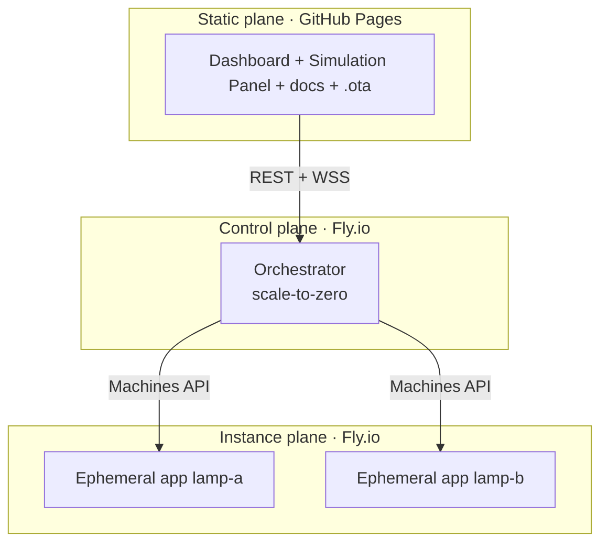
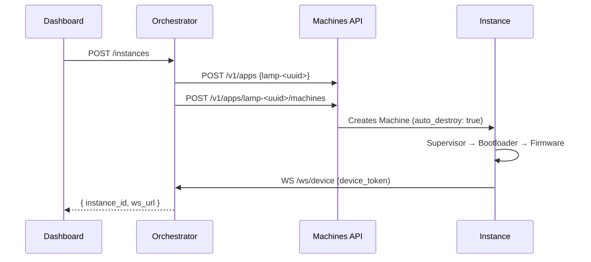

# 06 — Deployment architecture (Fly.io reference)

This document describes the reference deployment included in the repository.
The provider-neutral steps are in [`deployment.md`](deployment.md); the design
below applies to any host with the same three planes, with Fly.io as the working
example.

## 1. Principles

| Principle | Implication |
| :--- | :--- |
| **Three separate planes** | Static (Pages), control (orchestrator on Fly.io), instance (ephemeral Fly App per visit) |
| **Scale-to-zero on control** | The orchestrator suspends without traffic; cost ≈ $0 |
| **Auto-destroy on instances** | Each instance destroys itself after inactivity, without depending on the orchestrator |
| **Real isolation** | Firecracker microVM + private 6PN network per App |
| **CORS solved at the origin** | `.ota` binaries served from Pages itself, not from Releases |
| **Controlled cost** | Fly.io trial + <$2/month post-trial with scale-to-zero and auto-destroy |

## 2. Deployment architecture: three planes



| Plane | Where it lives | What it runs | Lifetime |
| :--- | :--- | :--- | :--- |
| **Static** | GitHub Pages | Dashboard, Simulation Panel, docs, `.ota` binaries | Permanent |
| **Control** | Fly.io (App `lamp-demo-orchestrator`) | Backend API, WS gateway, instance creation | Scale-to-zero (suspends without traffic) |
| **Instance** | Fly.io (App `lamp-<uuid>` per visit) | Supervisor + bootloader + firmware + LED driver | Ephemeral (`auto_destroy: true`) |

**Why a separate instance plane:** the requirement for multiple isolated instances that shut down on inactivity is solved naturally with **one dedicated Fly App per visit**. Fly.io can create Apps and Machines through its API in milliseconds, and each App has its own 6PN network, which guarantees network isolation.

## 3. Control plane: orchestrator on Fly.io

### 3.1 `fly.toml` configuration

```toml
app = "lamp-demo-orchestrator"
primary_region = "iad"

[build]
  dockerfile = "Dockerfile"

[http_service]
  internal_port = 8080
  force_https = true
  auto_stop_machines = "suspend"
  auto_start_machines = true
  min_machines_running = 0

[[vm]]
  cpu_kind = "shared"
  cpus = 1
  memory_mb = 256
```

- `auto_stop_machines = "suspend"` and `min_machines_running = 0` enable **scale-to-zero**: without traffic, the Machine suspends; when a request arrives, it resumes in **hundreds of milliseconds** compared with ~2 s for a cold start from `stop`.
- `auto_start_machines = true` guarantees that the first request after a period of inactivity wakes the orchestrator automatically.
- 256 MB of RAM is enough because the orchestrator does not run firmware, it only routes requests and calls the Machines API.

### 3.2 Orchestrator responsibilities

| Function | How |
| :--- | :--- |
| Create instance | `POST /instances` → calls the Machines API to create an ephemeral App + Machine |
| Route dashboard WS | Keeps an `instance_id → ws_url` map and does *fan-out* |
| Route firmware WS | Validates `device_token` and associates the connection with `instance_id` |
| Destroy instance | `DELETE /instances/{id}` or expired TTL → calls `DELETE /v1/apps/{app_name}` (cascades to Machines) |
| Serve OTA firmware | Redirects to Pages or serves the `.ota` from its own storage |

### 3.3 API token

The orchestrator needs an **organization token** (`fly tokens create org`) to create and destroy Apps, not a deploy token limited to a single App. That token is stored as a secret in Fly.io (`fly secrets set FLY_ORG_TOKEN=...`) and is never exposed to the client or to the ephemeral instances.

## 4. Instance plane: ephemeral Fly App per visit

### 4.1 Creation flow



### 4.2 Ephemeral Machine configuration

```json
{
  "config": {
    "image": "registry.fly.io/lamp-instance-base:latest",
    "auto_destroy": true,
    "env": {
      "DEVICE_TOKEN": "<token>",
      "ORCH_WS_URL": "ws://lamp-demo-orchestrator.internal:8081/ws/device",
      "IDLE_TIMEOUT_S": "300"
    },
    "guest": { "cpu_kind": "shared", "cpus": 1, "memory_mb": 256 }
  }
}
```

Creating the App with its own 6PN network isolates each instance: a Machine of `lamp-a` cannot route to `lamp-b`. `auto_destroy: true` makes Fly delete it automatically when the internal agent signals inactivity, without needing the orchestrator to be awake to do the cleanup.

### 4.3 Ephemeral instance image

A single container with:

| Component | Role |
| :--- | :--- |
| **Supervisor** | `ENTRYPOINT`: manages power on/off/reset, launches the bootloader or the app |
| **Bootloader** | Validates the `.ota`, manages A/B slots in `flash.bin` (mmap), `execve` to the app |
| **POSIX firmware** | FreeRTOS port + tasks + Modbus client + WS client + REST client |
| **Simulated LED driver** | Modbus TCP server + internal REST API for fault injection |
| **Idle agent** | Detects the absence of commands/telemetry and signals `auto_destroy` after N minutes |

**Image size:** ≈130 MB with `debian:bookworm-slim` (the binaries add up to <1 MB; the rest is the base). Good enough for fast boots; going below 100 MB would require distroless/alpine.

**Implementation:** `infra/instance/Dockerfile` (+
`entrypoint.sh`) builds a container with the driver, firmware, bootloader and
supervisor; the driver stays on `127.0.0.1:5020` and the supervisor on `5022`
(6PN). The orchestrator (`backend/src/orchestrator/`) creates the App + Machine
with `auto_destroy`, waits for its private IP and uses it for Modbus and the
supervisor channel. Cleanup of expired and orphaned instances runs in a
background task. The operational guide is in [`deployment.md`](deployment.md).

### 4.4 Idle agent

The agent is critical: **the instance does not depend on the orchestrator to shut down**. If the orchestrator is suspended, the instance keeps working and destroys itself when appropriate. This removes a single point of failure.

```bash
#!/bin/bash
# agent-idle.sh
IDLE_TIMEOUT=${IDLE_TIMEOUT_S:-300}
LAST_ACTIVITY=$(date +%s)

while true; do
  sleep 10
  NOW=$(date +%s)
  # The firmware writes a timestamp to /tmp/last_activity on every command/telemetry
  if [ -f /tmp/last_activity ]; then
    LAST_ACTIVITY=$(cat /tmp/last_activity)
  fi
  if [ $((NOW - LAST_ACTIVITY)) -gt $IDLE_TIMEOUT ]; then
    echo "Idle timeout reached, signaling auto_destroy"
    # Fly destroys the Machine when it receives SIGTERM and does not restart it
    kill -TERM 1
    exit 0
  fi
done
```

## 5. Static plane: GitHub Pages

### 5.1 Site structure

```text
_site/                         ← Pages root
├── index.html                 ← dashboard
├── sim.html                   ← Simulation Panel (PIN protected)
├── config.js                  ← orchestrator URL
├── src/                       ← JS, CSS
├── docs/                      ← MkDocs documentation site
│   ├── index.html
│   ├── manual/
│   └── adr/
└── firmware/
    ├── v1.0.3/
    │   └── firmware.ota
    └── v1.1.0/
        └── firmware.ota
```

The same Pages artifact contains the dashboard at `/` and the documentation at
`/docs/`; `mkdocs build --site-dir _site/docs` produces the second one.

### 5.2 Why the binaries go to Pages and not to Releases

GitHub Releases assets **do not send CORS headers**: `browser_download_url` redirects to `release-assets.githubusercontent.com`, and neither the redirect nor the final response includes `Access-Control-Allow-Origin`. A `fetch()` from the dashboard would fail. The standard solution is to **include the artifact in the Pages build**: `web/build_site.sh` copies `$OTA_FILE` to `_site/firmware/<version>/`, so it is served from the same origin as the dashboard and CORS does not apply.

Releases still exist as the **source of truth and versioning**, but the dashboard consumes the binaries from Pages.

### 5.3 Release workflow (fragment)

```yaml
- name: Build site
  env:
    PUBLIC_ORCHESTRATOR_URL: ${{ vars.PUBLIC_ORCHESTRATOR_URL }}
    OTA_FILE: dist/firmware-${{ needs.build.outputs.version }}.ota
    OTA_VERSION: ${{ needs.build.outputs.version }}
  run: ./web/build_site.sh _site
- uses: actions/setup-python@v5
  with:
    python-version: "3.12"
    cache: pip
    cache-dependency-path: requirements-docs.txt
- run: pip install -r requirements-docs.txt
- name: Build docs
  env:
    DOCS_SITE_URL: https://${{ github.repository_owner }}.github.io/${{ github.event.repository.name }}/docs/
  run: mkdocs build --strict --site-dir _site/docs
- uses: actions/upload-pages-artifact@v3
  with:
    path: _site
- uses: actions/deploy-pages@v4
```

## 6. CI/CD: three deployment workflows

| Workflow | Trigger | What it does |
| :--- | :--- | :--- |
| **`release-firmware.yml`** | Tag `v*` | Build → package OTA → verify → create Release → deploy Pages (dashboard + docs) |
| **`deploy-orchestrator.yml`** | Tag `v*` or manual | `flyctl deploy` to the orchestrator |
| **`deploy-instance-image.yml`** | Tag `v*` or manual | Build and push the instances base image |

The Fly.io workflow uses `superfly/flyctl-actions/setup-flyctl@master` and `flyctl deploy --remote-only` with `FLY_API_TOKEN` in secrets.

## 7. Real costs and limits

### 7.1 Fly.io trial

Fly.io **no longer offers a free tier for new accounts**: only a trial of **2 hours of runtime or 7 days**, whichever comes first, with a maximum of 10 Machines and auto-stop after 5 minutes.

### 7.2 Post-trial costs

| Resource | Cost | Note |
| :--- | :--- | :--- |
| shared-cpu-1x 256 MB Machine | **$2.19/month** if always on | But you only pay while it runs |
| Suspended orchestrator | ~$0.15/month (rootfs) | No CPU/RAM while suspended |
| Ephemeral instance (5 min) | ~$0.0002 | At $0.003/hour |
| Persistent volume | **$0.15/GB/month** | **Do not use** for ephemeral instances |
| Egress | $0.02/GB | Minimal for a demo |

**Realistic scenario:** 20 short visits per month → **< $1/month**. A shared-cpu-1x Machine with 256 MB costs $2.19/month if it were always on, but you only pay while it runs.

A short public summary of the cost:

> *"Demo deployed with a Fly.io trial. For continuous use, the estimated cost is <$2/month with scale-to-zero and auto-destroy."*

### 7.3 Warning about volumes

**Do not use persistent volumes** for the ephemeral instances: a 10 GB volume costs $1.50/month even when stopped, more than everything else combined. `flash.bin` lives inside the ephemeral rootfs and is destroyed with the Machine.

## 8. Simplified alternative (if time is tight)

If the Machines API adds too much complexity for the demo scope:

- **A single Machine on Fly.io** runs the orchestrator and N firmware instances as **processes inside the same VM**, managed by a supervisor (no nested Docker). Each instance has its own `flash.bin`, its own internal WS port and its own TTL.
- **Advantage:** you do not need the Machines API or organization tokens; everything lives in one `fly.toml` and one `supervisord.conf`.
- **Disadvantage:** there is **no real isolation** between instances (they share kernel and network), and scale-to-zero is at the whole-VM level, not per instance. For a demo it is acceptable, but the "isolation per Firecracker microVM" property is lost.

**Recommendation:** start with the simplified alternative to have something functional, and migrate to the Machines API if time allows. The interface design (REST/WS) does not change; only the *backend* that creates the instances changes.

## 9. Deployment checklist

### 9.1 Pre-deployment

- [ ] `FLY_ORG_TOKEN` configured in the orchestrator secrets
- [ ] `FLY_API_TOKEN` configured in GitHub Secrets
- [ ] `OTA_AES_KEY` and `OTA_SIGNING_KEY` in GitHub Secrets (`release` environment)
- [ ] `keys/ota_public.pem` committed to the repo
- [ ] `fly.toml` with `auto_stop_machines = "suspend"` and `min_machines_running = 0`
- [ ] Instance image <100 MB with a working healthcheck

### 9.2 Post-deployment

- [ ] `curl https://lamp-demo-orchestrator.fly.dev/health` responds 200
- [ ] `POST /instances` creates a real Machine (`fly apps list` confirms it)
- [ ] The instance destroys itself after `IDLE_TIMEOUT_S`
- [ ] The dashboard on Pages connects to the orchestrator over WSS
- [ ] The `.ota` binaries download from Pages without a CORS error
- [ ] The Fly.io trial has not expired (or the project has moved to a paid plan)

## 10. What is NOT implemented (and why)

| Not implemented | Reason | Next step |
| :--- | :--- | :--- |
| **Multi-region** | One region is enough for the demo | Fly.io regions + anycast |
| **Persistent volumes for instances** | Disproportionate cost; an ephemeral rootfs is enough | Volume per instance if persistence is required |
| **Canary deploy** | No traffic enough for A/B | Fly.io rolling deploy |
| **Automatic post-deploy rollback** | Smoke test + manual redeploy is enough | Fly.io releases + rollback |
| **CDN for `.ota` binaries** | Pages already serves through the GitHub CDN | Cloudflare CDN |
| **WAF / DDoS protection** | Fly.io has basic protection | Cloudflare WAF |

## 11. Deliverables for this area

- `fly.toml` — control plane config (root, build context).
- `infra/Dockerfile.orchestrator` — orchestrator image.
- `infra/instance/Dockerfile` — ephemeral instance image.
- `infra/instance/entrypoint.sh` — driver + supervisor with power/reset.
- `backend/src/orchestrator/machines_api.py` — Machines API client.
- `backend/src/orchestrator/manager.py` — provisioning, destruction and cleanup.
- `.github/workflows/release-firmware.yml`
- `.github/workflows/deploy-orchestrator.yml`
- `.github/workflows/deploy-instance-image.yml`
- `docs/deployment.md` — step-by-step guide with cost notes.

The orphan sweep and expiration replace `agent-idle.sh`: the orchestrator
destroys the App when the session closes or when the heartbeat expires, and
`auto_destroy` covers stopping the Machine.

## 12. References

- [Fly.io Resource Pricing](https://fly.io/docs/about/pricing/)(https://fly.io/docs/about/pricing/)
- [Fly.io Free Trial](https://fly.io/docs/about/pricing/#free-trial)(https://fly.io/docs/about/pricing/#free-trial)
- [Fly Machines API — Create Machine](https://fly.io/docs/machines/api/machines-resource/#create-a-machine)(https://fly.io/docs/machines/api/machines-resource/#create-a-machine)
- [Fly.io — Autostop/autostart Machines](https://fly.io/docs/launch/autostop-autostart/)(https://fly.io/docs/launch/autostop-autostart/)
- [GitHub Pages — CORS and Releases](https://docs.github.com/en/pages)
