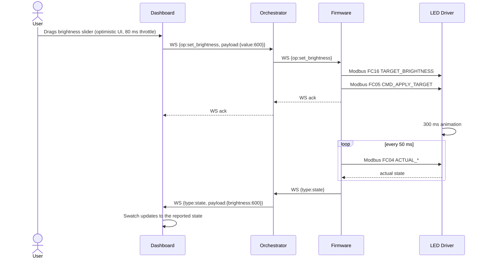
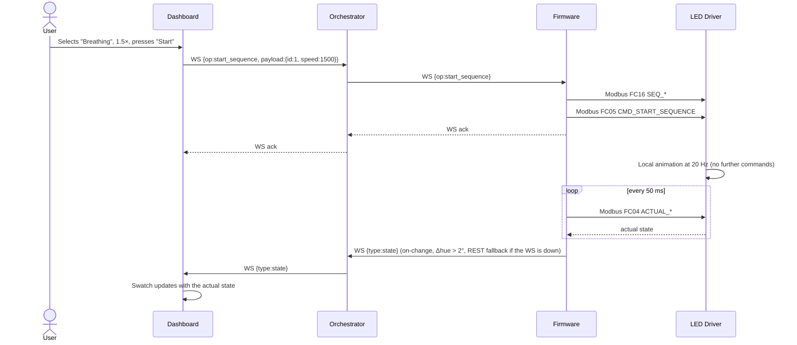
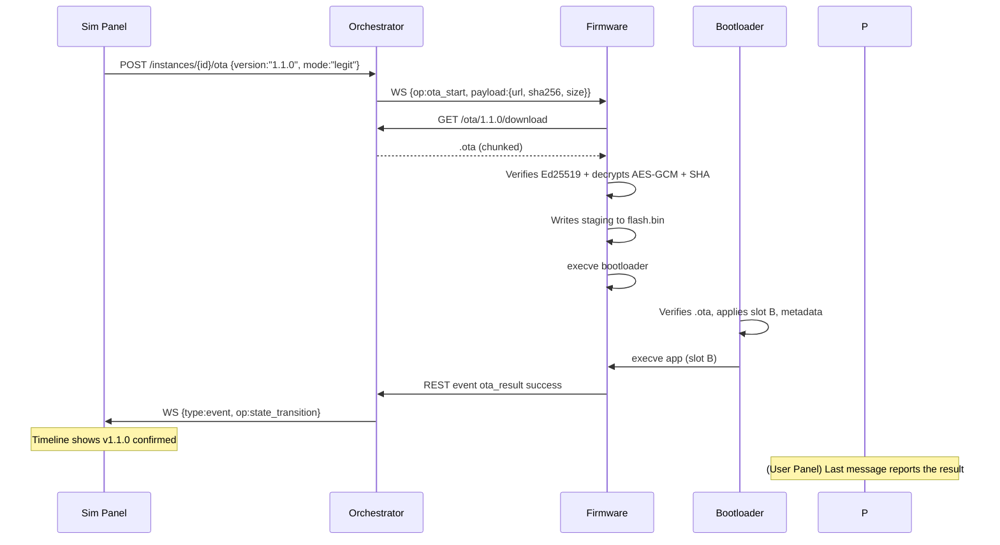
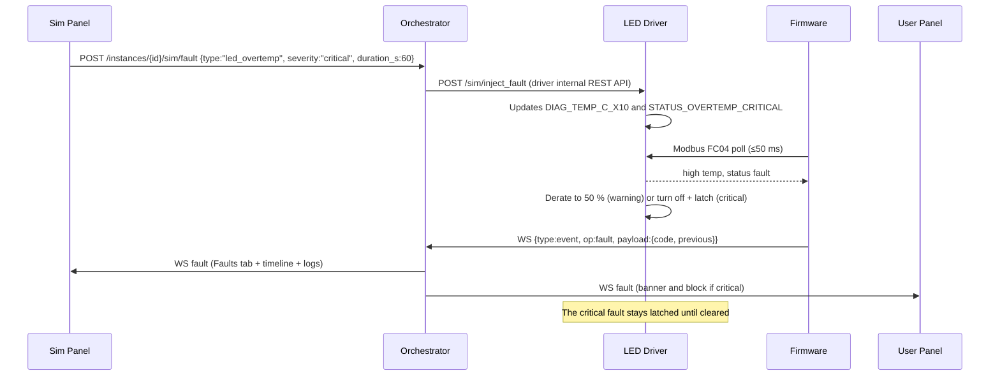
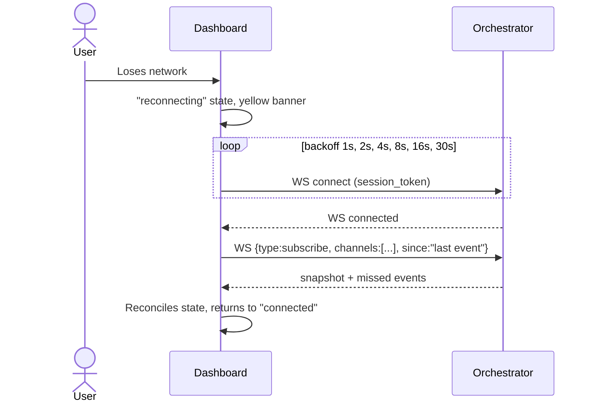

# 07 — Dashboards and UX

## 1. Principles

| Principle | Implication |
| :--- | :--- |
| **Two surfaces, two purposes** | The User Panel (operator) and the Simulation Panel (engineer) share neither permissions nor level of detail |
| **Zero business logic in the frontend** | The dashboard only renders, sends commands and reconciles |
| **Actual state visible** | The dashboard swatch shows the real state; target vs actual is available in the Simulation Panel |
| **Optimistic UI with confirmation** | Sliders respond instantly; the ack/last message reports the result, with no automatic revert |
| **Direct state updates** | The swatch follows the `state` messages; no client-side interpolation loop |
| **Graceful degradation** | Non-blocking reconnection; the last state stays visible |
| **Minimum AA accessibility** | Contrast, ARIA on sliders/toggles, visible focus |

## 2. Overall site structure

Two application screens on GitHub Pages, plus the documentation site:

```text
/          → dashboard (index.html)
/sim.html  → Simulation Panel (PIN protected)
/docs/     → MkDocs documentation
```

There is no separate landing page or `/demo` route. The dashboard creates or
reuses the instance on load; the PIN is only requested by the Simulation Panel.

### 2.1 UI states (implemented)

| State | When | What the user sees |
| :--- | :--- | :--- |
| Backend unavailable | WS closed or fetch fails | `backend unavailable` badge + amber banner; controls locked |
| Device offline | No device WS / device stopped | `device disconnected`; swatch dims; "No connection to the device" |
| Device online | Firmware connected | `device connected`; controls available |
| Pairing / connecting | Simulated onboarding | Network badge; controls locked |
| Fault latched | Critical fault, safe mode or heartbeat loss | Fault banner; controls locked until `Clear faults` |

The badge follows the **device presence**, not the browser connection. There is
no separate "reconnecting" or "expired" traffic-light state in the current UI.

## 3. User Panel

Clean view, aimed at the "end operator". No technical jargon.

### 3.1 Wireframe

```text
┌──────────────────────────────────────────────────────────────┐
│  💡 Lamp · inst-8f2a           ● Connected           [⚙️]     │
├──────────────────────────────────────────────────────────────┤
│                                                              │
│   ┌────────────────────────┐    ┌────────────────────────┐   │
│   │                        │    │  Status                │   │
│   │                        │    │  On                    │   │
│   │     [LARGE SWATCH]     │    │  Brightness  80%       │   │
│   │      Actual color      │    │  Mode    Sequence      │   │
│   │                        │    │  Sequence: breathing   │   │
│   │                        │    │  Step 14 / ∞           │   │
│   │                        │    │  ⏱ On for 12m          │   │
│   └────────────────────────┘    └────────────────────────┘   │
│                                                              │
│   ┌──────────────────────────────────────────────────────┐   │
│   │  Power  [●━━]   Brightness  [━━━━━●━━]  80%          │   │
│   │  Mode   ( Manual | CCT | Sequence | Scene )          │   │
│   └──────────────────────────────────────────────────────┘   │
│                                                              │
│   ┌── Color ─────────────────────────────────────────────┐   │
│   │  Hue   [━━●━━━━━━━━━━] 32°                           │   │
│   │  Sat   [━━━━━━●━━━━━] 85%                            │   │
│   │  Val   [━━━━●━━━━━━━] 60%                            │   │
│   │  Transition [━━●━━━━] 500 ms                         │   │
│   └──────────────────────────────────────────────────────┘   │
│                                                              │
│   ┌── Scenes / Sequences ────────────────────────────────┐   │
│   │  [Reading] [Relax] [Party] [Sunrise]                 │   │
│   │  Sequence: [Breathing ▾]  Speed [━●━] 1.5×           │   │
│   │  [▶ Start]  [■ Stop]                                 │   │
│   └──────────────────────────────────────────────────────┘   │
│                                                              │
└──────────────────────────────────────────────────────────────┘
```

### 3.2 Key components

#### 3.2.1 Swatch (actual state)

- The swatch reflects `state.color` arriving over WS (the driver's `ACTUAL_*`
  values); each state message updates it directly. There is no client-side
  `requestAnimationFrame` interpolation.
- The dashboard shows the **actual** state only. Target vs actual is visible in
  the Simulation Panel's Modbus tab, where the holding (`TARGET_*`) and input
  (`ACTUAL_*`) registers are listed side by side.
- A dual swatch (a small overlay with the last commanded color) is a future
  improvement, not implemented. It would help during transitions and
  sequences, but it requires separating the UI's optimistic state from the
  telemetry state.

#### 3.2.2 Controls

- Sliders update the **optimistic UI state** while dragging and send commands
  with an 80 ms throttle (`sendThrottled`); releasing the slider sends the final
  value.
- There is **no pending indicator** and no automatic revert on `nack`. A
  rejected command or a timeout is reported in the **Last message** line
  (`nack …` or `offline: …`); the optimistic value remains until the next state
  update.
- Color/brightness commands are throttled so dragging does not flood the WS.

#### 3.2.3 Connection indicator

- `device connected`: the firmware is connected and the lamp is powered.
- `device disconnected`: no device WS, or the device was stopped; controls lock
  and the swatch dims.
- `backend unavailable`: the dashboard cannot reach the orchestrator; an amber
  banner appears and controls lock.
- There is no green/yellow/red traffic light or hover tooltip in the current UI;
  the badge reflects device presence, not the browser WS.

#### 3.2.4 Firmware update

- The **Update firmware** button checks `GET /ota/latest`, compares it with the
  current `fw_version`, and triggers `POST /instances/{id}/ota` with the latest
  version.
- Progress and result appear in the **Last message** line (“installing…”,
  “accepted”, “up to date”, or the rejection code).
- There is no bell, “Install / Later” prompt, header progress bar or toast; the
  Simulation Panel’s Firmware tab shows the detailed version list and status.

#### 3.2.5 Recent activity

Not implemented in the user panel. The Simulation Panel’s **Logs** tab shows the
event history (`/sim/logs`); there is no `GET /instances/{id}/events` endpoint
and no “Recent activity” card.

### 3.3 Implementation

- Real files: `web/index.html`, `web/src/app.js`, `web/src/styles.css` and
  `web/src/i18n.js` (no framework, no build).
- **Language:** English by default; an EN/ES selector persisted in `localStorage`,
  `?lang=es` as an override, and dynamic texts translated with `t(key)`.
- **White mode:** 2000–6500 K temperature (warm→cool gradient) and brightness;
  it uses `set_mode cct` + `set_color_temperature`, already supported by the firmware.
- **Color mode:** HSV wheel on canvas (angular hue, radial saturation) with a
  marker, presets, global brightness and keyboard support (arrows/Home/End).
- **Scenes:** Reading (4000 K), Relax (2700 K), Focus (5600 K) and Night
  (2200 K), as combinations of existing commands.
- **Effects:** Breathing, Rainbow, Candle, Strobe, Police and Sunrise (driver
  IDs 1–6) with speed 0.5×–2× and stop.
- **User sequences:** summary card with steps and duration; the editor
  lives in a **Manage** dialog with up to 8 steps. Each step has a color and
  brightness selector inside the dialog (no need to close it to change color),
  using the same picker as the main panel: HSV wheel, white/CCT,
  brightness, presets and a preview of the effective color/brightness. It also
  has duration, reordering/removal; persisted in `localStorage`. Reordering is
  done by dragging the handle, with arrow keys for keyboard and mobile. The fade
  (`Fade`, 0.8 s by default) is sent as the `transition_ms` of each step and the
  speed (0.5×–2×) as `speed`; «Start» uploads the steps to the driver and starts
  the sequence, «Stop» stops it. The default duration of a new step is 4 s.
- **Party mode:** source selector (browser microphone or simulated beat),
  start/stop button, level meter and status. The analysis is local
  (`getUserMedia` + `AnalyserNode`); only `set_color` and
  `set_brightness` reach the firmware at ~8 Hz. If permission is denied, it
  falls back to the simulated beat. It stops when the device is lost.
- **Schedules:** summary card below Scenes with the next run; the
  editor and the list live in a **Manage** dialog. The dialog includes an
  action type selector: current light, color/white, scene, effect, off or sunrise,
  plus capturing the current light («Current»), turning it off («Off») or scheduling
  a sunrise. Color/white uses the same picker as the main panel (HSV wheel,
  CCT, brightness, presets and preview). There is no need to configure the light
  before opening. The schedule asks for a time, a repetition (once, daily, weekdays,
  weekends or specific days) and the browser's IANA time zone. A preview shows
  color/CCT/scene/effect. The next run is computed with `zoneinfo`
  (DST-safe); the list shows next/last run and allows enabling/disabling, editing
  and deleting. It refreshes every 30 s. «Start sunrise» captures the current
  CCT/brightness and asks for a duration (15/30/45 min); the backend runs the
  ramp and the schedule shows whether it is `running`, `retry`, `ok`, `skipped`
  or `failed`.
- **Adaptive white:** checkbox and «Configure» in the White panel. The dialog
  edits time→temperature points with a visual slider (warm→cool gradient),
  optional brightness per point and transition mode: **gradual** between points or
  **quick** at each point with N seconds. The points and the mode are saved in
  `localStorage`; a manual change pauses the curve for 60 min and offers «Resume».
- **Simulated onboarding:** «Add device» button in the header. The dashboard only
  scans; pairing is triggered by three off→on cycles of 1–10 s (5–10 s
  recommended, max. 2 min) using **Power Off/On from Panel Sim**, not the dashboard's
  soft Turn off, waiting for `APP_RUNNING` after each power-on. After
  the third power-on it enters pairing; one more cycle cancels it.
  Network shows the `1/3`, `2/3` progress, allows cancelling and keeps the previous
  network until a successful connect. «Forget Wi-Fi & pair» forgets the network with
  confirmation; entering pairing does not erase it. The lamp blinks white and the
  wizard shows the fictitious BLE scan and the network form. The
  password is stored encrypted (AES-256-GCM) per `device_token` and never
  displayed. New instances boot online with `Casa-Demo`; Network
  allows editing the whitelist, enabling «Allow any» and injecting faults. The
  demo credentials (`Casa-Demo`/`demo-password`, `Lab`/`lab-password`,
  `Guest`/`guest-password`) are shown in Network and in Add device; they are
  simulation credentials, not the device's stored password.
- **Manage and guides:** Schedules and Sequences show a summary and open a
  dialog; they close if the panel is locked for lack of network. The **Help**
  button opens a quick guide in the dashboard and in Panel Sim (pairing with
  `APP_RUNNING`, soft/hard power, schedules, sequences, credentials and
  whitelist/faults).
- **Power-on:** card with three modes: keep the last color, default warm
  white (3000 K/70 %) or custom color/CCT + brightness. It is applied on the
  first device connection (auto-start) and on **hard Power On** from Panel Sim;
  soft Turn on keeps the current color. An explicit Power Off from Panel Sim is
  respected and disables the auto-start. The policy persists per `device_token`.
- **No network / pairing:** the network badge shows `No Wi-Fi`, `Pairing`,
  `Connecting` or `Wi-Fi · SSID`. While it is not `online`, the panel keeps
  the live light state but blocks the controls; `Add device` is still
  available. A hard Power Off/On during pairing exits it and restores the light.
- **Device presence:** the connection badge follows `device_online`, not the
  browser WebSocket. A powered-off or booting device shows `device
  disconnected` and the controls are locked; there is no separate "starting"
  state. The backend exposes `device_online` in `GET /instances/{id}` to
  reconcile after a reload. A backend outage shows a dedicated alert.
- **Stale state:** the swatch dims and «Last known state» appears when the
  device is gone; the "no connection" note replaces the off/power glyph so the
  two do not overlap.

### 3.4 Layout

- **Three-column** grid (360 px + 2 flexible) with a maximum width of 1240 px:
  lamp + status + firmware; light + scenes; effects + party + sequences.
- The **swatch** is a ~320×320 square with rounded corners (`aspect-ratio: 1`),
  fixed size on desktop.
- Responsive: 1100 px → two columns with the tools across the full width; 900 px →
  tools in two columns; 720 px → one column and a centered swatch.
- **Mobile:** header in a column and controls in rows; the order prioritizes
  `Light`/scenes before effects, sequences, firmware and power-on. The
  cards take the full width.
- **Accessibility:** global visible focus, `prefers-reduced-motion` and contrast
  of secondary text; the fault history stacks with labels on mobile.
- The Simulation Panel raises its maximum width to 1280 px to take advantage of
  large monitors.

### 3.5 Sequences, adaptive white and maintenance

- **Sequences:** the step number is a circular badge; brightness is chosen
  inside the color picker and the swatch reflects the intensity. This keeps a
  single source of truth for brightness.
- **Adaptive white:** the dialog uses 840 px and a grid per point
  (time · swatch · temperature · remove), with the slider taking the
  remaining width. On mobile it stacks so fields are not lost.
- **Buttons:** dialog and sequence actions with natural width and consistent
  spacing; visible focus and `prefers-reduced-motion` remain active.
- **Settings:** allows **Reset dashboard** (sequences, adaptive white, party,
  schedules, power-on and history) and **Clear fault history**. It does not
  factory reset the lamp; the Sim Panel is there for that.
- **Synchronization:** on reconnecting the WS or receiving `device_online`,
  state, health, provisioning, power-on and schedules are refreshed; after a factory
  reset the dashboard clears its local configuration and syncs again.

### 3.6 What does NOT appear in this view

- RTOS metrics (stack HWM, heap).
- Fault codes.
- Power/reset/bootloader buttons at the supervisor level.
- Direct Modbus writes.
- Firmware version selection.
- Logs.

## 4. Simulation Panel

View for "engineer/QA". Denser, with tabs for organization.

### 4.1 Wireframe

```text
┌──────────────────────────────────────────────────────────────┐
│  🛠️ Simulation Panel · inst-8f2a   ● Connected      [Exit]   │
├──────────────────────────────────────────────────────────────┤
│  [ Device ] [ Firmware ] [ Modbus ] [ Faults ] [ Logs ] [ Network ] │
├──────────────────────────────────────────────────────────────┤
│                                                              │
│  TAB: Device                                                 │
│  ┌────────────────────────────────────────────────────────┐  │
│  │  State: APP_RUNNING   Uptime: 12m 34s                  │  │
│  │  Slot: A   Version: 1.0.3   Heartbeat: OK (1s)         │  │
│  │                                                        │  │
│  │  [⏻ Power On] [⏻ Power Off] [🔄 Reset]                  │  │
│  │  [🔧 Enter Bootloader] [🏭 Factory Reset]                │  │
│  └────────────────────────────────────────────────────────┘  │
│                                                              │
│  ┌── State timeline ──────────────────────────────────────┐  │
│  │  10:20:01  POWERED_OFF → BOOTING                       │  │
│  │  10:20:02  BOOTING → APP_RUNNING                       │  │
│  │  10:28:14  APP_RUNNING → POWERED_OFF (OTA reboot)      │  │
│  │  10:28:19  POWERED_OFF → BOOTING                       │  │
│  │  10:28:20  BOOTING → APP_RUNNING (v1.1.0)              │  │
│  └────────────────────────────────────────────────────────┘  │
│                                                              │
│  ┌── RTOS metrics ────────────────────────────────────────┐  │
│  │  Task        Stack HWM (free bytes)                     │  │
│  │  control     25,720 B                                   │  │
│  │  light        9,992 B                                   │  │
│  │  comms       11,880 B                                   │  │
│  │  free heap   94,456 B (min 60,512 B)                    │  │
│  └────────────────────────────────────────────────────────┘  │
└──────────────────────────────────────────────────────────────┘
```

> The wireframe is illustrative. The implemented Device tab shows state,
> health, hard-power controls, the event timeline and per-task stack high-water
> marks plus free heap; it does **not** show CPU %, queue occupancy or a jitter
> chart.

### 4.2 "Device" tab

- Lifecycle buttons: **Power On / Power Off / Reset / Enter Bootloader / Factory Reset**.
- Each button calls `POST /instances/{id}/sim/power` or `/sim/bootloader` and shows a confirmation for destructive actions (factory reset).
- Live **event timeline** from the instance log (power, faults, OTA).
- **RTOS metrics** as a text list: stack high-water mark per task, plus free heap and temperature from health.

### 4.3 "Firmware" tab

- **Current:** `vX · slot A|B` from the health; it changes when the OTA finishes.
- Artifact list (`GET /ota/versions`) with version, size and a badge
  `current`/`newer`/`older`.
- Mode selector with contextual explanation:
  - **Legit:** newer versions only; the button is disabled for the rest.
  - **Corrupt:** the backend flips one byte; the bootloader rejects the signature.
  - **Downgrade:** older versions only; anti-downgrade rejects them and
    the device stays on the current slot/version.
- After deploying, the panel waits ~18 s and shows:
  - `Updated to vX · slot B` if the health changed;
  - `No change: device remains on vX · slot A` if the bootloader rejected the
    image.
- The backend does a preflight and returns `409 OTA_NOT_NEWER`/`OTA_NOT_OLDER`
  before rebooting, so as not to bounce the device for no reason.

### 4.4 "Modbus" tab

- **Full register map** (table with coils, discrete inputs, holding, input).
- **Direct write editor:** select a register, type a value, "Write" button. Calls `POST /instances/{id}/sim/modbus/write`.
- **Direct read viewer:** select a range, "Read" button. Calls `GET /instances/{id}/sim/modbus/read`.
- **"Bypass" indicator**: a banner reminding you that this write skips the firmware and goes straight to the LED driver, so the firmware does not see it as a legitimate command.
- **Optional auto-refresh** (1 Hz) to watch how the actual state registers change while the lamp animates.

### 4.5 "Faults" tab

- Catalog of injectable faults with a button for each one:

| Fault | Severity | Expected effect |
| :--- | :--- | :--- |
| `led_overtemp_warn` | warning | Derate: brightness limited to 50 % |
| `led_overtemp` | critical | Turns off, latches and blocks power/start |
| `overcurrent` | critical | Turns off, latches and blocks power/start |
| `led_open` | critical | Turns off, latches and reports an open circuit |
| `heartbeat_lost` | warning | Turns off; when the heartbeat returns it restores the target if there is no latch |
| `ws_drop` | warning | The WS drops; the firmware reconnects and uses the REST fallback |
| `config_corrupt` | critical | Safe mode: defaults, output off and save/load/power blocked |

- Each fault has: severity, duration (seconds or "until cleared") and
  **expected effect** (derate/trip/latch/safe_mode/off/network) on the card.
- Critical faults latch: `STATUS_FAULT_LATCHED` and power/start blocked.
- **"Clear faults"** button (`CMD_CLEAR_FAULTS` + clearing the injection); the
  lamp stays off until you turn it on.
- **Dashboard:** fault banner with severity, effect, `Latched`/`Safe
  mode` badges and **Clear faults**; controls are blocked on critical faults.
- **History:** table with time, source (firmware/injected/user), fault,
  code, severity and effect. It helps explain a sequence of faults without
  reading the raw log. **Clear history** deletes only fault events and keeps
  the rest of the log.
- **Factory reset** (Device tab) erases flash, driver state, schedules,
  power-on and history; the open dashboard clears its local settings and
  resynchronizes.

### 4.6 "Logs" tab

- Live **device/backend events** (power, faults, OTA, commands); full
  supervisor/firmware/driver stdout stays in `docker compose logs`.
- **Text filter** over the event line.
- **Download .log** (generated in the browser from the current event list).
- There are no level/component filters, no separate stdout streaming and no
  "tail" indicator; the list is the same in-memory event history exposed at
  `GET /instances/{id}/sim/logs`.

### 4.6.1 Implementation

- Page: `/sim.html` (vanilla JS), linked from the User Panel.
- PIN `2025` exchanged for a `sim_token`; «Use demo PIN» button for testing.
- **Device:** state/health, RTOS metrics and live timeline. Power
  on/off, reset, enter/exit bootloader and factory reset (with confirmation)
  go through the supervisor control channel; the supervisor state is
  shown even when the app is off.
- **Firmware:** list of `.ota` artifacts from the backend and legit/corrupt/downgrade modes.
  The corrupt mode requires a higher version (otherwise anti-downgrade wins).
- **Modbus:** snapshot and direct writes to the driver (firmware bypass);
  writing a target applies with coil 0. If the lamp is off, the
  color is not reflected until it is turned on.
- **Faults:** catalog injectable through `SIM_*` registers + `ws_drop`.
- **Logs:** live device/backend events (boot, OTA, faults,
  connection); stdout logs of the firmware/driver remain in Docker.

### 4.7 Language and implementation

- All panel texts (tabs, state, firmware, Modbus, faults, logs, PIN,
  confirmations and dynamic messages) are in `web/src/i18n.js`; the EN/ES selector
  shares the preference with the dashboard.
- The fault catalog translates the label on the client from the `type`;
  the backend keeps its own labels for other consumers.
- Technical messages (register names, supervisor states, codes)
  are deliberately left untranslated.

### 4.8 Panel authentication

- On first entry, a modal asks for a **static PIN** (for example `2025`, visible in the README and in the PIN hint).
- It is stored in `sessionStorage`. It is not real security, it is minimal friction and models the concept of a "protected interface".
- In production, this interface would sit behind SSO with action auditing.

## 5. Key interaction flows

### 5.1 Turning on and changing color



### 5.2 Starting the "breathing" sequence



### 5.3 Legitimate OTA from the Simulation Panel



### 5.4 Injecting an overheating fault



### 5.5 Disconnection and reconnection



## 6. Notable UX decisions

| Decision | Why |
| :--- | :--- |
| **Single swatch (actual)** | Shows what the lamp is really doing; target vs actual remains in the Simulation Panel. A dual swatch is a future improvement |
| **Optimistic UI on sliders** | Low perceived latency; the ack/last message reports the result, but the UI does not auto-revert |
| **80 ms throttle** | Avoids flooding the WS; the final command is what matters |
| **Direct state updates** | The swatch follows the `state` messages; no client-side interpolation loop |
| **Strict separation of views** | The operator does not see technical faults; the engineer does not treat the "pretty" UI as the source of truth |
| **Non-blocking reconnection banner** | The user can keep seeing the last state while reconnecting |
| **No OTA toast** | Results appear in the Last message line; destructive actions use a modal |
| **Static PIN in the simulation panel** | Models a "protected interface" without implementing real auth; documented as a demo decision |
| **Logs downloadable from the browser** | Useful for the visitor who wants to review later; it does not require the backend |

## 7. Frontend stack

| Piece | Choice | Reason |
| :--- | :--- | :--- |
| Framework | **Vanilla JS, no framework** | Static site on Pages; no npm build or runtime dependency |
| Charts | **None** | RTOS metrics are rendered as text; charts are not required for the demo |
| Styles | **Modern CSS** (custom properties, grid, flex) | No dependencies; full control |
| WS | **Native WebSocket** | No library needed |
| State | Plain object + explicit `render()` | The state is small: `{state, connection}` |
| Session persistence | `sessionStorage` (`lamp_instance`, `lamp_sim_token`) | Recover the instance on reload |
| Build | **None** | `web/build_site.sh` copies static files for Pages |
| Testing | **Playwright E2E** during development; manual browser checks | The repo has no frontend unit runner committed |

**Rule:** the frontend does **not** implement business logic. It only renders state, sends commands and reconciles. All truth lives in the firmware and the backend.

### 7.1 Local assistant (implemented)

The dashboard ships a **rule-based, client-side assistant**:

- No LLM, API key or per-request cost; nothing leaves the browser.
- Its knowledge comes from `docs/manual/` through
  `tools/build_assistant_knowledge.py` (`web/src/assistant-knowledge.js`).
- It reads a small context snapshot: power, brightness, color, Wi-Fi, firmware
  version/slot and fault.
- It explains state, suggests manual topics and proposes safe light actions.
  Every mutating action requires **Apply**.
- OTA, factory reset, pairing and credentials are intentionally out of scope.
- Files: `web/src/assistant.js` and `web/src/assistant-knowledge.js`.

### 7.2 State handling

The dashboard keeps its state in a plain object and re-renders explicitly. Command acks update the same state object. There is no committed frontend unit runner; the flows are covered by Playwright E2E during development and by manual browser checks.

## 8. Accessibility and responsive (minimum)

- AA contrast in texts and controls.
- Sliders with `aria-valuemin/max/now` and `aria-label`.
- Buttons with `aria-pressed` for toggles (power).
- Responsive layout: on mobile, the swatch moves to the top and the controls stack. The Simulation Panel is not a priority on mobile (a "better on desktop" banner warns about it).
- Visible focus on all interactive controls.
- Keyboard navigation in the Simulation Panel tabs (`role="tablist"`, `aria-selected`).

## 9. Error handling and empty states

| Situation | Behavior |
| :--- | :--- |
| Command `nack` | Shows `nack …` in the Last message line; the optimistic value is not reverted automatically |
| Command timeout (2 s) | Shows `offline: …`/timeout text in the Last message line; the value is not reverted automatically |
| WS closed | `backend unavailable` badge + amber banner; controls locked |
| Expired instance | A 404 makes the dashboard create/reuse an instance automatically |
| Instance creation error | `backend unavailable` badge/banner; the reconnect loop retries |
| Empty version list | Message "No versions available" |
| No events in the Sim log | Empty Logs tab |

## 10. What is NOT implemented (and why)

| Not implemented | Reason | Next step |
| :--- | :--- | :--- |
| **Landing page and `/demo` route** | The dashboard itself is the entry point; a separate landing page is not implemented | Add a static landing page that creates an instance |
| **Dual swatch (actual vs commanded)** | Requires separating optimistic UI state from telemetry | Add a small commanded-color overlay |
| **OTA bell, Install/Later prompt and progress bar** | The Update firmware button and Last message cover the demo | Header notification with progress |
| **Recent activity card** | The Simulation Panel Logs tab already exposes events | Add a read-only events endpoint and card |
| **CPU %, queue occupancy and jitter chart** | Only stack HWM and heap are measured | Add CPU/queue instrumentation |
| **Optimistic pending indicator and revert on nack** | The Last message reports failures; automatic revert is extra UI | Snapshot values and restore on nack |
| **SSO / OAuth in the sim panel** | A static PIN is enough for a demo | OAuth2 + auditing |
| **Dark mode** | Adds design work without demonstrative value | CSS custom properties already allow it |
| **More than EN/ES** | The demo already ships an EN/ES dictionary | i18next or a locale bundle |
| **PWA / offline** | Does not add to the use case | Service worker |
| **Advanced animations** | The driver transitions already demonstrate the concept | Framer Motion (if migrating to React) |
| **Committed E2E tests (Playwright)** | No frontend test runner is committed; flows are checked with Playwright during development and manually | Commit a Playwright E2E suite |
| **Automatic light/dark mode** | System preference | `prefers-color-scheme` |

## 11. Deliverables for this area

- `web/index.html` — dashboard.
- `web/sim.html` — Simulation Panel.
- `web/src/app.js` — dashboard state, rendering and commands.
- `web/src/sim.js` — Simulation Panel tabs and Modbus/fault UI.
- `web/src/i18n.js` — EN/ES dictionary and language switch.
- `web/src/endpoint.js` — backend/WS URL resolution.
- `web/src/help.js` — shared Help dialog.
- `web/src/styles.css`, `web/src/sim.css` — layout and responsive styles.
- `web/build_site.sh` — static export for GitHub Pages.

## 12. References

- [WebSocket API (MDN)](https://developer.mozilla.org/en-US/docs/Web/API/WebSocket)
- [WCAG 2.1 AA Quick Reference](https://www.w3.org/WAI/WCAG21/quickref/)
- [Canvas API (MDN)](https://developer.mozilla.org/en-US/docs/Web/API/Canvas_API)
- [Web Audio API (MDN)](https://developer.mozilla.org/en-US/docs/Web/API/Web_Audio_API)
