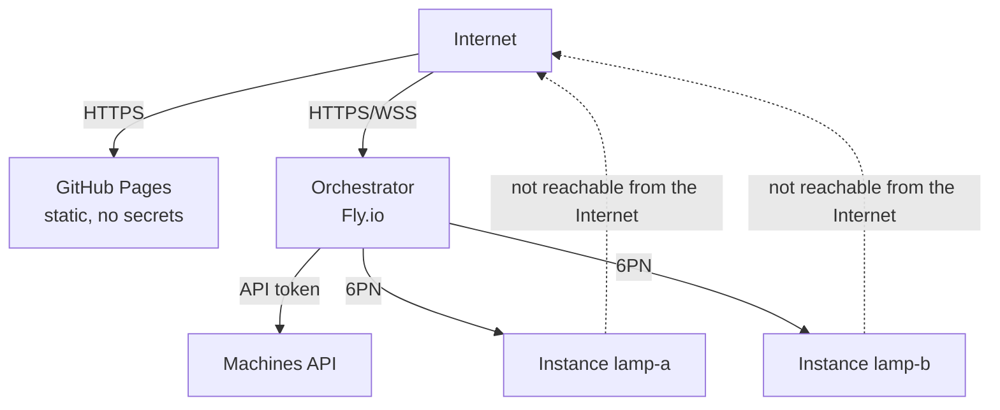
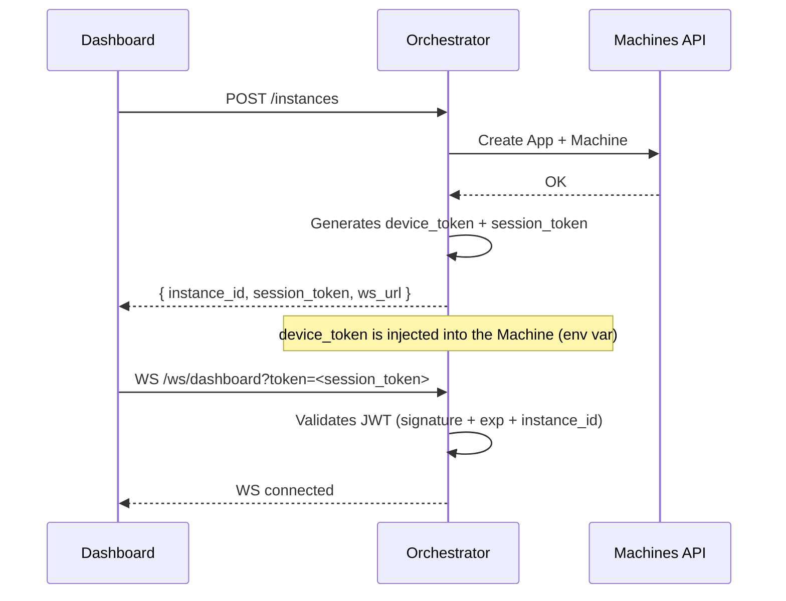

# 08 — Security and threat model

## 1. Principles

| Principle | Implication |
| :--- | :--- |
| **Explicit model, not implicit** | Every asset, adversary and surface is documented; whatever is not protected is justified |
| **Simulation honesty** | What is preserved in POSIX is distinguished from what is not simulable |
| **Minimal surface** | Ephemeral instances do not expose public ports; the orchestrator is the only entry point |
| **Least privilege** | `session_token` only operates on its `instance_id`; `package` is the only job with access to signing keys |
| **Defense in depth** | Rate limiting + JWT + opaque tokens + network isolation + microVM |
| **Secrets out of the code** | Keys in Fly Secrets / GitHub Secrets; HSM note as next step |

## 2. Threat model

### 2.1 Assets to protect

| Asset | Sensitivity | Consequence if compromised |
| :--- | :--- | :--- |
| **Ephemeral instances** | Low | Resource abuse (cost), no real data |
| **Simulation Panel** | Medium | A visitor could inject faults into someone else's instances |
| **`device_token`** | Medium | Impersonate the firmware before the backend |
| **`FLY_ORG_TOKEN`** | **High** | Create/destroy Apps in the Fly.io organization (cost, chaos) |
| **`OTA_SIGNING_KEY`** | **High** | Sign malicious firmware that the bootloader would accept |
| **`OTA_AES_KEY`** | **High** | Decrypt images; combined with the signature, create valid images |
| **`JWT_SECRET`** | Medium | Forge `session_tokens` for someone else's instances |
| **`session_token`** | Low | Access to one specific ephemeral instance |

### 2.2 Adversaries considered

| Adversary | Capability | Motivation | Mitigation |
| :--- | :--- | :--- | :--- |
| **Curious visitor** | Browses the demo, opens DevTools | Understand how it works; not malicious | None (this is the target user) |
| **Scraper / bot** | Automates `POST /instances` | Exhaust the Fly.io trial or generate cost | Per-IP rate limiting + global limit + optional Turnstile |
| **Opportunistic attacker** | Finds the orchestrator URL | Inject faults, impersonate firmware, create instances in bulk | JWT + `device_token` + per-`instance_id` authorization + rate limiting |

### 2.3 Explicitly out of scope

| Out of scope | Reason |
| :--- | :--- |
| An attacker with physical access to the Fly.io server | Fly.io is responsible for physical security |
| Side-channel attacks (power analysis, timing) | They do not apply in POSIX; they do on real hardware |
| Compromise of the dependency supply chain | Mitigated with pinned versions, not with exhaustive auditing |
| Volumetric DDoS | Fly.io has basic protection; this is not designed to withstand a targeted attack |
| Firmware reverse engineering | AES-GCM encryption makes it harder, but does not prevent it if the attacker has the key |
| Compromise of the visitor's browser | XSS, malicious extensions; outside the project's control |

### 2.4 Attack surfaces



| Surface | Exposed to | Mitigation |
| :--- | :--- | :--- |
| `POST /instances` | Internet | Rate limiting + optional Turnstile |
| `WS /ws/dashboard` | Internet | `session_token` JWT |
| `WS /ws/device` | Internet | Opaque `device_token` |
| REST `/telemetry/*` | Internet | `device_token` |
| REST `/instances/{id}/sim/*` | Internet | `role: sim` in the JWT |
| Ephemeral instances | Orchestrator only (6PN) | Private network per App |
| `.ota` binaries | Internet (public) | Signature + encryption; public by design |

**Key decision:** ephemeral instances **do not expose public ports**. All traffic goes through the orchestrator, which acts as the single entry point. This drastically reduces the surface.

## 3. Per-channel authentication

| Channel | Mechanism | Issuance | Validation | TTL |
| :--- | :--- | :--- | :--- | :--- |
| **Dashboard → Orchestrator (REST)** | `session_token` (JWT HS256) | `POST /instances` returns the token | Signature + `exp` + `instance_id` in the claims | 1 h |
| **Dashboard → Orchestrator (WS)** | Same `session_token` in the query string | — | Same as REST | 1 h |
| **Firmware → Orchestrator (REST)** | `device_token` (32 B hex, opaque) | The orchestrator generates it when creating the instance and injects it into the Machine | Lookup in the `instances` table + constant-time comparison | Lifetime of the instance |
| **Firmware → Orchestrator (WS)** | Same `device_token` | — | Same as REST | Lifetime of the instance |
| **Simulation Panel** | Static PIN (`2025`) + `session_token` with `role: sim` | Modal on entry | Comparison + issuance of `sim_session` in `sessionStorage` | Browser session |
| **Orchestrator → Fly Machines API** | `FLY_ORG_TOKEN` | `fly secrets set` | Fly.io validates it | Manual rotation |

### 3.1 Why JWT for the dashboard and an opaque token for the firmware

- **Dashboard:** the JWT allows validation without querying the database (stateless), it includes `instance_id` and `exp` in the claims, and it is easy to issue and to revoke by expiration. Immediate revocation is not needed because the instance lives at most 1 h.
- **Firmware:** an opaque 32-byte token is simpler to implement in C (no JWT parsing, no HMAC signature verification in the firmware) and safer on a resource-constrained device. Validation is a table lookup + a constant-time `memcmp`. In addition, the `device_token` is **never exposed to the browser**: only the orchestrator and the ephemeral Machine know it.

### 3.2 `session_token` claims

```json
{
  "sub": "session-abc123",
  "instance_id": "inst-8f2a",
  "role": "user",
  "iat": 1705312200,
  "exp": 1705315800,
  "jti": "uuid-v4"
}
```

The `role` claim distinguishes `user` (User Panel) from `sim` (Simulation Panel). The backend **rejects** `/sim/*` endpoints if the `role` is not `sim`, even if the `instance_id` is correct.

### 3.3 Issuance and validation flow



## 4. Authorization: permission matrix

| Action | `role: user` | `role: sim` | Firmware (`device_token`) |
| :--- | :---: | :---: | :---: |
| `POST /instances` | ✅ (creates its own) | ✅ | ❌ |
| `GET /instances/{id}` (own) | ✅ | ✅ | ❌ |
| `DELETE /instances/{id}` (own) | ✅ | ✅ | ❌ |
| `POST /instances/{id}/sim/power` | ❌ | ✅ | ❌ |
| `POST /instances/{id}/sim/bootloader` | ❌ | ✅ | ❌ |
| `POST /instances/{id}/sim/reboot` | ❌ | ✅ | ❌ |
| `POST /instances/{id}/sim/*` | ❌ | ✅ | ❌ |
| `POST /instances/{id}/ota` | ✅ | ✅ | ❌ |
| `GET /instances/{id}/state` | ✅ | ✅ | ❌ |
| `POST /telemetry/*` | ❌ | ❌ | ✅ |
| `GET /ota/check` | ❌ | ❌ | ✅ |
| `GET /ota/{version}/download` | ❌ | ❌ | ✅ |
| `GET /commands/pending` (fallback) | ❌ | ❌ | ✅ |

**Golden rule:** a `session_token` can only operate on **its own** `instance_id`. The backend validates `token.instance_id == path.instance_id` on every request. This prevents a visitor from tampering with another visitor's instance even if they guess the ID (which is a UUID v4, not sequential).

### 4.1 Middleware implementation

```python
# backend/src/auth/middleware.py
async def require_session(request, call_next):
    token = extract_bearer(request)
    claims = decode_jwt(token, JWT_SECRET)
    if claims["exp"] < now():
        raise HTTPException(401, "TOKEN_EXPIRED")
    request.state.session = claims
    return await call_next(request)

async def require_instance_owner(request, call_next):
    claims = request.state.session
    path_instance = request.path_params["id"]
    if claims["instance_id"] != path_instance:
        raise HTTPException(403, "FORBIDDEN")
    return await call_next(request)

async def require_sim_role(request, call_next):
    if request.state.session["role"] != "sim":
        raise HTTPException(403, "SIM_ONLY")
    return await call_next(request)
```

## 5. Secret management

| Secret | Storage | Access | Rotation |
| :--- | :--- | :--- | :--- |
| `FLY_ORG_TOKEN` | Fly Secrets (orchestrator) | Only the orchestrator process | Manual, quarterly |
| `JWT_SECRET` (HS256) | Fly Secrets (orchestrator) | Only the orchestrator | Manual, quarterly |
| `OTA_AES_KEY` | GitHub Secrets (`release` environment) | Only the `package` job | Yearly or per incident |
| `OTA_SIGNING_KEY` | GitHub Secrets (`release` environment) | Only the `package` job | Yearly or per incident |
| `OTA_PUBLIC_KEY` | Repo (public) | Everyone (bootloader, verify, README) | N/A (it is public) |
| `device_token` | Generated per instance, in the memory of the orchestrator and of the Machine | Orchestrator + Machine | Per instance |
| Sim panel PIN | Source code (public, it is a demo) | Everyone | N/A |

### 5.1 Critical note on the OTA keys in GitHub Secrets

In a real product, `OTA_SIGNING_KEY` should **never** live in a CI runner: a compromised runner would exfiltrate the key and allow signing malicious firmware. The correct practice is **remote signing via HSM or KMS** (AWS KMS, YubiHSM, HashiCorp Vault with transit engine): the runner sends the artifact hash to the HSM, which returns the signature without exposing the key.

The decision is documented in `docs/key-management.md`:

> *"In this demo, the signing key resides in GitHub Secrets for simplicity. In production, remote signing via HSM/KMS would be used so that the key never leaves a secure module. The pipeline was designed with an isolated `package` step precisely so that migrating to remote signing is a localized change in `tools/package_ota.py`."*

### 5.2 Key rotation

| Key | Frequency | Procedure |
| :--- | :--- | :--- |
| `OTA_AES_KEY` | Yearly or per incident | Regenerate, repackage firmware, update bootloader (requires a bootloader OTA) |
| `OTA_SIGNING_KEY` | Yearly or per incident | Same as above; the new public key must be in the bootloader **before** rotating the private one |
| `FLY_ORG_TOKEN` | Quarterly | `fly tokens create org` + `fly secrets set` |
| `JWT_SECRET` | Quarterly | Regenerate and restart the orchestrator (invalidates active sessions) |

## 6. Isolation between instances

| Layer | Mechanism | What it guarantees |
| :--- | :--- | :--- |
| **Network** | Fly 6PN per App (`lamp-<uuid>`) | One instance cannot route to another |
| **Process** | Firecracker microVM per Machine | Kernel and memory isolation |
| **Data** | `flash.bin` in the ephemeral rootfs of each Machine | No shared state between instances |
| **Tokens** | A different `device_token` per instance | Cross-instance impersonation is impossible |
| **Authorization** | `session_token.instance_id` verified on every request | A user does not operate on someone else's instance |

**What is NOT isolated:** all instances share the same firmware binary and the same container image. An attacker who compromises one instance could attempt a privilege escalation attack against the orchestrator (for example, by abusing the WS). Mitigation: the orchestrator validates `device_token` on every WS message and rate-limits per instance.

## 7. Rate limiting and anti-abuse

| Endpoint | Limit | Window | Action when exceeded |
| :--- | :--- | :--- | :--- |
| `POST /instances` per IP | 5 | 1 h | `429` + Retry-After |
| `POST /instances` global | 50 | 1 h | `429` (protects the Fly.io trial) |
| Global concurrent instances | 10 | — | `503` "demo saturated" |
| WS commands per session | 50 | 1 s | Connection closed |
| `POST /telemetry/*` per device | 100 | 1 s | `429` |
| `GET /ota/*/download` per IP | 20 | 1 h | `429` |

### 7.1 Implementation

```python
# backend/src/auth/rate_limit.py
from collections import defaultdict
from time import time

class SlidingWindowLimiter:
    def __init__(self, max_requests: int, window_s: int):
        self.max = max_requests
        self.window = window_s
        self.requests = defaultdict(list)  # key -> [timestamps]

    def check(self, key: str) -> bool:
        now = time()
        cutoff = now - self.window
        # Drops timestamps outside the window
        self.requests[key] = [t for t in self.requests[key] if t > cutoff]
        if len(self.requests[key]) >= self.max:
            return False
        self.requests[key].append(now)
        return True
```

**Note:** for a demo with a single Machine, an in-memory `dict` is enough. In production with multiple orchestrators, Redis would be used.

### 7.2 Optional captcha (if there is time)

For `POST /instances`, an invisible **Cloudflare Turnstile** (no user interaction) would reduce automated abuse without friction for legitimate visitors. Turnstile is free and integrates with a single line of JS in the dashboard; it is not implemented. It remains a next step if per-IP rate limiting proves insufficient in testing.

## 8. Firmware security in POSIX: what can and cannot be done

This section is the most delicate one: on real hardware, **RDP (Read-Out Protection)**, secure boot and anti-downgrade are enforced by the SoC. In POSIX there is **no RDP** (there is no debug port to protect), and "secure boot" is simulated. The table below is explicit about what is preserved and what is simulated.

| Security property | On real hardware | In POSIX (demo) | Fidelity |
| :--- | :--- | :--- | :--- |
| **Image signature** | Ed25519/RSA verified in the bootloader | Ed25519 verified in the POSIX bootloader | **High** |
| **Image encryption** | AES in the bootloader | AES-256-GCM in the POSIX bootloader | **High** |
| **Anti-downgrade** | Monotonic version in OTP/flash | Monotonic version in `flash.bin` (mmap) | **High** |
| **A/B slots + rollback** | Flash partitions | Partitions in `flash.bin` | **High** |
| **RDP** | Hardware register, irreversible | **Not simulable** | **None** |
| **SoC secure boot** | Boot ROM verifies the first stage | **Not simulable** (there is no Boot ROM) | **None** |
| **Executed RAM protection** | Functions in RAM protected for manufacturing data | **Not simulable** | **None** |
| **Hardware watchdog** | SoC WDT | Simulated WDT (a task that is not fed) | **Medium** |
| **Debug port lockout** | JTAG/SWD disabled | **Not simulable** | **None** |

### 8.1 Documentation approach

`docs/threat-model.md` includes a **"Security properties preserved vs. simulated"** section with this table. It states which properties are preserved in the simulation and which ones are not simulable in POSIX. The non-simulated properties are documented as conscious limitations, not as oversights. Simulating RDP artificially would add no security value.

### 8.2 Properties that are preserved

- **Cryptographic verification:** Ed25519 + SHA-256 + AES-GCM are identical in POSIX and on ARM.
- **Anti-downgrade:** the version comparison logic is the same.
- **A/B and rollback:** the bootloader state machine is the same.
- **Recovery mode:** the `force_bootloader` flag and the behavior are the same.
- **Boot confirmation:** the app confirms after a self-test, just as on hardware.

### 8.3 Properties that are not simulated (and why)

- **RDP:** requires an irreversible hardware register; there is no equivalent in POSIX.
- **SoC secure boot:** requires a Boot ROM that verifies the first stage; it does not exist in a Linux process.
- **Executed RAM protection:** requires memory regions protected by the MPU; POSIX does not expose them.
- **Debug port lockout:** requires disabling JTAG/SWD; it does not apply in POSIX.
- **Hardware watchdog:** the SoC WDT is a peripheral; it is simulated with a task that is not fed, but it does not behave the same way (immediate reset vs. `SIGTERM`).

## 9. What is NOT implemented (and why)

| Not implemented | Reason | How it is documented |
| :--- | :--- | :--- |
| **SSO / OAuth for the sim panel** | A static PIN is enough for a demo | "In production: SSO + action auditing" |
| **mTLS firmware↔backend** | PKI complexity out of scope for the demo | "In production: mTLS with rotating certificates" |
| **Remote signing via HSM** | Production key management; the demo signs with a local Ed25519 seed in GitHub Secrets | "In production: AWS KMS/CloudHSM, YubiHSM or a PKCS#11 service" |
| **Automatic secret rotation** | There is no vault in the demo | "In production: Vault + automatic rotation" |
| **Persistent action auditing** | The instance is ephemeral | "In production: immutable log per user action" |
| **WAF / DDoS protection** | Fly.io has basic protection | "In production: Cloudflare WAF" |
| **RDP / SoC secure boot** | Not simulable in POSIX | Table of preserved vs. simulated properties |
| **Captcha** | Per-IP rate limiting may be enough | "Implement Turnstile if there is abuse" |
| **Strict Content Security Policy** | The demo does not handle sensitive data | `Content-Security-Policy` header on Pages |
| **Subresource Integrity (SRI)** | Minimal dependencies; no external CDN | SRI if CDNs are used |
| **Forced HTTPS on Pages** | GitHub Pages already does it | — |

**Rule:** every "not implemented" item has a justification and a "next step". The README does not hide limitations; it explains them. Documented limitations are preferred over security theater.

## 10. Security checklist

### 10.1 Pre-release

- [ ] `JWT_SECRET` is random (≥32 bytes) and is not in the repo
- [ ] `FLY_ORG_TOKEN` is in Fly Secrets, not in the repo
- [ ] `OTA_AES_KEY` and `OTA_SIGNING_KEY` are in GitHub Secrets (`release` environment)
- [ ] `keys/ota_public.pem` is in the repo (it is public)
- [ ] Rate limiting configured on all public endpoints
- [ ] CORS configured: only the Pages domain can call the orchestrator
- [ ] `device_token` never appears in responses to the dashboard
- [ ] `session_token.instance_id` is validated on every request
- [ ] `/sim/*` requires `role: sim`
- [ ] Ephemeral instances do not expose public ports
- [ ] 6PN network per App (not shared)
- [ ] `flash.bin` in the ephemeral rootfs (not a persistent volume)
- [ ] Logs do not include `device_token` or `session_token` in plaintext
- [ ] `verify_ota.py` passes in CI before publishing

### 10.2 Post-release

- [ ] `curl -I https://lamp-demo-orchestrator.fly.dev/api/v1/instances` returns `401` without a token
- [ ] `curl -I https://lamp-demo-orchestrator.fly.dev/api/v1/instances/{id}/sim/fault` returns `403` with `role: user`
- [ ] A `session_token` from instance A cannot operate on instance B
- [ ] An invalid `device_token` cannot open a WS
- [ ] Rate limiting returns `429` after 5 `POST /instances` in 1 h
- [ ] The `.ota` binaries are served from Pages without a CORS error
- [ ] The Fly.io trial has not expired (or the project has moved to a paid plan)

## 11. Deliverables for this area

- `docs/threat-model.md` — assets, adversaries, surfaces, table of preserved vs. simulated properties.
- `docs/key-management.md` — key policy, with an HSM note as next step.
- `docs/auth.md` — permission matrix, JWT claims, issuance and validation flow.
- `backend/src/auth/middleware.py` — JWT, `device_token` validation, per-`instance_id` authorization.
- `backend/src/auth/rate_limit.py` — in-memory `dict` implementation.
- `backend/src/auth/sim_pin.py` — static PIN for the simulation panel.
- `firmware/src/comms/auth.c` — `device_token` handling in C (no JWT parsing).
- `.env.example` — all environment variables documented (without real values).
- `keys/ota_public.pem` — Ed25519 public key.

## 12. References

- [OWASP IoT Top 10](https://owasp.org/www-project-internet-of-things/)
- [OWASP API Security Top 10](https://owasp.org/www-project-api-security/)
- [JWT Best Current Practices (RFC 8725)](https://datatracker.ietf.org/doc/html/rfc8725)
- [Ed25519 (RFC 8032)](https://datatracker.ietf.org/doc/html/rfc8032)
- [NIST SP 800-38D — AES-GCM](https://csrc.nist.gov/publications/detail/sp/800-38d/final)
- [Fly.io — 6PN Private Networks](https://fly.io/docs/reference/private-networking/)
- [Fly.io — Firecracker microVMs](https://fly.io/docs/reference/architecture/#firecracker)
