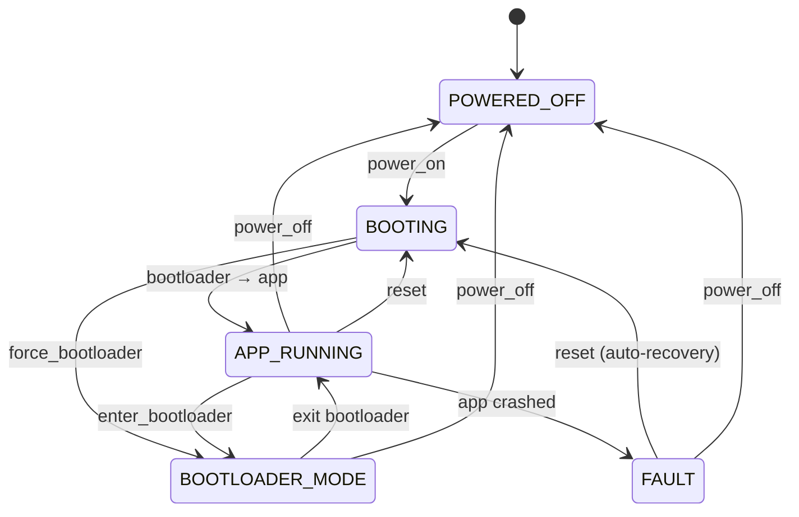

# ADR-004 — Supervisor as PMIC and reset controller

- **Date:** 2026-11-18
- **Status:** Accepted
- **Decision makers:** Project maintainer
- **Project context:** The device must be able to power on, power off, reset and enter bootloader mode in a controlled way that is observable from the dashboard.

> **Control channel:** the supervisor keeps a line-based TCP control channel
> on `SUPERVISOR_PORT` (5022, Docker private network/6PN); the orchestrator's
> public API remains REST/WS. The state machine includes `BOOTLOADER_MODE`,
> auto power-on when the container starts, `FAULT` with the exit code if the
> app dies, and factory reset by deleting `flash.bin` and reprovisioning from
> `FACTORY_APP`.

## Context

The firmware needs to model the full lifecycle of an embedded device:

- **Power ON:** start the device from scratch.
- **Power OFF:** power the device off in a controlled way (not just killing the process).
- **Reset:** restart the device, preserving the persistent state in flash.
- **Enter Bootloader:** boot directly into recovery mode, without running the application.
- **Factory Reset:** erase the persistent configuration and return to the factory state.

On a real MCU, these operations are controlled by a **PMIC** (Power Management IC) or a power management block of the SoC, together with a **reset controller**. The application firmware has no direct control over its own power.

Three ways of modeling this in POSIX were evaluated:

1. **Control from the orchestrator:** the backend sends signals directly to the firmware process.
2. **A supervisor as the container `ENTRYPOINT` process:** it manages the lifecycle of the firmware and the LED driver.
3. **A thread inside the firmware:** the firmware itself manages its "shutdown" and "restart" internally.

## Decision

**A supervisor as the container `ENTRYPOINT` process is chosen**, acting as PMIC + reset controller + boot manager.

The supervisor:

- Is the **first process** that starts in the container.
- Manages the lifecycle of the bootloader, the firmware and the LED driver as child processes.
- Exposes a control interface (WS) to the orchestrator to receive power/reset/bootloader commands.
- Publishes state transitions (`POWERED_OFF → BOOTING → APP_RUNNING`, etc.) to the orchestrator.
- Is the **only** one that can kill and relaunch processes.

## Alternatives considered

### Alternative A: Control from the orchestrator

**Advantages:**
- The orchestrator has total visibility of the lifecycle.
- There is no extra process inside the container.
- Less code in the ephemeral instance.

**Drawbacks:**
- **Couples the device lifecycle to the control plane:** if the orchestrator is suspended (scale-to-zero), it cannot manage power/reset.
- **Requires the orchestrator to have access to the firmware process,** which breaks isolation: the orchestrator should not be able to kill processes inside the instance.
- **Not faithful to real hardware:** on an MCU, the PMIC is local, not remote.
- **The `power off` command would require the orchestrator to send a signal to the container,** which adds complexity to the Fly.io API.

**Discarded because:** it breaks isolation between planes and couples the lifecycle to a service that may be suspended.

### Alternative B: A thread inside the firmware

**Advantages:**
- All the code lives in a single binary.
- There are no separate processes to coordinate.
- The firmware has full control of its own lifecycle.

**Drawbacks:**
- **Not faithful to real hardware:** an MCU cannot power itself off without an external PMIC.
- **The firmware cannot restart itself cleanly:** an `execve` from inside the firmware is possible, but the previous process cannot supervise the new one.
- **No supervision:** if the firmware crashes, nobody restarts it.
- **The LED driver shares a process with the firmware,** which breaks the separation of responsibilities (see ADR-005).
- **The `power off` command makes no sense:** the firmware cannot "power off" without killing the process, which leaves the container in an inconsistent state.

**Discarded because:** it breaks fidelity to hardware and the separation of responsibilities.

### Alternative C: Supervisor as the `ENTRYPOINT` process (chosen)

**Advantages:**
- **Faithful to real hardware:** the supervisor models the PMIC + reset controller, which are components local to the device.
- **Independent of the orchestrator:** the supervisor keeps working even if the orchestrator is suspended.
- **Supervision:** the supervisor detects the firmware's death with `waitpid` and decides whether to restart it (power cycle) or leave it off (power off).
- **Separation of responsibilities:** the supervisor manages the lifecycle; the firmware manages the business logic; the LED driver manages the LED control.
- **Access control:** only the supervisor can kill and relaunch processes, which reduces the attack surface.
- **Compatible with `execve`:** the supervisor `posix_spawn`s the bootloader, which `execve`s the app (see ADR-003).

**Drawbacks:**
- **An extra process inside the container:** it adds ~100 KB to the binary and ~1 MB of RAM.
- **Requires a control interface (WS) for the supervisor:** it cannot be a "dumb" process, it must listen for commands.
- **Requires coordinating the lifecycle with the orchestrator:** the supervisor must publish state transitions so the dashboard reflects them.
- **Signal complexity:** the supervisor must handle `SIGTERM`, `SIGCHLD` and `SIGINT` correctly.

**Chosen because:** it is the option that best preserves the properties of an MCU boot model: local PMIC, supervision, separation of responsibilities, independence from the control plane.

## Consequences

### Positive

- **Robust lifecycle:** the supervisor detects crashes and decides whether to restart (power cycle) or leave the device off (power off).
- **Independence from the orchestrator:** the instance keeps working even if the orchestrator is suspended.
- **Fidelity to hardware:** the local PMIC model is the same as in a real product.
- **Observability:** state transitions are published over WS and reflected in the Simulation Panel timeline.
- **Access control:** only the supervisor can kill processes, which reduces the attack surface.

### Negative

- **More code:** the supervisor is an additional component with its own signal logic and its own WS interface.
- **Larger attack surface:** the supervisor exposes a control WS that must authenticate with the same `device_token` as the firmware.
- **More complex debugging:** there are three processes (supervisor, firmware, LED driver) to coordinate; logs must be clearly labeled per component.
- **The supervisor must manage `flash.bin`:** it is the only one that can write the `force_bootloader` flag before launching the bootloader.

### Neutral

- **The supervisor is the container `ENTRYPOINT`:** if the supervisor dies, the container dies and Fly.io restarts it (or destroys it, if `auto_destroy` is active).
- **The LED driver is a child process of the supervisor:** its lifecycle is independent of the firmware, but the supervisor restarts it if it dies.
- **The supervisor has its own `device_token`:** the same as the firmware, to avoid duplicating token management.

## Implementation notes

### Supervisor control interface

The supervisor listens for commands over WS (`/ws/device`, same as the firmware):

| `op` | `payload` | Effect |
| :--- | :--- | :--- |
| `power_on` | `{}` | Starts the bootloader |
| `power_off` | `{}` | `SIGTERM` to the firmware, state `POWERED_OFF` |
| `reset` | `{}` | `SIGTERM` + `posix_spawn` of the bootloader |
| `enter_bootloader` | `{}` | Writes `force_bootloader = true`, `SIGTERM` + `posix_spawn` of the bootloader |
| `factory_reset` | `{confirm: true}` | Deletes `flash.bin`, recreates partitions, `posix_spawn` of the bootloader |

### Supervisor state machine



### Implementation

```c
// supervisor.c (skeleton)
int main() {
    init_ws_client();  // connects to the orchestrator
    while (1) {
        cmd = ws_receive_command();
        switch (cmd.op) {
            case OP_POWER_ON:
                spawn_bootloader();
                state = BOOTING;
                break;
            case OP_POWER_OFF:
                kill(firmware_pid, SIGTERM);
                waitpid(firmware_pid);
                state = POWERED_OFF;
                break;
            case OP_RESET:
                kill(firmware_pid, SIGTERM);
                waitpid(firmware_pid);
                spawn_bootloader();
                state = BOOTING;
                break;
            case OP_ENTER_BOOTLOADER:
                flash_write(META_FORCE_BOOTLOADER, 1);
                kill(firmware_pid, SIGTERM);
                waitpid(firmware_pid);
                spawn_bootloader();
                state = BOOTLOADER_MODE;
                break;
            case OP_FACTORY_RESET:
                kill(firmware_pid, SIGTERM);
                waitpid(firmware_pid);
                flash_factory_reset();
                spawn_bootloader();
                state = BOOTING;
                break;
        }
    }
}
```

- `spawn_bootloader()` uses `posix_spawn` (more portable than `fork`+`exec`).
- The `SIGCHLD` handler detects the firmware's death and transitions to `FAULT` or `POWERED_OFF` depending on the exit code.
- The `SIGTERM` handler kills all children and exits cleanly.

## References

- [`01-general-architecture.md`](../01-general-architecture.md) — section 3.1
- [`posix_spawn(3)` — Linux man pages](https://man7.org/linux/man-pages/man3/posix_spawn.3.html)
- [`waitpid(2)` — Linux man pages](https://man7.org/linux/man-pages/man2/waitpid.2.html)
- [`signal(7)` — Linux man pages](https://man7.org/linux/man-pages/man7/signal.7.html)
