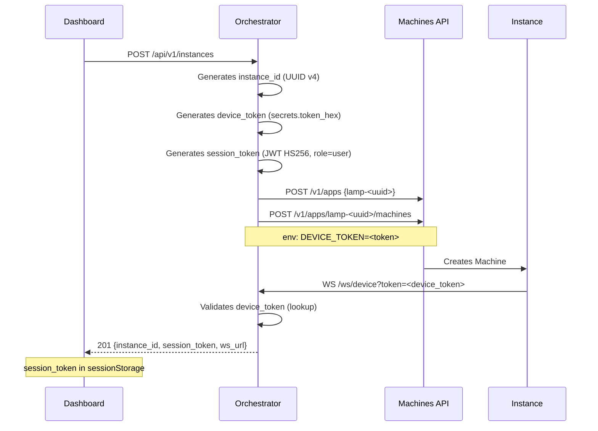
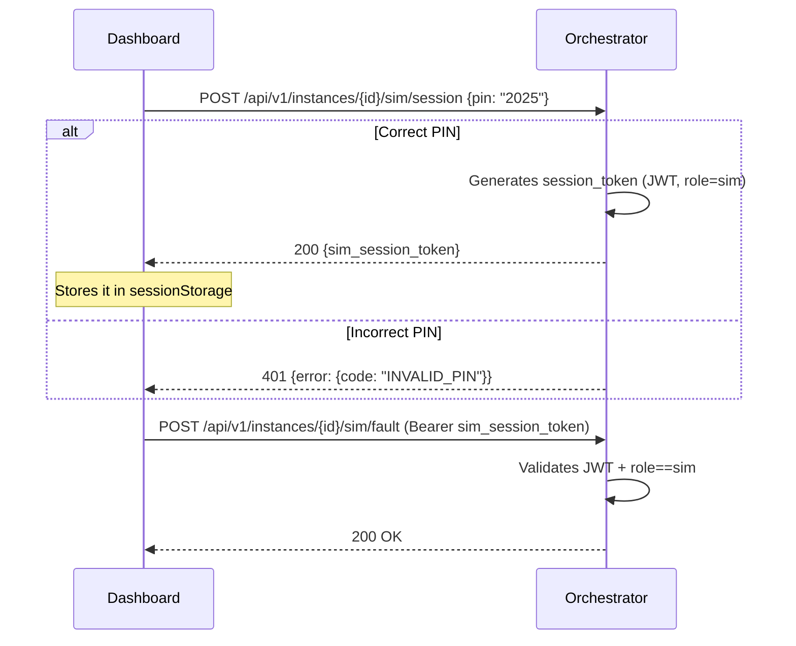
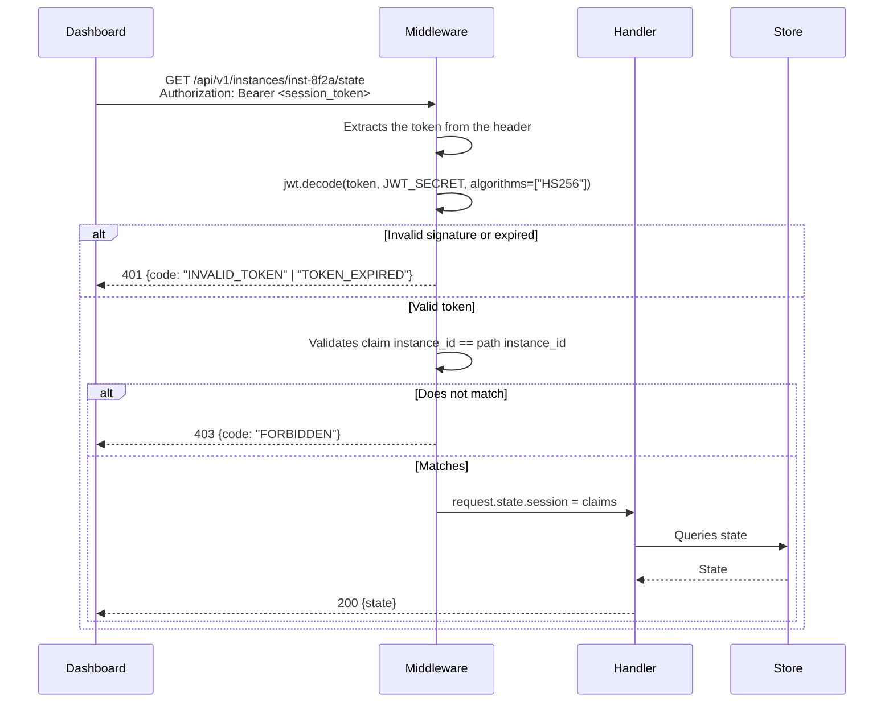
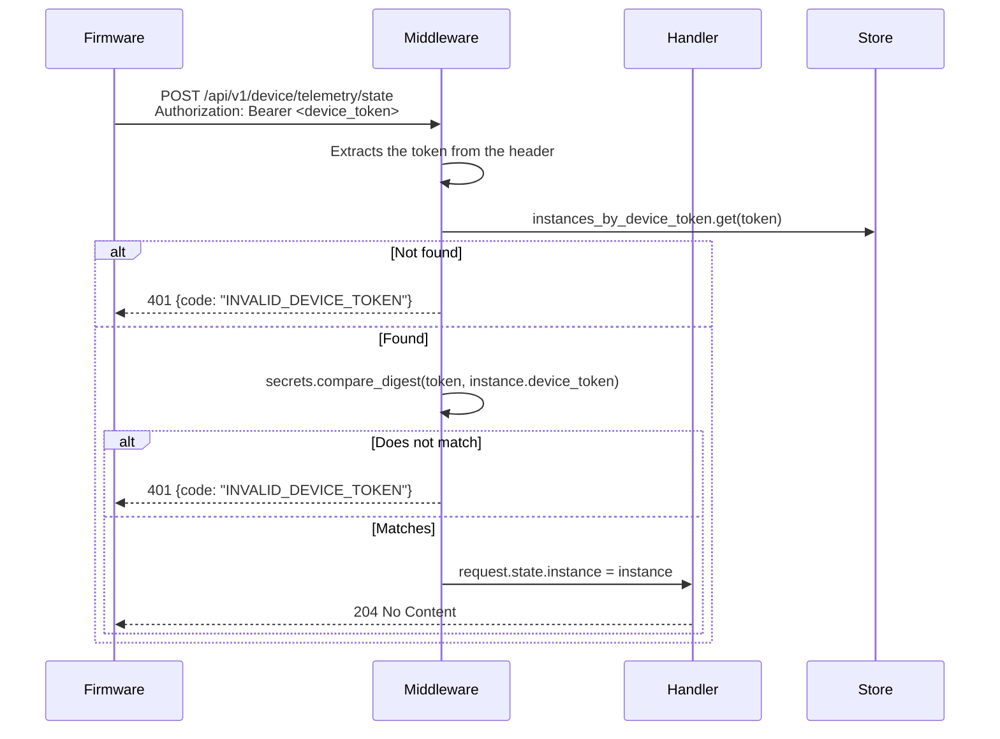

# Auth — Authentication and authorization

## 1. Purpose and scope

This document describes the demo's **authentication and authorization model**:

- **Who** can access **what** and **how**.
- The **tokens** used, their properties and their lifecycle.
- The **flows** for issuance, validation and revocation.
- The **implementations** in the backend (Python) and firmware (C).

**Out of scope:** the full threat model (see [`threat-model.md`](threat-model.md)) and the key policy (see [`key-management.md`](key-management.md)).

## 2. Principles

| Principle | Implication |
| :--- | :--- |
| **Each client, its own token** | JWT for the dashboard (browser), opaque token for the firmware (C) |
| **Least privilege** | A `session_token` only operates on its `instance_id` |
| **Separate surfaces** | `/api/v1/` (dashboard) vs. `/api/v1/device/` (firmware) |
| **Explicit roles** | `user` (operator) vs. `sim` (engineer/QA) |
| **Stateless where possible, stateful where necessary** | JWT for the dashboard (no lookup); table lookup for the firmware (immediate revocation) |
| **Fail closed** | No token → `401`; invalid token → `401`; no permission → `403` |
| **Do not leak information** | Generic errors (`INVALID_TOKEN`, not `TOKEN_EXPIRED_AT_...`) |

## 3. Token types

### 3.1 Summary

| Token | Client | Type | Size | TTL | Storage | Revocation |
| :--- | :--- | :--- | :--- | :--- | :--- | :--- |
| `session_token` | Dashboard | JWT HS256 | ~250-300 chars | 1 h | `sessionStorage` | On expiration |
| `device_token` | Firmware | Opaque hex | 64 chars | Instance lifetime | Orchestrator memory + env var | Immediate (remove from the map) |
| `sim_pin` | Sim Panel | Static PIN | 4 chars | Browser session | `sessionStorage` | N/A (it is a demo) |

### 3.2 `session_token` (JWT HS256)

**Structure:**

```text
header.payload.signature
```

**Header:**
```json
{ "alg": "HS256", "typ": "JWT" }
```

**Payload (claims):**
```json
{
  "sub": "session-abc123",
  "instance_id": "inst-8f2a",
  "role": "user",
  "iat": 1705312200,
  "exp": 1705315800,
  "jti": "550e8400-e29b-41d4-a716-446655440000"
}
```

| Claim | Type | Purpose |
| :--- | :--- | :--- |
| `sub` | string | Session identifier (for logs) |
| `instance_id` | string | Instance it operates on (validated on every request) |
| `role` | string | `"user"` or `"sim"` |
| `iat` | int | Issued at (Unix timestamp) |
| `exp` | int | Expires at (Unix timestamp, `iat + 3600`) |
| `jti` | string | UUID v4 for auditing and correlation |

**Signature:** HMAC-SHA256 with `JWT_SECRET` (≥32 bytes, in Fly Secrets).

**Validation:**
- Valid signature (HS256 with `JWT_SECRET`).
- `exp` > now.
- `iat` <= now (with 30 s tolerance for clock skew).
- `alg` == `HS256` (reject `none` and unexpected algorithms).
- `instance_id` == path `instance_id` (authorization).
- `role` == `sim` if the endpoint is `/sim/*` (authorization).

### 3.3 `device_token` (opaque)

**Generation:**
```python
import secrets
device_token = secrets.token_hex(32)  # 64 hex chars, 256 bits of entropy
```

**Storage:**
- In the orchestrator's memory: `instances_by_device_token: dict[str, Instance]`.
- In the ephemeral Machine: `DEVICE_TOKEN` environment variable.

**Validation:**
- Lookup in `instances_by_device_token`.
- Constant-time comparison with `secrets.compare_digest`.
- If the instance was destroyed, the token is no longer in the map → `401`.

**Advantages over JWT:**
- No parsing in C (the firmware only compares strings).
- Immediate revocation (remove from the map).
- 64 chars vs. ~300 for a JWT.

**Limitation:** stateful (requires a lookup). Acceptable because there is one entry per instance.

### 3.4 `sim_pin` (static PIN)

**Value:** `2025` (hardcoded, documented in the README and in the PIN hint).

**Purpose:** model the concept of a "protected interface" without implementing real auth. It is not security; it is minimal friction to prevent a casual visitor from entering the simulation panel by accident.

**Flow:**
1. The visitor clicks "Simulation mode (engineer)".
2. A modal asks for the PIN.
3. If the PIN is correct, the frontend requests a `session_token` with `role: sim` from the backend (`POST /instances/{id}/sim/session`).
4. The token is stored in `sessionStorage`.
5. All requests to `/sim/*` use that token.

**Note:** the PIN is validated in the **backend**, not in the frontend. The frontend never knows whether the PIN is correct until the backend responds.

## 4. Flows

### 4.1 Instance creation and token issuance



**Response `201`:**
```json
{
  "instance_id": "inst-8f2a",
  "created_at": "2026-11-18T10:30:00Z",
  "ttl_s": 3600,
  "session_token": "eyJhbGciOiJIUzI1NiIs...",
  "ws_dashboard_url": "wss://.../ws/dashboard?instance=inst-8f2a"
}
```

**The `device_token` does NOT appear in this response.** Only the orchestrator and the Machine know it.

### 4.2 Access to the Simulation Panel



**Note:** the `sim_session_token` is a normal JWT with `role: sim`. It has the same `instance_id` as the user's `session_token`, but elevated permissions.

### 4.3 Validation on every request (dashboard)



### 4.4 Validation on every request (firmware)



### 4.5 Revocation

| Token | How it is revoked | Effect |
| :--- | :--- | :--- |
| `session_token` | Expires via `exp` (1 h) or the instance is destroyed | The dashboard receives `401` and must restart the demo |
| `device_token` | The instance is destroyed (removed from the map) | The firmware receives `401` on the next request |
| `sim_pin` | The tab is closed (removed from `sessionStorage`) | The next access asks for the PIN again |

**There is no explicit revocation endpoint** for `session_token`. If one were needed (for example, "log out on all devices"), a `DELETE /instances/{id}/sessions` would be added that increments a version counter in the `jti` claim and validates it in the middleware. It is documented as a next step.

> **Implementation:** JWT **HS256** with the standard library
> (`hmac`/`hashlib`, no PyJWT); claims `instance_id`, `role` (`user`/`sim`),
> `iat` and `exp`. Both `Authorization: Bearer ...` and `X-Session-Token` are
> accepted. The simulation session is issued after validating the PIN (5
> attempts/min per IP). The dashboard WS uses an **ephemeral single-use ticket**
> (30 s) that the client exchanges with its JWT at
> `POST /instances/{id}/ws-ticket`; the JWT does not travel in the WS URL. The
> ticket does appear in the uvicorn logs, but it is invalidated on connect.
> `session` in the query string is kept as a fallback for tests/compatibility.
> `POST /instances/{id}/ota` is allowed for `user` and `sim`; the user dashboard
> has the update button.

## 5. Permission matrix

### 5.1 By role

| Endpoint | `role: user` | `role: sim` | `device_token` |
| :--- | :---: | :---: | :---: |
| `POST /instances` | ✅ | ✅ | ❌ |
| `GET /instances/{id}` (own) | ✅ | ✅ | ❌ |
| `DELETE /instances/{id}` (own) | ✅ | ✅ | ❌ |
| `POST /instances/{id}/heartbeat` | ✅ | ✅ | ❌ |
| `POST /instances/{id}/sim/power` | ❌ | ✅ | ❌ |
| `POST /instances/{id}/sim/bootloader` | ❌ | ✅ | ❌ |
| `POST /instances/{id}/sim/reboot` | ❌ | ✅ | ❌ |
| `POST /instances/{id}/sim/session` | ❌ | — | ❌ |
| `POST /instances/{id}/sim/fault` | ❌ | ✅ | ❌ |
| `POST /instances/{id}/sim/modbus/write` | ❌ | ✅ | ❌ |
| `GET /instances/{id}/sim/modbus/read` | ❌ | ✅ | ❌ |
| `GET /instances/{id}/sim/logs` | ❌ | ✅ | ❌ |
| `GET /instances/{id}/state` | ✅ | ✅ | ❌ |
| `POST /instances/{id}/ota` | ✅ | ✅ | ❌ |
| `POST /telemetry/health` | ❌ | ❌ | ✅ |
| `POST /telemetry/state` | ❌ | ❌ | ✅ |
| `POST /telemetry/events` | ❌ | ❌ | ✅ |
| `GET /ota/check` | ❌ | ❌ | ✅ |
| `GET /ota/{version}/download` | ❌ | ❌ | ✅ |
| `GET /commands/pending` | ❌ | ❌ | ✅ |
| `POST /commands/{id}/ack` | ❌ | ❌ | ✅ |
| `POST /commands/{id}/nack` | ❌ | ❌ | ✅ |

### 5.2 Instance ownership rule

**Every `session_token` (whether `user` or `sim`) can only operate on its own `instance_id`.** The `require_instance_owner` middleware validates:

```python
claims["instance_id"] == request.path_params["id"]
```

If they do not match → `403 FORBIDDEN`, **even if the role is `sim`**. This prevents a visitor with a valid PIN from injecting faults into another visitor's instance.

### 5.3 Separation of surfaces

| Prefix | Middleware | Client |
| :--- | :--- | :--- |
| `/api/v1/` | `require_session` (JWT) | Dashboard |
| `/api/v1/instances/{id}/sim/` | `require_session` + `require_sim_role` + `require_instance_owner` | Dashboard (role sim) |
| `/api/v1/device/` | `require_device` (lookup) | Firmware |
| `/ws/dashboard` | ephemeral ticket (JWT fallback) | Dashboard |
| `/ws/device` | `require_device` (query string) | Firmware |

## 6. Backend implementation (Python)

### 6.1 Configuration

```python
# backend/src/auth/config.py
import os

JWT_SECRET = os.environ["JWT_SECRET"]
JWT_ALGORITHM = "HS256"
JWT_TTL_SECONDS = 3600
SIM_PIN = os.environ.get("SIM_PIN", "2025")
```

### 6.2 Token issuance

```python
# backend/src/auth/tokens.py
import secrets, uuid
from datetime import datetime, timedelta, timezone
import jwt
from .config import JWT_SECRET, JWT_ALGORITHM, JWT_TTL_SECONDS

def issue_session_token(instance_id: str, role: str = "user") -> str:
    now = datetime.now(timezone.utc)
    return jwt.encode(
        {
            "sub": f"session-{uuid.uuid4().hex[:8]}",
            "instance_id": instance_id,
            "role": role,
            "iat": int(now.timestamp()),
            "exp": int((now + timedelta(seconds=JWT_TTL_SECONDS)).timestamp()),
            "jti": str(uuid.uuid4()),
        },
        JWT_SECRET,
        algorithm=JWT_ALGORITHM,
    )

def issue_device_token() -> str:
    return secrets.token_hex(32)
```

### 6.3 Middlewares

```python
# backend/src/auth/middleware.py
from fastapi import HTTPException, Request
from fastapi.responses import JSONResponse
import jwt
from .config import JWT_SECRET, JWT_ALGORITHM
from .store import instances_by_device_token

async def require_session(request: Request, call_next):
    auth = request.headers.get("Authorization", "")
    if not auth.startswith("Bearer "):
        return JSONResponse({"error": {"code": "UNAUTHORIZED"}}, status_code=401)
    token = auth.removeprefix("Bearer ")
    try:
        claims = jwt.decode(
            token, JWT_SECRET,
            algorithms=[JWT_ALGORITHM],
            options={"require": ["exp", "iat", "instance_id", "role"]},
        )
    except jwt.ExpiredSignatureError:
        return JSONResponse({"error": {"code": "TOKEN_EXPIRED"}}, status_code=401)
    except jwt.InvalidTokenError:
        return JSONResponse({"error": {"code": "INVALID_TOKEN"}}, status_code=401)
    request.state.session = claims
    return await call_next(request)

async def require_instance_owner(request: Request, call_next):
    claims = request.state.session
    path_id = request.path_params.get("id")
    if path_id and claims["instance_id"] != path_id:
        return JSONResponse({"error": {"code": "FORBIDDEN"}}, status_code=403)
    return await call_next(request)

async def require_sim_role(request: Request, call_next):
    if request.state.session["role"] != "sim":
        return JSONResponse({"error": {"code": "SIM_ONLY"}}, status_code=403)
    return await call_next(request)

async def require_device(request: Request, call_next):
    auth = request.headers.get("Authorization", "")
    if not auth.startswith("Bearer "):
        return JSONResponse({"error": {"code": "UNAUTHORIZED"}}, status_code=401)
    token = auth.removeprefix("Bearer ")
    instance = instances_by_device_token.get(token)
    if instance is None or not secrets.compare_digest(token, instance["device_token"]):
        return JSONResponse({"error": {"code": "INVALID_DEVICE_TOKEN"}}, status_code=401)
    request.state.instance = instance
    return await call_next(request)
```

### 6.4 Applying to routes

```python
# backend/src/main.py
from fastapi import FastAPI, Depends
from .auth.middleware import require_session, require_instance_owner, require_sim_role, require_device

app = FastAPI()

# Dashboard routes
app.include_router(dashboard_router, prefix="/api/v1",
                   dependencies=[Depends(require_session)])

# Sim panel routes (require role sim + ownership)
app.include_router(sim_router, prefix="/api/v1/instances/{id}/sim",
                   dependencies=[Depends(require_session),
                                 Depends(require_instance_owner),
                                 Depends(require_sim_role)])

# Firmware routes
app.include_router(device_router, prefix="/api/v1/device",
                   dependencies=[Depends(require_device)])
```

### 6.5 Per-token rate limiting

```python
# backend/src/auth/rate_limit.py
from collections import defaultdict
from time import time

class SlidingWindowLimiter:
    def __init__(self, max_requests: int, window_s: int):
        self.max = max_requests
        self.window = window_s
        self.requests = defaultdict(list)

    def check(self, key: str) -> bool:
        now = time()
        cutoff = now - self.window
        self.requests[key] = [t for t in self.requests[key] if t > cutoff]
        if len(self.requests[key]) >= self.max:
            return False
        self.requests[key].append(now)
        return True

# Usage
command_limiter = SlidingWindowLimiter(max_requests=50, window_s=1)

async def rate_limit_commands(request: Request, call_next):
    key = request.state.session["sub"]  # or request.state.instance["id"]
    if not command_limiter.check(key):
        return JSONResponse({"error": {"code": "RATE_LIMITED"}}, status_code=429)
    return await call_next(request)
```

## 7. Firmware implementation (C)

### 7.1 Handling the `device_token`

```c
// firmware/src/comms/auth.c
#include <string.h>

// Constant-time comparison to prevent timing attacks.
// The firmware does NOT parse JWTs: it only compares the opaque token.
int validate_device_token(const char *token, const char *expected) {
    if (token == NULL || expected == NULL) return -1;
    size_t len = strlen(token);
    if (len != strlen(expected)) return -1;
    unsigned char diff = 0;
    for (size_t i = 0; i < len; i++) {
        diff |= (unsigned char)(token[i] ^ expected[i]);
    }
    return diff == 0 ? 0 : -1;
}
```

### 7.2 Reading the token from the environment

```c
// firmware/src/comms/auth.c
#include <stdlib.h>

const char *get_device_token(void) {
    const char *token = getenv("DEVICE_TOKEN");
    if (token == NULL || strlen(token) != 64) {
        // Invalid or missing token: the firmware cannot authenticate.
        // The supervisor should have injected it; if not, it is a configuration error.
        return NULL;
    }
    return token;
}
```

### 7.3 Use in REST and WS requests

```c
// firmware/src/comms/rest_client.c
static int add_auth_header(struct curl_slist **headers, const char *token) {
    char header[128];
    snprintf(header, sizeof(header), "Authorization: Bearer %s", token);
    *headers = curl_slist_append(*headers, header);
    return *headers != NULL ? 0 : -1;
}
```

```c
// firmware/src/comms/ws_client.c
// The token is passed as a query string in the WS URL
char url[256];
snprintf(url, sizeof(url), "%s?token=%s", ORCH_WS_URL, device_token);
ws_connect(url);
```

### 7.4 What the firmware does NOT do

- **It does not parse JWTs:** it does not need `mbedtls` for authentication (it does for TLS).
- **It does not verify HMAC signatures:** the orchestrator is the only one that signs and verifies.
- **It does not store the token in flash:** it lives in the environment variable and is read at startup.
- **It does not rotate the token:** the token is valid for as long as the instance lives.

## 8. Errors and responses

### 8.1 Error codes

| HTTP | Code | When | Body |
| :---: | :--- | :--- | :--- |
| `401` | `UNAUTHORIZED` | Missing `Authorization` header | `{"error": {"code": "UNAUTHORIZED"}}` |
| `401` | `INVALID_TOKEN` | Malformed JWT or invalid signature | `{"error": {"code": "INVALID_TOKEN"}}` |
| `401` | `TOKEN_EXPIRED` | `exp` < now | `{"error": {"code": "TOKEN_EXPIRED"}}` |
| `401` | `INVALID_DEVICE_TOKEN` | Failed lookup or failed comparison | `{"error": {"code": "INVALID_DEVICE_TOKEN"}}` |
| `401` | `INVALID_PIN` | Incorrect sim panel PIN | `{"error": {"code": "INVALID_PIN"}}` |
| `403` | `FORBIDDEN` | `instance_id` does not match | `{"error": {"code": "FORBIDDEN"}}` |
| `403` | `SIM_ONLY` | `/sim/*` endpoint without `role: sim` | `{"error": {"code": "SIM_ONLY"}}` |
| `429` | `RATE_LIMITED` | Rate limit exceeded | `{"error": {"code": "RATE_LIMITED"}}` + `Retry-After` |

### 8.2 Do not leak information

**Bad:**
```json
{ "error": { "code": "TOKEN_EXPIRED_AT_2025_01_15_11_30_00" } }
```

**Good:**
```json
{ "error": { "code": "TOKEN_EXPIRED" } }
```

The client knows the token expired, but gets no information about the server clock or about other users' tokens.

### 8.3 Logging

- **Do log:** `instance_id`, `jti`, `sub`, `role`, `ts`, error code.
- **Do not log:** the full token, `JWT_SECRET`, the `device_token`, the PIN.
- **Redact:** `token=***` in debug logs.

## 9. Security considerations

### 9.1 Why HS256 and not RS256

- **HS256** (symmetric) is simpler: a single key (`JWT_SECRET`) signs and verifies.
- **RS256** (asymmetric) would require managing a key pair and distributing the public key to every verifier.
- For a demo with a single orchestrator, HS256 is enough.
- **Limitation:** if there are multiple services verifying tokens in the future, HS256 requires sharing the secret, which increases the attack surface. In that case, migrate to RS256 or ES256.

### 9.2 Why not `alg: none`

The middleware pins `algorithms=["HS256"]` in `jwt.decode`. PyJWT rejects tokens with `alg: none` or with an algorithm that is not listed. This prevents the classic "alg confusion" attack.

### 9.3 Why constant-time comparison

`secrets.compare_digest` (Python) and the XOR loop (C) prevent an attacker from measuring comparison time to guess the token byte by byte. In practice, with 64 hex chars (256 bits), the attack is infeasible even with a non-constant-time comparison, but it is good practice.

### 9.4 Why the `device_token` is not in the dashboard

If the dashboard could read the `device_token`, an XSS could steal it and impersonate the firmware. By keeping it only in the orchestrator and in the Machine, the dashboard never sees it.

### 9.5 Why the PIN is validated in the backend

If the frontend validated the PIN, anyone could bypass the validation by modifying the JS. By validating it in the backend, the PIN is a real (if weak) barrier against casual access.

### 9.6 Why `role: sim` does not exempt from `require_instance_owner`

A visitor with a valid PIN could try to inject faults into another instance. By requiring `require_instance_owner` **after** `require_sim_role`, it is guaranteed that even a `sim` only operates on its own instance.

### 9.7 Known limitations

| Limitation | Impact | Mitigation |
| :--- | :--- | :--- |
| JWT not revocable before `exp` | A stolen token is valid for up to 1 h | Short TTL; ephemeral instances |
| No refresh token | The user must restart the demo if the token expires | A 1 h TTL is enough for the demo |
| Hardcoded static PIN | Anyone who reads the README knows it | It is a demo; it models friction, not security |
| No mTLS | The `device_token` travels in the header/query | TLS covers transit; mTLS as a next step |
| No automatic `JWT_SECRET` rotation | Quarterly manual rotation | Documented in `key-management.md` |
| No persistent auditing | A past incident cannot be reconstructed | Fly.io logs (30 days) |

## 10. Next steps (out of scope for the demo)

| Improvement | Reason | Complexity |
| :--- | :--- | :--- |
| **Strict CSP** | Mitigate XSS in the dashboard | Low |
| **Refresh tokens** | Longer sessions without re-auth | Medium |
| **Explicit revocation** | Log out on all devices | Medium |
| **mTLS firmware↔backend** | Eliminate the cleartext `device_token` | High |
| **SSO in the sim panel** | Replace the static PIN | Medium |
| **Persistent auditing** | Reconstruct incidents | Medium |
| **RS256 / ES256** | Multiple verifiers | Medium |
| **Turnstile on `POST /instances`** | Anti-bot | Low |
| **Distributed rate limiting (Redis)** | Multiple orchestrators | Medium |
| **JWT with `kid`** | Zero-downtime key rotation | Medium |

## 11. References

- [`08-security-and-threat-model.md`](08-security-and-threat-model.md) — section 3
- [`threat-model.md`](threat-model.md) — full threat model
- [`key-management.md`](key-management.md) — key and secret management
- [`adr/adr-010-jwt-vs-opaque-token.md`](adr/adr-010-jwt-vs-opaque-token.md)
- [JWT (RFC 7519)](https://datatracker.ietf.org/doc/html/rfc7519)
- [JWT Best Current Practices (RFC 8725)](https://datatracker.ietf.org/doc/html/rfc8725)
- [PyJWT documentation](https://pyjwt.readthedocs.io/)
- [OWASP — Authentication Cheat Sheet](https://cheatsheetseries.owasp.org/cheatsheets/Authentication_Cheat_Sheet.html)
- [OWASP — Authorization Cheat Sheet](https://cheatsheetseries.owasp.org/cheatsheets/Authorization_Cheat_Sheet.html)
- [OWASP — Timing Attacks](https://owasp.org/www-community/attacks/Timing_Attack)
