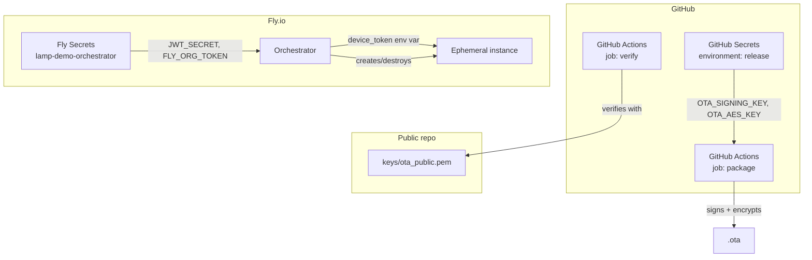
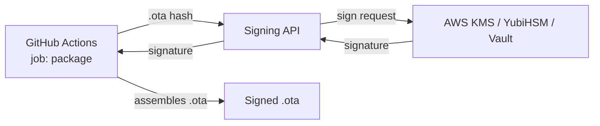

# Key Management — Keys and secrets management

## 1. Principles

| Principle | Implication |
| :--- | :--- |
| **Least privilege per job** | Only `package` accesses signing keys; `verify` only uses the public key |
| **Environment separation** | Development and production use different keys; they are never shared |
| **Keys outside the repo** | `.env`, `*.pem`, `*.key` are in `.gitignore`; only the public key is committed |
| **Documented rotation** | Every key has an explicit frequency and procedure |
| **Traceability** | Every secret has an owner, a purpose and a last-rotation date |
| **HSM as a goal, not an excuse** | GitHub Secrets is acceptable in the demo; the design allows migrating to an HSM without a refactor |

## 2. Inventory of keys and secrets

### 2.1 Cryptographic keys

| Name | Algorithm | Size | Purpose | Storage | Access |
| :--- | :--- | :--- | :--- | :--- | :--- |
| `OTA_SIGNING_KEY` | Ed25519 (private) | 32 B | Sign `.ota` images | GitHub Secrets (`release`) | `package` job |
| `OTA_PUBLIC_KEY` | Ed25519 (public) | 32 B | Verify `.ota` signatures | **Repo** (`keys/ota_public.pem`) | `verify` job, bootloader, driver |
| `OTA_AES_KEY` | AES-256 | 32 B | Encrypt the `.ota` payload | GitHub Secrets (`release`) | `package` job, bootloader |
| `JWT_SECRET` | HMAC-SHA256 | ≥32 B | Sign/verify `session_token` | Fly Secrets (orchestrator) | Orchestrator process |

### 2.2 Infrastructure tokens

| Name | Type | Purpose | Storage | Access | Rotation |
| :--- | :--- | :--- | :--- | :--- | :--- |
| `FLY_ORG_TOKEN` | Fly.io organization token | Create/destroy Apps and Machines | Fly Secrets (orchestrator) | Orchestrator process | Quarterly |
| `FLY_API_TOKEN` | Fly.io deploy token | `flyctl deploy` from CI | GitHub Secrets | `deploy-*` workflows | Quarterly |

### 2.3 Ephemeral tokens (do not persist)

| Name | Generation | Lifetime | Storage |
| :--- | :--- | :--- | :--- |
| `device_token` | `secrets.token_hex(32)` per instance | Instance lifetime | Orchestrator memory + Machine env var |
| `session_token` | JWT HS256 issued by `POST /instances` | 1 h | Browser `sessionStorage` |

### 2.4 Non-sensitive secrets (public by design)

| Name | Where it lives | Why it is public |
| :--- | :--- | :--- |
| Sim panel PIN (`2025`) | Source code | It is a demo; it models friction, not security |
| `OTA_PUBLIC_KEY` | Repo | Public keys are not secret by definition |
| `.ota` `magic` (`"LAMPOTA1"`) | Source code | Format identifier, not a secret |

## 3. Key generation

### 3.1 `OTA_SIGNING_KEY` and `OTA_PUBLIC_KEY` (Ed25519)

```bash
# Generate an Ed25519 key pair
python3 -c "
from nacl.signing import SigningKey
import binascii
sk = SigningKey.generate()
print('PRIVATE:', binascii.hexlify(bytes(sk)).decode())
print('PUBLIC: ', binascii.hexlify(bytes(sk.verify_key)).decode())
"
```

**Result:**
- The **private** key (64 hex chars) is stored in GitHub Secrets as `OTA_SIGNING_KEY`.
- The **public** key (64 hex chars) is stored in `keys/ota_public.pem` (PEM format) or as hex in the repo.

**Convert to PEM (for `verify_ota.py`):**

```bash
python3 -c "
import binascii
from nacl.signing import VerifyKey
from cryptography.hazmat.primitives import serialization
from cryptography.hazmat.primitives.asymmetric import ed25519

pub_hex = '<public_hex>'
pub_bytes = binascii.unhexlify(pub_hex)
pub = ed25519.Ed25519PublicKey.from_public_bytes(pub_bytes)
pem = pub.public_bytes(
    encoding=serialization.Encoding.PEM,
    format=serialization.PublicFormat.SubjectPublicKeyInfo,
)
open('keys/ota_public.pem', 'wb').write(pem)
"
```

### 3.2 `OTA_AES_KEY`

```bash
# 32 random bytes = 64 hex chars
python3 -c "import secrets; print(secrets.token_hex(32))"
```

Store it in GitHub Secrets as `OTA_AES_KEY`.

### 3.3 `JWT_SECRET`

```bash
python3 -c "import secrets; print(secrets.token_urlsafe(48))"
```

Store it in Fly Secrets:

```bash
fly secrets set JWT_SECRET="<valor>" --app lamp-demo-orchestrator
```

### 3.4 `FLY_ORG_TOKEN`

```bash
# Organization token (to create/destroy Apps)
fly tokens create org --name "lamp-demo-orchestrator"

# Store in Fly Secrets
fly secrets set FLY_ORG_TOKEN="<valor>" --app lamp-demo-orchestrator
```

### 3.5 `FLY_API_TOKEN` (for CI)

```bash
# Deploy token (limited to the project's Apps)
fly tokens create deploy --name "github-actions"
```

Store it in GitHub Secrets as `FLY_API_TOKEN`.

## 4. Distribution and access

### 4.1 Access diagram



### 4.2 Access rules

| Secret | Who can read it | Who cannot |
| :--- | :--- | :--- |
| `OTA_SIGNING_KEY` | `package` job (only with manual environment approval) | `verify` job, deploy jobs, fork PRs |
| `OTA_AES_KEY` | `package` job | `verify` job, deploy jobs |
| `OTA_PUBLIC_KEY` | Everyone (`verify` job, bootloader, anyone who clones the repo) | — |
| `JWT_SECRET` | Orchestrator process | Ephemeral instances, dashboard, firmware |
| `FLY_ORG_TOKEN` | Orchestrator process | Ephemeral instances, dashboard, firmware, CI |
| `FLY_API_TOKEN` | `deploy-*` workflows | Ephemeral instances, dashboard, firmware |

### 4.3 Configuring the `release` environment in GitHub

1. **Settings → Environments → New environment → `release`**
2. **Required reviewers:** add at least one reviewer (a second account or a collaborator).
3. **Wait timer:** 0 minutes (approval is immediate).
4. **Deployment branches:** only `main` and `v*` tags.
5. **Environment secrets:** add `OTA_SIGNING_KEY` and `OTA_AES_KEY` **here**, not in the repo secrets.

**Why:** a malicious workflow in a fork PR cannot access the secrets of the `release` environment without manual approval. This is the main defense against supply chain attacks in GitHub Actions.

## 5. Key rotation

### 5.1 `OTA_SIGNING_KEY` (Ed25519 private)

**Frequency:** yearly or on incident.

**Procedure:**

1. Generate a new Ed25519 key pair (see §3.1).
2. **Before rotating the private key**, the new public key must be in the bootloader of all deployed instances. This requires:
   - A firmware release that includes the new `OTA_PUBLIC_KEY` (with the old one still accepted, to allow rollback).
   - A transition period during which the bootloader accepts **both** public keys.
   - After confirming that all instances have the new key, retire the old one.
3. Update `OTA_SIGNING_KEY` in GitHub Secrets (`release` environment).
4. Update `keys/ota_public.pem` in the repo.
5. Issue a new `vX.Y.Z` release signed with the new key.

**Complexity:** high. In a real product, rotating the signing key is an event planned months in advance. In the demo, it is documented but not executed.

### 5.2 `OTA_AES_KEY`

**Frequency:** yearly or on incident.

**Procedure:**

1. Generate a new AES key (see §3.2).
2. As with signing, the new key must be in the bootloader before encrypting with it.
3. Transition period: the bootloader accepts **both** keys (try to decrypt with the new one, and fall back to the old one if that fails).
4. Update `OTA_AES_KEY` in GitHub Secrets.
5. Issue a new release encrypted with the new key.
6. After confirming, retire the old key from the bootloader.

**Complexity:** high. Same logic as the signing rotation.

### 5.3 `JWT_SECRET`

**Frequency:** quarterly.

**Procedure:**

1. Generate a new secret (see §3.3).
2. `fly secrets set JWT_SECRET="<nuevo>" --app lamp-demo-orchestrator`
3. Fly restarts the orchestrator Machine automatically.
4. **Effect:** all active sessions are invalidated (JWTs signed with the old secret no longer verify). Visitors with the dashboard open will see "session expired" and will have to restart the demo.

**Mitigation:** do it during low-traffic hours (or accept the interruption, since it is a demo).

### 5.4 `FLY_ORG_TOKEN`

**Frequency:** quarterly.

**Procedure:**

1. `fly tokens create org --name "lamp-demo-orchestrator-$(date +%Y%m%d)"`
2. `fly secrets set FLY_ORG_TOKEN="<nuevo>" --app lamp-demo-orchestrator`
3. Revoke the old token: `fly tokens revoke <token_id>`
4. Verify that the orchestrator still creates/destroys instances correctly.

### 5.5 `FLY_API_TOKEN` (CI)

**Frequency:** quarterly.

**Procedure:**

1. `fly tokens create deploy --name "github-actions-$(date +%Y%m%d)"`
2. Update `FLY_API_TOKEN` in GitHub Secrets.
3. Revoke the old token.
4. Verify that `deploy-orchestrator.yml` and `deploy-instance.yml` still work.

### 5.6 `device_token` and `session_token`

**They do not require manual rotation:** they are generated per instance and destroyed with it.

- `device_token`: generated in `POST /instances` and deleted when the instance is destroyed.
- `session_token`: expires via `exp` (1 h) or when the instance is destroyed.

## 6. HSM / KMS as a next step

### 6.1 Why GitHub Secrets is not enough in production

In the demo, `OTA_SIGNING_KEY` resides in GitHub Secrets. This is acceptable because:

- It is a public demo with no real data.
- The `release` environment requires manual approval.
- The impact of a compromise is low (signing malicious firmware for a demo).

In a real product, it should **never** be on a CI runner:

- A compromised runner would exfiltrate the key.
- A malicious workflow in a fork PR could try to access it (mitigated by the environment, but not impossible).
- There is no audit of when the key was used.

### 6.2 Alternative: remote signing via HSM / KMS

**Architecture:**



**Advantages:**

- The private key **never leaves** the HSM.
- Audit of every signing operation (who, when, which hash).
- Rotation managed by the HSM (without downtime).
- Compliance with FIPS 140-2 / Common Criteria.

**Implementation with AWS KMS:**

```python
import boto3

def sign_ota(ota_hash: bytes) -> bytes:
    kms = boto3.client("kms")
    response = kms.sign(
        KeyId="arn:aws:kms:us-east-1:123456789:key/abc-123",
        Message=ota_hash,
        MessageType="DIGEST",
        SigningAlgorithm="ECDSA_SHA_256",  # or ED25519 if the KMS supports it
    )
    return response["Signature"]
```

**Note:** AWS KMS does not support Ed25519 natively (it supports ECDSA and RSA). For Ed25519, you would use a dedicated HSM (YubiHSM 2) or a service such as Vault with the transit engine.

### 6.3 How the current design makes migration easier

The pipeline is designed with an isolated `package` step. Migrating to remote signing is a localized change in `tools/package_ota.py`:

```python
# Before (demo)
signature = SigningKey(signing_key).sign(message).signature

# After (production)
signature = kms_sign(hashlib.sha256(message).digest())
```

The rest of the pipeline (`verify`, `release`, bootloader) **does not change**.

## 7. Antipatterns (what NOT to do)

| Antipattern | Why it is bad | Alternative |
| :--- | :--- | :--- |
| **Committing `.env` or private `*.pem` files** | Permanent exposure in the Git history | `.gitignore` + secrets manager |
| **Hardcoding keys in the code** | Same exposure, harder to rotate | Environment variables + secrets |
| **Using the same key for dev and prod** | A compromise in dev exposes prod | Separate keys per environment |
| **Passing secrets as CLI arguments** | Visible in `ps` and in shell logs | Environment variables or stdin |
| **Logging tokens in clear text** | Visible in Fly.io and orchestrator logs | Redact in logs (`token=***`) |
| **Reusing AES-GCM nonces** | Breaks confidentiality completely | `os.urandom(12)` for every packaging operation |
| **Storing `device_token` in the dashboard** | Exposes the firmware token to the browser | Only the orchestrator and the Machine know it |
| **Using `memcmp` to compare tokens** | Timing attack (although the risk is low) | `secrets.compare_digest` or a constant-time loop |
| **Rotating keys without a transition period** | Breaks deployed instances | Accept both keys during the transition |
| **RSA-based signing** | Slower, bigger, more obsolete | Ed25519 |

## 8. Key management checklist

### 8.1 Initial setup

- [ ] Generate `OTA_SIGNING_KEY` and `OTA_PUBLIC_KEY` (Ed25519)
- [ ] Generate `OTA_AES_KEY` (AES-256)
- [ ] Generate `JWT_SECRET` (HMAC-SHA256)
- [ ] Create `FLY_ORG_TOKEN` (organization)
- [ ] Create `FLY_API_TOKEN` (CI deploy)
- [ ] Configure the `release` environment in GitHub with required reviewers
- [ ] Add `OTA_SIGNING_KEY` and `OTA_AES_KEY` to the `release` environment
- [ ] Add `FLY_API_TOKEN` to the repo secrets
- [ ] Add `JWT_SECRET` and `FLY_ORG_TOKEN` to Fly Secrets
- [ ] Commit `keys/ota_public.pem` (public)
- [ ] Verify `.gitignore` includes `.env`, `*.key`, `*.pem` (except `ota_public.pem`)

### 8.2 Pre-release

- [ ] `OTA_SIGNING_KEY` and `OTA_AES_KEY` are in the `release` environment, not in the repo
- [ ] `verify_ota.py` passes with the repo's public key
- [ ] The generated `.ota` can be verified and decrypted
- [ ] The `package` job logs do not expose the keys (check the output)
- [ ] The `.ota` is signed with the correct key (verify with `verify_ota.py`)

### 8.3 Post-release

- [ ] The `.ota` is in GitHub Releases and on Pages
- [ ] The firmware can download it and verify it
- [ ] The bootloader accepts the `.ota` and applies the update
- [ ] A corrupted `.ota` is rejected without switching slots
- [ ] Rollback works when a pending app does not confirm
- [ ] The Fly.io logs do not expose `JWT_SECRET` or `FLY_ORG_TOKEN`

### 8.4 Periodic rotation

- [ ] `JWT_SECRET` rotated within the last 90 days
- [ ] `FLY_ORG_TOKEN` rotated within the last 90 days
- [ ] `FLY_API_TOKEN` rotated within the last 90 days
- [ ] `OTA_SIGNING_KEY` rotated within the last 365 days (or justified)
- [ ] `OTA_AES_KEY` rotated within the last 365 days (or justified)
- [ ] Old tokens revoked

## 9. Handling secrets in local development

### 9.1 `.env` for development

```bash
# .env (do NOT commit)
JWT_SECRET=dev-secret-do-not-use-in-prod
FLY_ORG_TOKEN=dev-token
OTA_AES_KEY=dev-aes-key-64-hex-chars
OTA_SIGNING_KEY=dev-signing-key-64-hex-chars
INSECURE=true  # allows http:// and ws:// locally
```

### 9.2 `.env.example` (do commit)

```bash
# .env.example
JWT_SECRET=<generate with: python3 -c "import secrets; print(secrets.token_urlsafe(48))">
FLY_ORG_TOKEN=<generate with: fly tokens create org>
OTA_AES_KEY=<generate with: python3 -c "import secrets; print(secrets.token_hex(32))">
OTA_SIGNING_KEY=<generate with: see docs/key-management.md §3.1>
INSECURE=false
```

### 9.3 `.gitignore`

```gitignore
# Secrets
.env
.env.*
!.env.example
*.key
*.pem
!keys/ota_public.pem

# Build
build/
dist/
*.o
*.elf
*.bin
!docs/firmware/**/*.ota

# IDE
.vscode/
.idea/
```

## 10. Audit and traceability

### 10.1 What is audited

| Event | Where it is recorded | Retention |
| :--- | :--- | :--- |
| Use of `OTA_SIGNING_KEY` | GitHub Actions logs (`package` job) | 90 days |
| Creation of `FLY_ORG_TOKEN` | Fly.io audit log | 30 days (free tier) |
| Use of `FLY_ORG_TOKEN` | Fly.io audit log + orchestrator logs | 30 days |
| Issuance of `session_token` | Orchestrator logs (with `jti`) | Instance lifetime |
| Issuance of `device_token` | Orchestrator logs (redacted) | Instance lifetime |
| Key rotation | `docs/key-management.md` (manual changelog) | Permanent |

### 10.2 Rotation changelog

Keep a record in this same document:

```markdown
## Rotation changelog

| Date | Key | Reason | Owner |
| :--- | :--- | :--- | :--- |
| 2026-11-18 | (initial) | Initial setup | Maintainer |
| 2027-02-18 | JWT_SECRET | Quarterly rotation | Maintainer |
| 2027-02-18 | FLY_ORG_TOKEN | Quarterly rotation | Maintainer |
```

## 11. Deliverables of this area

- `docs/key-management.md` (this document)
- `docs/threat-model.md` — full threat model
- `docs/auth.md` — permission matrix and token flow
- `.env.example` — environment variable template
- `.gitignore` — with rules for secrets
- `keys/ota_public.pem` — Ed25519 public key
- `tools/generate_keys.sh` — script to generate all the keys (with instructions)

## 12. References

- [`04-ota-and-image-security.md`](04-ota-and-image-security.md) — section 6
- [`05-ci-cd.md`](05-ci-cd.md) — section 8
- [`08-security-and-threat-model.md`](08-security-and-threat-model.md) — section 5
- [`adr/adr-009-ed25519-aes-gcm.md`](adr/adr-009-ed25519-aes-gcm.md)
- [`adr/adr-010-jwt-vs-opaque-token.md`](adr/adr-010-jwt-vs-opaque-token.md)
- [GitHub Actions — Encrypted secrets](https://docs.github.com/en/actions/security-guides/encrypted-secrets)
- [GitHub Actions — Environments](https://docs.github.com/en/actions/deployment/targeting-different-environments/using-environments-for-deployment)
- [Fly.io — Secrets](https://fly.io/docs/reference/secrets/)
- [Fly.io — Tokens](https://fly.io/docs/reference/tokens/)
- [AWS KMS — Sign](https://docs.aws.amazon.com/kms/latest/APIReference/API_Sign.html)
- [YubiHSM 2](https://www.yubico.com/products/hardware-security-module/)
- [OWASP — Secrets Management Cheat Sheet](https://cheatsheetseries.owasp.org/cheatsheets/Secrets_Management_Cheat_Sheet.html)
