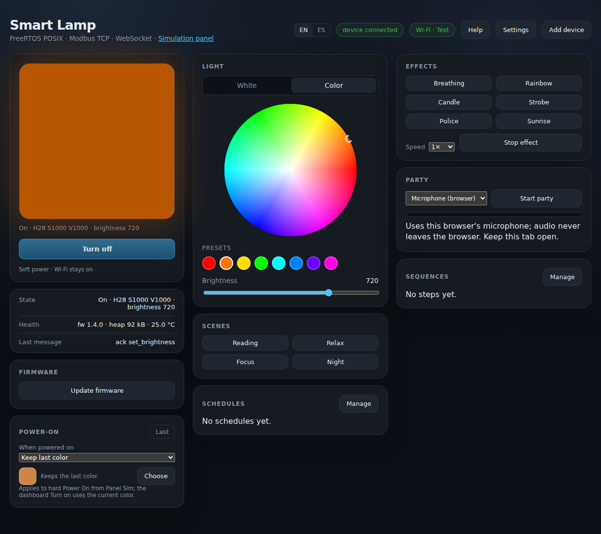

# Dashboard

The dashboard is the normal usage view. It is organized into three zones:

- **Light:** state, power, color/white, brightness.
- **Scenes and schedules:** quick actions and scheduling.
- **Effects, party, sequences:** automation and ambience.

## Turning on and off

1. Press `Turn on` or `Turn off` below the large swatch.
2. The text underneath says `Soft power · Wi-Fi stays on`: a soft power off does
   not cut the network.
3. If the lamp is in a latched fault, the button appears locked; clear the fault
   first ([Faults](06-faults.md)).

## Changing the color

1. Under `LIGHT`, choose `Color`.
2. Tap the HSV wheel or a preset.
3. Adjust `Brightness` (0–1000).
4. The large swatch shows the real state; during a transition it may lag behind
   the requested value.

To go back to white:

1. Choose `White`.
2. Move `Color temperature` between 2000 K (warm) and 6500 K (cool).
3. If `Adaptive white` is active, the color changes with the time of day; manual
   control suspends it until you press `Resume` or the window passes.

## Scenes

Under `SCENES` there are four shortcuts:

- `Reading`: reading white.
- `Relax`: warm, soft tone.
- `Focus`: cooler white.
- `Night`: low light and warm temperature.

A scene turns the lamp on, changes the mode and applies color/temperature and
brightness. It does not create a schedule; for that, use [Schedules](05-schedules.md).

## Effects

Under `EFFECTS` you can start `Breathing`, `Rainbow`, `Candle`, `Strobe`,
`Police` or `Sunrise`. `Speed` controls the speed. `Stop effect` stops the
effect and returns to the manual state.

## Power-on

The `POWER-ON` card decides what happens when the device starts:

- `Keep last color`: keeps the last color.
- `Default warm`: 3000 K at 70 %.
- `Custom color`: color/CCT and brightness chosen with `Choose`.

It is applied once when a fresh instance connects (auto-start) and on a **hard
Power On** from the Sim panel. An explicit `Power Off` in the Sim panel is
respected. The dashboard's soft `Turn on` does **not** apply this policy; it
keeps the current state.

## Firmware update

`Update firmware` asks the backend for the latest `.ota`:

- If there is no artifact, it says so.
- If the current version is already up to date, it does not restart the lamp.
- If a newer artifact exists, it sends the OTA and shows `accepted` or
  `rejected`.

For modes (`Legit`, `Corrupt`, `Downgrade`) and the current slot, use the
Simulation Panel → Firmware. See [OTA and slots](07-ota-slots.md).

## Settings

The `Settings` button opens two maintenance actions:

- `Reset dashboard`: clears sequences, adaptive white, party mode, schedules,
  power-on and history. It does not erase the device flash.
- `Clear fault history`: clears only the fault history.

## Why controls get locked

The dashboard locks the controls when:

- the backend is unavailable;
- the firmware is disconnected;
- the instance is in pairing/connecting;
- there is a critical fault or configuration safe mode.

Check the banner and the network badge before assuming it's a bug.

[Back to the manual](README.md) · [Pairing](02-pairing.md)
