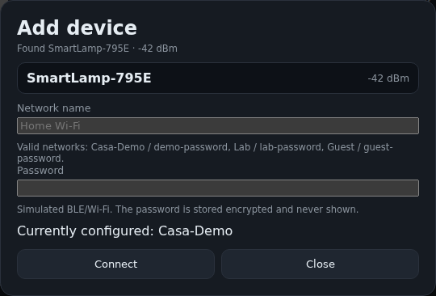

# Pairing

The demo pairing is **simulated**, but it follows the flow of a real lamp: you
have to power it off and on several times, and the dashboard can only scan.

> A new instance usually starts already connected to `Casa-Demo`. You only need
> to pair if you've used `Forget Wi-Fi & pair`, if you're on `No Wi-Fi`, or if
> you want to try the full flow.

## Before you start

- Use **Power Off / Power On** in the **Sim panel → Device**, not the dashboard's
  `Turn off`. The dashboard power off is soft and does not count.
- Wait for the Sim panel to show `APP_RUNNING` after each Power On.
- Keep the dashboard open in another tab.

## 3-cycle flow

1. In the Sim panel, press `Power Off`.
2. Wait between **1 and 10 seconds** (5–10 recommended).
3. Press `Power On` and wait for `APP_RUNNING`.
4. Repeat the cycle up to **3 times**.
5. On the third power-on, the lamp enters pairing and blinks white.
6. In the dashboard, press `Add device`.
7. Choose `SmartLamp-XXXX` and press `Connect`.
8. Enter the SSID and password, or choose a network from the list.

The whole cycle must fit within **2 minutes**. If you go over, the counter resets.

`XXXX` in the pairing list is the last four alphanumeric characters of the
device serial (for example `8ED1` for serial `SL-1-LA-2647-64508ED1`). Until the
first health report arrives, the dashboard temporarily shows the instance id.

## What each state means

| State | Meaning |
| :--- | :--- |
| `No Wi-Fi` | No network configured; controls are locked |
| `Pairing` | The lamp is advertising; the dashboard can scan |
| `Connecting` | SSID/password are being validated |
| `Wi-Fi · SSID` | Network connected; controls available |

`Add device` does **not force** pairing: it only scans. If nothing appears, the
device is not in pairing mode.

## Canceling or exiting

- Press `Cancel pairing` in Sim panel → Network.
- Or do a fourth `Power Off/On` cycle; it exits pairing and restores the previous
  light.
- `Forget Wi-Fi & pair` forgets the network and enters pairing; use it only if
  you want to start from scratch.

## Demo credentials

| Network | Password |
| :--- | :--- |
| `Casa-Demo` | `demo-password` |
| `Lab` | `lab-password` |
| `Guest` | `guest-password` |

The password is stored encrypted in the backend and is never shown or sent to the
firmware. In Sim panel → Network you can edit the whitelist, enable `Allow any`
and simulate errors.

## Typical errors

- **The device does not appear:** it's not in pairing, or you used soft power.
- **Wrong password:** check the credential or the simulated `wrong password`
  fault in Network.
- **Unknown network:** add it to the whitelist or enable `Allow any`.
- **Timeout:** try again; the `timeout` fault is simulated.
- **One cycle too many:** you exit pairing; repeat the 3 cycles.

## After pairing

The dashboard should show `Wi-Fi · SSID` and `device connected`. If not, wait a
few seconds and check [Common issues](09-troubleshooting.md).

[Back to the manual](README.md) · [Dashboard](01-dashboard.md)
