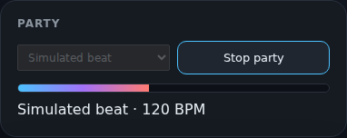

# Scenes, effects and party mode

## Scenes

Scenes are prepared combinations of color, temperature and brightness.

1. Under `SCENES`, press `Reading`, `Relax`, `Focus` or `Night`.
2. The lamp turns on and applies the scene.
3. To go back to a manual color, choose `Color` or `White` under `LIGHT`.

Scenes can also be used as the action of a schedule
([Schedules](05-schedules.md)).

## Effects

Effects are run by the LED driver and controlled over Modbus.

1. Under `EFFECTS`, choose `Breathing`, `Rainbow`, `Candle`, `Strobe`, `Police` or
   `Sunrise`.
2. Adjust `Speed` (0.5×–2×).
3. Press `Stop effect` to stop it.

If you change the color or brightness manually, the effect stops and you return to
normal mode.

`Sunrise` is a sunrise effect; to schedule it at a specific time, use a schedule
with the `Sunrise` action and a duration of 15–45 minutes.

## Party mode

1. Under `PARTY`, choose `Microphone (browser)` or `Simulated beat`.
2. Press `Start party`.
3. The meter shows the level; color and brightness change with the beat.
4. Press `Stop party` to finish.

With a microphone:

- The browser asks for permission. If it's denied, use the simulated beat.
- Audio is analyzed **in the browser**; it is not uploaded to the backend.
- Only color and brightness travel over WebSocket.
- The tab must stay open.

With `Simulated beat` you don't need a microphone, which is handy for recording
the demo without depending on permissions.

## When to use each one

| I need… | I use |
| :--- | :--- |
| A specific light | `Color` or `White` |
| Quick ambience | `SCENES` |
| Continuous animation | `EFFECTS` |
| Reacting to music | `PARTY` with a microphone |
| My own sequence of steps | [Sequences](04-sequences.md) |
| A change at a set time | [Schedules](05-schedules.md) |

[Back to the manual](README.md) · [Sequences](04-sequences.md)
