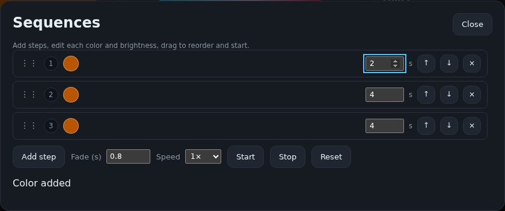
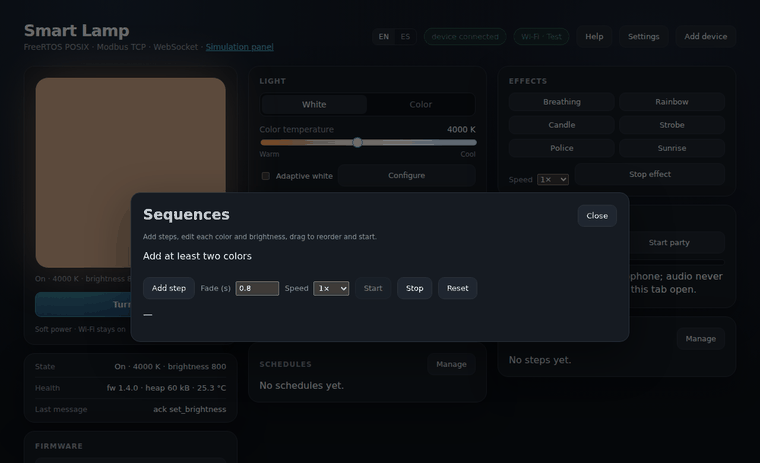

# Sequences

A sequence is a list of color steps that run in order. It is saved in the
**browser**, not in the device flash.

## Opening the editor

1. Under `SEQUENCES`, press `Manage`.
2. The editor shows the current steps or `No steps yet`.
3. `Add step` adds a step with the lamp's current color.

You can have up to **8 steps**.

## Editing a step

Each row has:

- a badge with the step number;
- a color swatch;
- the duration in seconds;
- `↑`/`↓` and `×` arrows.

### Color and brightness

1. Press the step's circular swatch.
2. Choose `Color` or `White`.
3. Adjust the color/CCT and brightness in the picker.
4. Press `Apply`.

The swatch reflects the intensity: low brightness looks dimmer. **There is no
second brightness field in the row**; the only source of truth is the color
picker.

### Duration and order

- Change the number of seconds for the step.
- Drag the `⋮⋮` handle to reorder.
- Or use `↑`/`↓` for keyboard and mobile.
- `×` deletes the step.

## Running it

1. Adjust `Fade (s)` (transition between steps, 0.8 s by default).
2. Choose `Speed` (0.5×–2×).
3. Press `Start`.
4. `Stop` stops the sequence.

`Start` uploads the sequence to the driver over Modbus with CRC-16 and sends
`start_sequence` to the firmware. If the control is locked by network or a fault,
the button does not respond; check the banner.

## Reset

`Reset` removes all steps and returns to `Fade 0.8` / `Speed 1×`. It asks for
confirmation and does not affect the lamp or the schedules.

## Where it is stored

- In the browser's `localStorage`.
- It is not synced between browsers and not saved to flash.
- `Settings → Reset dashboard` also deletes it.

## Typical errors

- **It does not start:** you need at least 2 steps.
- **The color does not change:** the step may be set to `White`; check the picker.
- **It stops when I change the brightness:** that's normal; manual control cancels
  the sequence.
- **It disappeared:** you switched browsers, cleared data or reset the dashboard.

[Back to the manual](README.md) · [Schedules](05-schedules.md)
