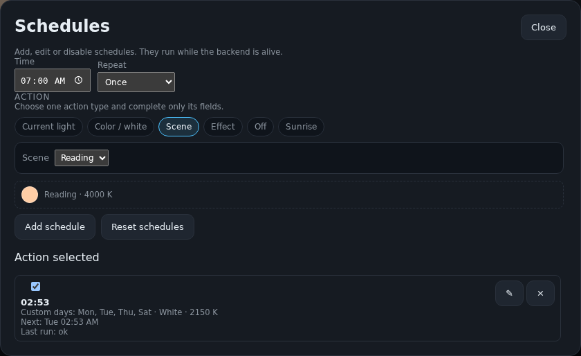

# Schedules

A schedule runs an action at a specific time. Schedules live in the **backend**
and run while the orchestrator is awake.

## Creating a schedule

1. Under `SCHEDULES`, press `Manage`.
2. Choose the time and the repeat type:
   - `Once`
   - `Every day`
   - `Weekdays`
   - `Weekends`
   - `Custom days`
3. If you choose `Custom days`, check the days.
4. Build the action:
   - `Current`: captures the current light.
   - `Off`: turns it off.
   - `Color / white`: color, CCT and brightness.
   - `Scene`: an existing scene.
   - `Effect`: an effect and its speed.
   - `Sunrise`: gradual sunrise over 15, 30 or 45 minutes.
5. Press `Add schedule`.

The card shows the summary and the next run. The time zone is shown in the editor
(`Times use ...`).

## Editing, enabling or deleting

- Check/uncheck the checkbox to enable or disable without deleting.
- Press the pencil to edit.
- Press `×` to delete.
- `Reset schedules` deletes all schedules for the instance and asks for
  confirmation.

## Sunrise

`Sunrise` is not just “turn on”: it ramps temperature/brightness over 15–45
minutes. It can be combined with a time and a repeat type.

## Where they are stored

- In the backend's SQLite (`/data/schedules.db` in compose).
- On Fly you need a `/data` volume so they survive a redeploy.
- A Sim panel factory reset deletes them.

## If they do not run

- The orchestrator must be awake; on Fly it is configured not to suspend.
- Check that the schedule is enabled and that the time/zone are correct.
- If the device is in pairing/connecting, the action may not be applied.
- After a factory reset, create them again.

## Example: reading light at 07:00

1. `Manage → Time 07:00`.
2. `Every day`.
3. Choose `Scene`, then `Reading`.
4. `Add schedule`.
5. Verify that the summary says `Next: ...`.

[Back to the manual](README.md) · [Faults](06-faults.md)
