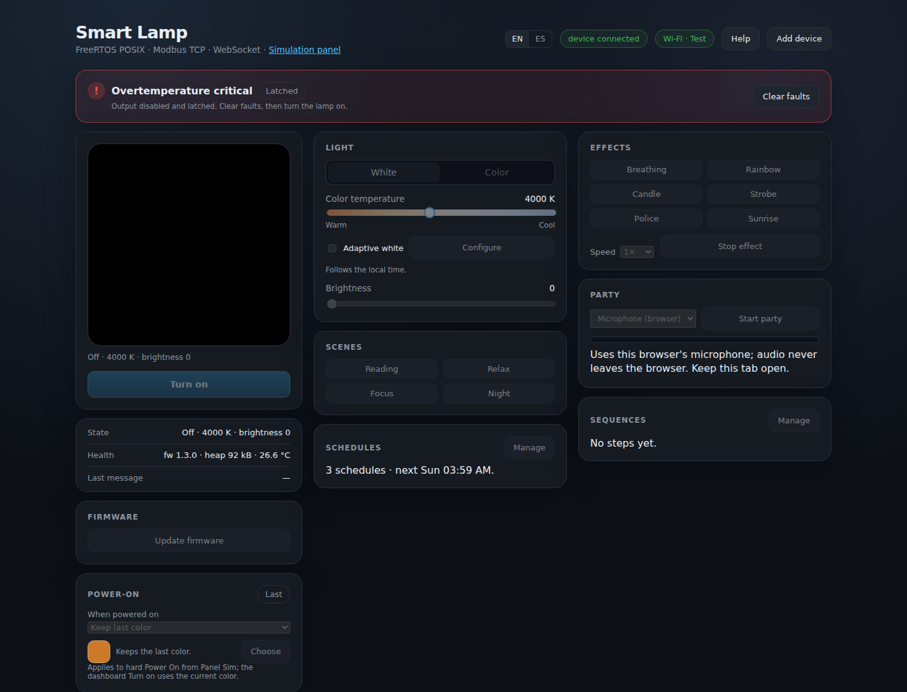
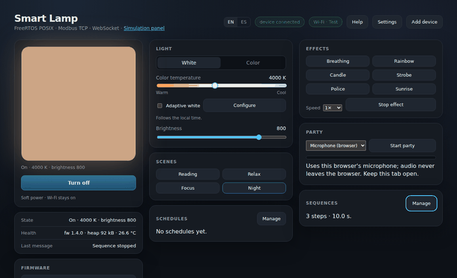

# Faults and recovery

The demo has faults with real effects, not just diagnostic codes.

## Overtemperature warning

- Code `1`.
- The driver limits brightness to **50 %**.
- It does not latch.
- When the condition disappears, brightness returns to the target.
- The dashboard shows an amber banner; controls remain available.

## Critical fault, overcurrent or open LED

- Codes `2`, `3` and `4`.
- The output turns off, the sequence stops and the fault stays **latched**.
- `POWER_ON`, `APPLY_TARGET`, `START_SEQUENCE` and `LOAD_CONFIG` are blocked.
- The dashboard shows `Latched` and disables the controls.
- Pressing `Turn on` while latched does not turn the lamp on.

## How to recover

1. Remove the cause or withdraw the injection in Sim panel → Faults.
2. Press `Clear faults` in the dashboard or `Clear faults` in the Sim panel.
3. The lamp **stays off**; clearing does not turn it on.
4. Press `Turn on` manually.

The first critical code is preserved until the clear. Simulated faults also
increment the diagnostic counter.

## Corrupt configuration (safe mode)

- Code `5`; discrete `STATUS_CONFIG_SAFE_MODE`.
- The driver applies safe defaults, turns the output off and blocks
  save/load/power.
- Clearing the fault exits the mode, but the file stays corrupt until you save a
  valid configuration or do a factory reset.
- The dashboard shows the `Safe mode` badge.

## Lost heartbeat

- Code `7`.
- The driver turns the output off and saves the target.
- When the firmware writes the heartbeat again, it restores the target unless
  there is a latch or safe mode.
- In the Sim panel you can inject it or stop the firmware to see it.

## History

Sim panel → Faults shows a table with:

- time,
- origin (`Firmware`, `Injected`, `User`),
- fault,
- code,
- severity,
- effect.

`Clear history` deletes only fault events; it keeps the rest of the log.
`Factory reset` also clears schedules, power-on, flash and history.

## Dashboard Settings

`Settings` allows you to:

- `Reset dashboard`: sequences, adaptive white, party mode, schedules, power-on
  and history.
- `Clear fault history`: only the history.

Neither one does a factory reset of the lamp.

## UI signals

| Signal | Meaning |
| :--- | :--- |
| Amber banner | Warning; the lamp keeps working with derate |
| Red banner + `Latched` | Critical fault; you have to clear it |
| `Safe mode` | Corrupt configuration; defaults active |
| `device disconnected` | Firmware/backend down |
| Gray controls | Network, pairing or fault |

[Back to the manual](README.md) · [OTA and slots](07-ota-slots.md)
