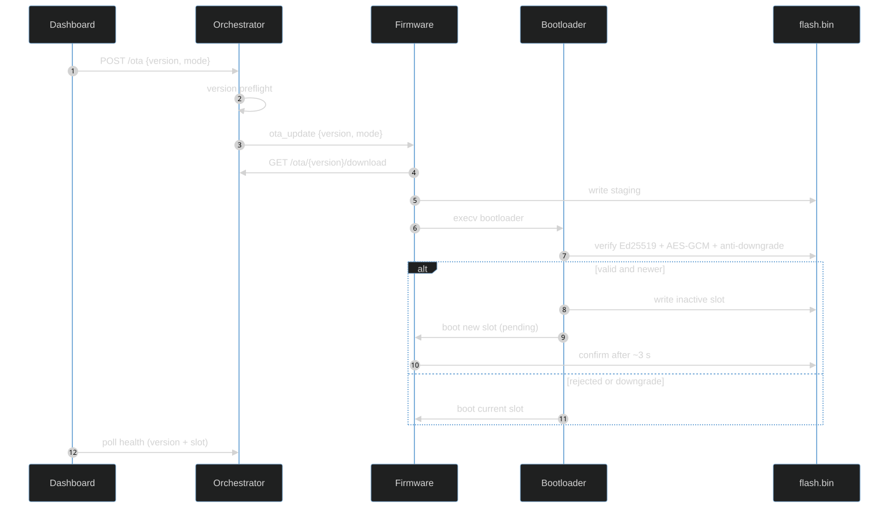
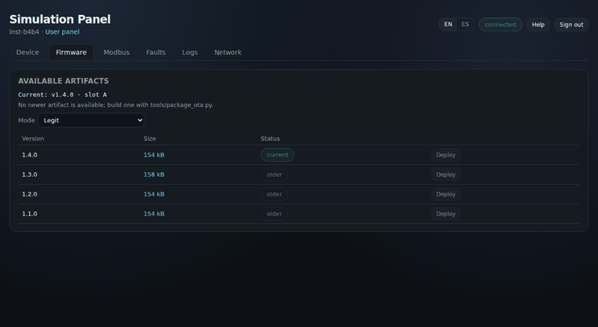

# OTA and slots





OTA downloads a signed and encrypted `.ota`, verifies it in the bootloader and
writes it to the inactive slot. If the new app does not confirm, the next boot
rolls back.

## Before deploying

In Sim panel → Firmware you will see:

```text
Current: v1.4.0 · slot B
Only a version newer than the current one is accepted.
```

The list shows each artifact with a badge:

- `current`: the version running right now.
- `newer`: can be deployed in legit mode.
- `older`: can only be tried in downgrade/corrupt mode.

## Modes

| Mode | What it does | Expected result |
| :--- | :--- | :--- |
| `Legit` | Serves the artifact as is | If it is newer, it switches slots |
| `Corrupt` | Alters one byte of the ciphertext | The bootloader rejects the signature |
| `Downgrade` | Tries an older version | Anti-downgrade rejects it |

## Legitimate upgrade

1. Choose a `newer` artifact.
2. Leave the mode on `Legit`.
3. Press `Deploy`.
4. The panel shows `Sent…` and waits for the bootloader.
5. When it finishes, you'll see `Updated to vX · slot A|B`.

The version and slot change; the inactive slot becomes the active one.

## What happens under the hood

1. The running app downloads the `.ota` over HTTP into a **staging** area
   (208 KB).
2. It reboots into the bootloader.
3. The bootloader verifies the format, hardware, anti-downgrade, Ed25519,
   AES-GCM and SHA-256, then writes the **decrypted payload** to the inactive
   slot and marks it pending.
4. The new app confirms after 3 s if Modbus is up; otherwise the next boot
   rolls back.

The encrypted artifact stays in staging; the inactive slot receives the
plaintext firmware. The current artifact is ~149 KB, so it fits in staging with
headroom.

## Downgrade

A downgrade **must not** work:

1. Choose an `older` artifact.
2. Switch the mode to `Downgrade`.
3. Press `Deploy`.
4. The panel waits for the restart and shows:
   `No change: the device remains on vX · slot A|B. The bootloader rejected the
   image (anti-downgrade or signature).`

That is correct: anti-downgrade protects against going back to a vulnerable
version. If you want to see another slot change, generate a **newer** artifact.

## Corrupt

`Corrupt` mode modifies one byte of the ciphertext. The bootloader rejects the
signature/GCM and the device stays on the current slot. It is there to show that
a tampered image is not applied.

## Generating a new artifact

From the repository root:

```bash
cmake -B build-ota -G Ninja -DFW_VERSION_MINOR=4 -DFW_VERSION_PATCH=0
cmake --build build-ota --target firmware
set -a; . ./.env; set +a
python3 tools/package_ota.py \
  --input build-ota/bin/firmware \
  --version 1.4.0 \
  --output firmware/releases/1.4.0.ota
python3 tools/verify_ota.py \
  --input firmware/releases/1.4.0.ota \
  --pubkey keys/ota_public.pem \
  --active-version 1.3.0
```

The serial is read from the driver, so it does not change after an OTA.
All bundled artifacts (1.1.0–1.4.0) include this read.

The backend reads the `.ota` files from `firmware/releases/` locally (or
`/data/ota` on Fly). Artifacts are not committed.

## What the panel does not do

- It does not allow bypassing anti-downgrade.
- It does not install a corrupt image “just to try”.
- It does not switch slots if verification fails.
- It does not let you choose a slot manually; the bootloader decides the inactive
  one.

## If the panel does not change

- Check that the artifact is newer than `Current`.
- Check `fw-status`; if it says `No change`, the bootloader rejected the image.
- If the backend sees no artifacts, check `OTA_DIR` and the `/data/ota` volume.
- A factory reset returns to the factory app and clears the history.

[Back to the manual](README.md) · [Sim panel](08-simulation-panel.md)
