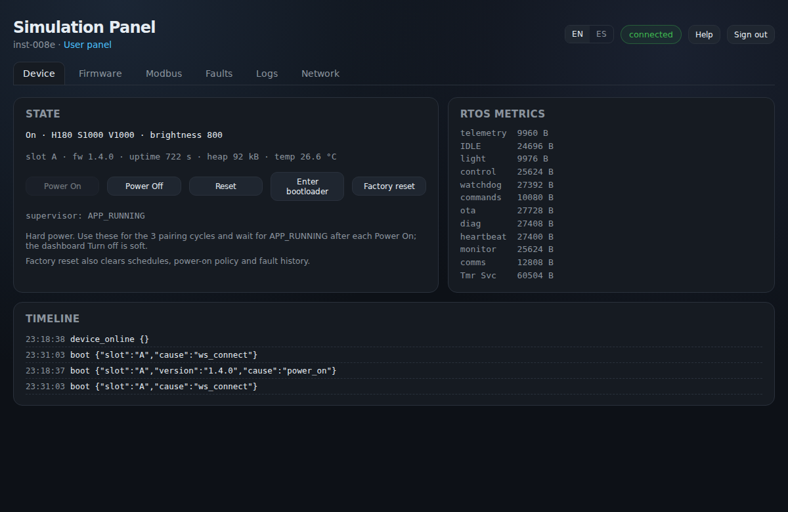

# Simulation Panel

This is the engineering/QA view. It opens at:

<http://localhost:3000/sim.html?pin=2025>

The demo PIN is `2025`. The panel shares the same instance and the same
WebSocket as the dashboard.

## Device

- `Power On` / `Power Off`: **hard** power off; counts toward pairing.
- `Reset`: restarts the firmware.
- `Enter bootloader` / `Exit bootloader`: leaves the device in recovery mode.
- `Factory reset`: clears flash, driver, schedules, power-on and history.
- `RTOS metrics`: task stack high-water marks.
- `Timeline`: recent events.

The factory reset asks for confirmation and leaves the open dashboard
resynchronized.

## Firmware

- `Current: vX · slot A|B`.
- Artifact list and `current`/`newer`/`older` badges.
- `Legit`, `Corrupt`, `Downgrade` modes.
- Result: `Updated…` or `No change…`.

Details in [OTA and slots](07-ota-slots.md).

## Modbus

- Reads and writes coils, discrete, holding and input.
- `Bypass`: writes go **straight to the driver**, without passing through the
  firmware. It is there to demonstrate the register map.
- `Auto-refresh` reads at 1 Hz while the tab is open.
- `Apply target` writes the target and applies the command.

If you write a holding register and see no change, check that you pressed `Apply
target` or that the firmware has not overwritten it.

## Faults

- Catalog with severity and effect.
- `Duration (s, 0 = until cleared)`.
- `Inject` sends the fault to the driver.
- `Clear faults` clears the injection and the latch.
- `Clear history` clears only the fault history.
- The table shows origin, severity and effect.

Details in [Faults](06-faults.md).

## Logs

- Events from the backend, firmware and driver.
- Text filter.
- Download to `.log`.

## Network

- Provisioning state and pairing progress.
- `Start pairing`, `Cancel pairing`, `Forget Wi-Fi & pair`.
- SSID and password whitelist.
- `Allow any`.
- Simulated faults: wrong password, unknown network, timeout.

Details in [Pairing](02-pairing.md).

## When to use the Sim panel

- To try faults, OTA, pairing and Modbus.
- To see the timeline and logs when something does not respond.
- To do a factory reset.

It is not the end-user view; the dashboard is the normal view.

[Back to the manual](README.md) · [Common issues](09-troubleshooting.md)
