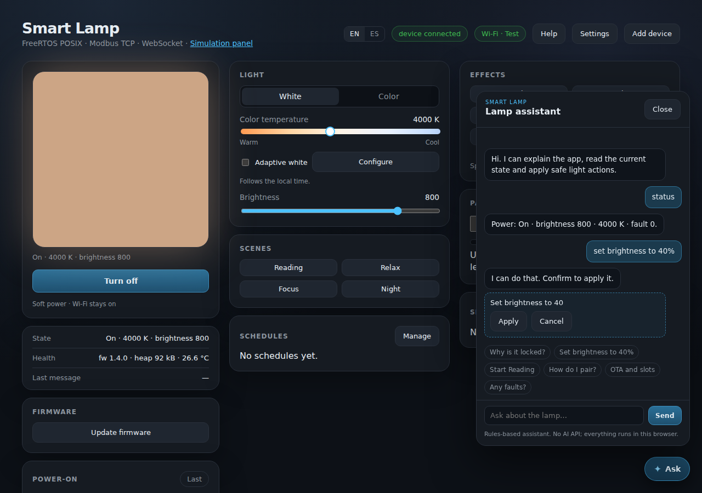

# Local assistant



The dashboard includes a small **rule-based assistant**. It runs entirely in
the browser: there is no AI model, no API key and no prompt sent anywhere.

Open it with the **Ask** button in the bottom-right corner, or with the compact
button in the header on small screens.

## What it can do

- Explain the app and the manual: pairing, schedules, sequences, faults, OTA,
  settings and controls.
- Read the current state: power, brightness, color/CCT, Wi-Fi, firmware
  version, slot and active fault.
- Diagnose why the controls are locked.
- Open the Help, Settings, Schedules and Sequences dialogs.
- Propose safe actions and apply them only after you press **Apply**:
  - turn the lamp on or off;
  - set brightness;
  - set white temperature;
  - set a named color;
  - apply a scene;
  - start or stop an effect;
  - clear faults.

## Examples

```text
Why is it locked?
Set brightness to 40%
Make it warm
Set the color to blue
Start Reading
Start breathing
Stop the effect
Any faults?
What version and slot do I have?
How do I pair?
OTA and slots
Open settings
```

The assistant follows the UI language: English or Spanish.

## What it cannot do

- It does not call an LLM and does not learn from the conversation.
- It does not send audio, passwords or the device token anywhere.
- It does not perform OTA, factory reset, pairing or credential changes.
- It does not control the Simulation Panel or other browser tabs.
- It cannot understand arbitrary phrasing. If it has no rule, it suggests a
  topic or searches the manual.

## Safety model

Actions use the same dashboard functions and WebSocket commands as the normal
buttons. The assistant never executes an action immediately: it shows a plan
with **Apply** and **Cancel**. If the controls are locked by a fault, stale
connection or Wi-Fi state, it explains the reason instead of sending a command.

## Updating the knowledge

The knowledge base is generated from this manual:

```bash
python3 tools/build_assistant_knowledge.py
```

The generated file is `web/src/assistant-knowledge.js` and is committed so
GitHub Pages can serve it as a static asset. If you edit the manual and forget
to regenerate, the assistant still works for its built-in intents; only the
manual search results become stale.

[Back to the manual](README.md) · [Controls reference](10-controls-reference.md)
