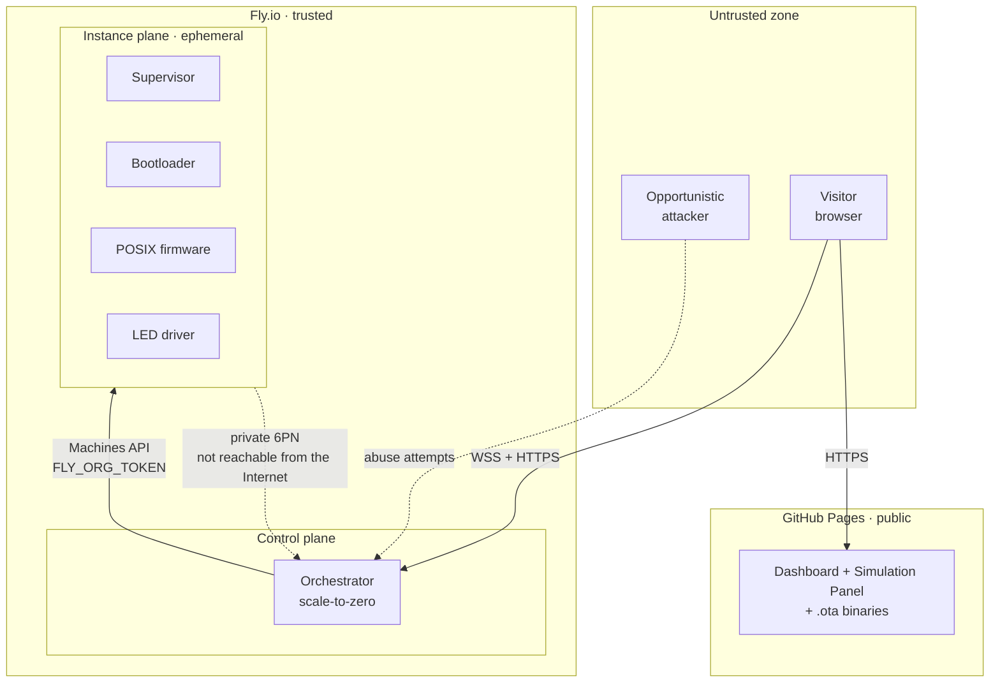

# Threat Model — Threat model for the smart lamp demo

## 1. Purpose and scope

This document describes the **threat model** of the public smart lamp demo. Its goal is to:

- **Make explicit** what is protected, from whom and how.
- **Document** the security decisions and their limits.
- **Distinguish** what is preserved in POSIX from what cannot be simulated.
- **Serve as a checklist** to review the design before publishing.

The model follows an adaptation of **STRIDE** for embedded and IoT systems, complemented with **attack trees** for the critical paths (OTA, firmware impersonation, instance hijacking).

**Scope:** the complete demo (POSIX firmware, bootloader, LED driver, backend, dashboards, infrastructure on Fly.io and Pages).

**Out of scope:** see §11.

## 2. System model and trust boundaries

### 2.1 Trust boundary diagram



### 2.2 Trust boundaries

| Boundary | On one side | On the other side | What crosses |
| :--- | :--- | :--- | :--- |
| **TB-1: Internet ↔ Pages** | Visitor | Static content | HTML, JS, `.ota` (public by design) |
| **TB-2: Internet ↔ Orchestrator** | Visitor / attacker | Backend | REST, WS, tokens |
| **TB-3: Orchestrator ↔ Instance** | Control plane | Instance plane | Commands (WS), telemetry (REST), OTA |
| **TB-4: Firmware ↔ LED driver** | Firmware | LED driver | Modbus TCP (localhost / docker network) |
| **TB-5: Firmware ↔ Simulated flash** | Firmware process | `flash.bin` (mmap) | Memory reads/writes |

**Key observation:** the ephemeral instance **does not expose ports to the Internet**. All traffic goes through the orchestrator (TB-3), which validates `device_token` on every message. This drastically reduces the attack surface.

## 3. Assets

| ID | Asset | Sensitivity | Location | Consequence if compromised |
| :--- | :--- | :--- | :--- | :--- |
| **A1** | Ephemeral instances | Low | Fly.io | Resource abuse (cost), no real data |
| **A2** | Simulation Panel | Medium | Pages + Orchestrator | Fault injection into other instances |
| **A3** | `device_token` | Medium | Orchestrator memory + Machine env var | Impersonate the firmware before the backend |
| **A4** | `FLY_ORG_TOKEN` | **High** | Fly Secrets | Create/destroy Apps in the organization (cost, chaos) |
| **A5** | `OTA_SIGNING_KEY` | **High** | GitHub Secrets (`release`) | Sign malicious firmware accepted by the bootloader |
| **A6** | `OTA_AES_KEY` | **High** | GitHub Secrets (`release`) | Decrypt images; combined with A5, craft valid images |
| **A7** | `JWT_SECRET` | Medium | Fly Secrets | Forge `session_tokens` for other instances |
| **A8** | `session_token` | Low | Browser `sessionStorage` | Access to one specific ephemeral instance |
| **A9** | `flash.bin` (config state) | Low | Ephemeral rootfs | Corrupted configuration of one instance (destroyed with it) |
| **A10** | Orchestrator logs | Low | Fly.io | Debug information; possible token leak if not redacted |

## 4. Adversaries

| ID | Adversary | Capability | Motivation | Relevance |
| :--- | :--- | :--- | :--- | :--- |
| **T1** | Curious visitor | Browses the demo, opens DevTools | Understand how it works; not malicious | **High** (this is the target user) |
| **T2** | Scraper / bot | Automates `POST /instances` | Exhaust the Fly.io trial or generate cost | **High** |
| **T3** | Opportunistic attacker | Finds the orchestrator URL | Inject faults, impersonate firmware, create instances in bulk | **Medium** |
| **T4** | Attacker with access to the CI runner | Compromises a workflow or a dependency | Exfiltrate `OTA_SIGNING_KEY` / `OTA_AES_KEY` | **Low** (mitigated by the `release` environment) |
| **T5** | Attacker with physical access to the Fly.io server | Hypervisor access | Read the memory of the instances | **None** (out of scope; Fly.io's responsibility) |

## 5. Attack surfaces

| ID | Surface | Exposed to | Assets at risk | Main mitigation |
| :--- | :--- | :--- | :--- | :--- |
| **S1** | `POST /instances` | Internet | A1, A4 | Rate limiting + optional Turnstile |
| **S2** | `WS /ws/dashboard` | Internet | A2, A7, A8 | `session_token` JWT + authorization by `instance_id` |
| **S3** | `WS /ws/device` | Internet | A3 | Opaque `device_token` + constant-time comparison |
| **S4** | REST `/telemetry/*` | Internet | A3 | `device_token` |
| **S5** | REST `/instances/{id}/sim/*` | Internet | A2 | `role: sim` in the JWT |
| **S6** | REST `/ota/*` | Internet | A5, A6 | Signature + encryption; the `.ota` files are public by design |
| **S7** | Ephemeral instances | **Orchestrator only** (6PN) | A1, A9 | Private network per App; no public ports |
| **S8** | GitHub Actions `package` | Only with manual approval | A5, A6 | `release` environment + required reviewers |
| **S9** | GitHub Pages | Internet | None | Public content; no secrets |
| **S10** | `flash.bin` | Firmware process + supervisor | A9 | Ephemeral rootfs; destroyed with the instance |

## 6. STRIDE analysis by component

### 6.1 Orchestrator (backend)

| Threat | Description | Mitigation | Residual risk |
| :--- | :--- | :--- | :--- |
| **S**poofing | Impersonate the dashboard with a forged JWT | JWT HS256 with `JWT_SECRET` in Fly Secrets; short `exp` (1 h) | Low (requires A7) |
| **T**ampering | Modify commands in transit | TLS (WSS/HTTPS) | Low |
| **R**epudiation | Deny having created an instance | `jti` in the JWT + orchestrator logs | Low (no persistent audit) |
| **I**nformation disclosure | Leak `device_token` to the dashboard | `device_token` is never included in responses to the dashboard | Low |
| **D**enial of service | Mass `POST /instances` | Rate limiting per IP + global limit + concurrent instance limit | Medium (no Turnstile) |
| **E**levation of privilege | Use `role: user` to access `/sim/*` | `require_sim_role` middleware | Low |

### 6.2 Firmware (POSIX)

| Threat | Description | Mitigation | Residual risk |
| :--- | :--- | :--- | :--- |
| **S**poofing | Impersonate the orchestrator (firmware connects to a fake backend) | TLS + `device_token` | Low (requires compromising TLS) |
| **T**ampering | Modify the firmware in `flash.bin` | Ed25519 signature in the bootloader | Low |
| **R**epudiation | Deny having sent telemetry | Orchestrator logs with `ts` | Low |
| **I**nformation disclosure | Read the `.ota` image in transit | TLS + AES-256-GCM | Low |
| **D**enial of service | Flood the firmware with commands | Rate limiting in the orchestrator + `vCommsTask` with a bounded queue | Low |
| **E**levation of privilege | Escape the container | Firecracker microVM + unprivileged + read-only rootfs except `/tmp` and `flash.bin` | Low |

### 6.3 Bootloader

| Threat | Description | Mitigation | Residual risk |
| :--- | :--- | :--- | :--- |
| **S**poofing | Install a third-party `.ota` | Ed25519 signature verified with the embedded `OTA_PUBLIC_KEY` | Low (requires A5) |
| **T**ampering | Modify the `.ota` in staging | SHA-256 + GCM tag + signature over header+ciphertext+tag | Low |
| **R**epudiation | Deny having applied an update | `ota_result` event via telemetry | Low |
| **I**nformation disclosure | Read the firmware from `flash.bin` | AES-256-GCM (optional); in the demo the binary is served publicly by design | Medium (the firmware is public, there are no real secrets) |
| **D**enial of service | Corrupt `flash.bin` to prevent boot | A/B slots + rollback + recovery mode (`force_bootloader`) | Low |
| **E**levation of privilege | Bypass verification and run arbitrary code | Verification is the bootloader's first instruction; there is no "skip" flag | Low |

### 6.4 LED driver (Modbus TCP)

| Threat | Description | Mitigation | Residual risk |
| :--- | :--- | :--- | :--- |
| **S**poofing | Impersonate the firmware | Modbus TCP on the local network (6PN); no protocol-level authentication | **Medium** (Modbus has no auth; mitigated by network isolation) |
| **T**ampering | Modify registers directly | Only the firmware and the Simulation Panel can write; the panel requires `role: sim` | Low |
| **I**nformation disclosure | Read the real LED state | Input registers are read-only; they contain no secrets | None |
| **D**enial of service | Flood with polls | Rate limiting in the firmware; the driver accepts no more than N connections | Low |
| **E**levation of privilege | Write to `flash.bin` from the driver | The driver has no access to `flash.bin`; only to `driver_state.bin` | None |

**Note:** Modbus has no authentication by design. In a real product, the bus would be physically isolated (RS-485 inside an enclosure) or Modbus Security (TLS) would be used. In the demo, 6PN network isolation is the main mitigation.

### 6.5 Dashboards (browser)

| Threat | Description | Mitigation | Residual risk |
| :--- | :--- | :--- | :--- |
| **S**poofing | Phishing to steal `session_token` | No explicit mitigation (demo) | Low (1 h tokens, ephemeral instances) |
| **T**ampering | Modify JS in transit | HTTPS (Pages) + SRI if CDNs are used | Low |
| **I**nformation disclosure | XSS steals `session_token` from `sessionStorage` | Strict CSP + HTML escaping + no `innerHTML` with user data | Medium (no CSP implemented) |
| **D**enial of service | Overload the dashboard WS | Rate limiting in the orchestrator | Low |

### 6.6 CI/CD pipeline

| Threat | Description | Mitigation | Residual risk |
| :--- | :--- | :--- | :--- |
| **S**poofing | A fork PR tries to access secrets | `release` environment with required reviewers | Low |
| **T**ampering | Modify `package_ota.py` to exfiltrate keys | Code review + branch protection + independent `verify` | Medium (a compromised maintainer could do it) |
| **I**nformation disclosure | `package` job logs expose keys | Keys are not printed; `verify` validates the `.ota` without seeing the private key | Low |
| **E**levation of privilege | A malicious workflow accesses `FLY_ORG_TOKEN` | `FLY_ORG_TOKEN` is only in Fly Secrets, not in GitHub Secrets | Low |

## 7. Attack trees

### 7.1 AT-1: Install malicious firmware on an instance

```text
Goal: get the bootloader to accept an .ota controlled by the attacker
├── 1. Obtain OTA_SIGNING_KEY
│   ├── 1.1 Compromise a CI runner
│   │   └── Mitigated: release environment + required reviewers
│   ├── 1.2 Compromise GitHub (owner account)
│   │   └── Mitigated: 2FA on GitHub (recommended, not implemented in the demo)
│   └── 1.3 Social engineering against the owner
│       └── Out of technical scope
├── 2. Bypass verification in the bootloader
│   ├── 2.1 Modify the bootloader binary
│   │   └── Mitigated: the bootloader is in the protected partition of flash.bin; the firmware cannot write it
│   ├── 2.2 Corrupt OTA_PUBLIC_KEY
│   │   └── Mitigated: the public key is embedded in the bootloader, not in flash.bin
│   └── 2.3 Exploit a bug in verify.c
│       └── Partially mitigated: code review + unit tests; no fuzzing
└── 3. Replace the binary after verification (TOCTOU)
    └── Mitigated: the bootloader verifies and copies in the same transaction; there is no window
```

**Conclusion:** the most viable path is compromising the private key (A5), which requires compromising GitHub or the runner with manual approval. The residual risk is **low** for a demo.

### 7.2 AT-2: Hijack someone else's instance

```text
Goal: control another visitor's instance
├── 1. Forge a session_token
│   ├── 1.1 Obtain JWT_SECRET
│   │   └── Mitigated: Fly Secrets, not reachable from the Internet
│   └── 1.2 Exploit a bug in JWT validation
│       └── Mitigated: PyJWT with a fixed algorithm (does not accept "none")
├── 2. Guess the instance_id
│   └── Mitigated: UUID v4 (122 bits of entropy)
├── 3. Reuse someone else's session_token
│   └── Mitigated: the token is in the victim browser's sessionStorage; requires XSS
└── 4. Exploit a role confusion
    └── Mitigated: require_sim_role middleware + instance_id validation on every request
```

**Conclusion:** the most viable path is XSS in the dashboard (without a strict CSP), which would allow stealing the victim's `session_token`. The residual risk is **medium** and is mitigated with a CSP (next step).

### 7.3 AT-3: Exhaust the Fly.io trial

```text
Goal: generate cost or exhaust the Fly.io trial
├── 1. Mass POST /instances
│   ├── 1.1 Without rate limiting
│   │   └── Mitigated: rate limiting per IP (5/h) + global limit (50/h) + concurrent limit (10)
│   ├── 1.2 With rotating IPs (botnet)
│   │   └── Partially mitigated: global limit; Turnstile as a next step
│   └── 1.3 With multiple accounts
│       └── Out of scope (requires Turnstile or CAPTCHA)
└── 2. Keep instances alive artificially
    ├── 2.1 Fake heartbeats over WS
    │   └── Mitigated: the heartbeat requires a valid session_token
    └── 2.2 Instances that do not destroy themselves
        └── Mitigated: agent-idle + auto_destroy + TTL in the orchestrator
```

**Conclusion:** the residual risk is **medium**. Turnstile or an invisible CAPTCHA would reduce automated abuse. It is documented as a next step.

## 8. Security properties preserved vs. simulated

This section distinguishes what is **really being demonstrated** from what is a conscious limitation of the POSIX environment.

| Property | On real hardware (MCU) | On POSIX (demo) | Fidelity | Notes |
| :--- | :--- | :--- | :---: | :--- |
| **Image signature (Ed25519)** | Verified in the bootloader | Verified in the POSIX bootloader | **High** | Same code, same library (`libsodium`) |
| **Image encryption (AES-256-GCM)** | Verified in the bootloader | Verified in the POSIX bootloader | **High** | Same code, same library (`mbedtls`) |
| **Anti-downgrade** | Monotonic version in OTP/flash | Monotonic version in `flash.bin` | **High** | Same comparison logic |
| **A/B slots + rollback** | Flash partitions | Partitions in `flash.bin` (mmap) | **High** | Same state machine |
| **Boot confirmation** | Flag in flash | Flag in `flash.bin` | **High** | Same flow |
| **Recovery mode** | Boot GPIO + flag in flash | Flag in `flash.bin` | **High** | Same behavior |
| **Hardware watchdog** | SoC WDT | `vWatchdogTask` task + supervisor `SIGTERM` | **Medium** | No immediate reset; there is a `SIGTERM` |
| **RDP (Read-Out Protection)** | Hardware register, irreversible | **Not simulable** | **None** | There is no debug port to protect in POSIX |
| **SoC Secure Boot** | Boot ROM verifies the first stage | **Not simulable** | **None** | There is no Boot ROM in a Linux process |
| **Executed RAM protection** | MPU + protected regions | **Not simulable** | **None** | POSIX does not expose an MPU |
| **Debug port lockout (JTAG/SWD)** | Hardware fuse | **Not simulable** | **None** | There is no JTAG in POSIX |
| **Memory isolation between tasks** | Per-task MPU | pthreads with a shared address space | **Low** | FreeRTOS POSIX does not use an MPU |
| **Timing determinism** | Deterministic scheduler | Linux scheduler (non-deterministic) | **Low** | No real-time guarantees are claimed |

### 8.1 How to interpret this table

- **High fidelity:** the code and the logic are identical to those of an MCU; only the substrate changes (mapped memory vs. physical flash).
- **Medium fidelity:** the behavior is similar but not identical (for example, the simulated WDT does not reset the CPU, it sends `SIGTERM` instead).
- **Low fidelity:** the mechanism exists but does not offer the same guarantees (for example, there is no MPU, so one task can corrupt another task's memory).
- **No fidelity:** it is not simulable in POSIX; it is documented as a conscious limitation.

### 8.2 Documented limitations

The table favors **documented honesty** over security theater:

> The project documents which security properties are preserved in the simulation and which ones are not simulable in POSIX. The non-simulated properties are conscious limitations, not oversights. The HAL boundary also allows migrating to real hardware.

This is preferable to simulating RDP artificially or claiming that a Linux process "is an MCU".

## 9. Mitigation matrix

| Control | Threats mitigated | Implemented | Next step |
| :--- | :--- | :---: | :--- |
| **Ed25519 signature** | S/T in the bootloader, AT-1 | ✅ | — |
| **AES-256-GCM encryption** | I in the bootloader | ✅ | — |
| **Anti-downgrade** | T in the bootloader | ✅ | — |
| **A/B slots + rollback** | D in the bootloader | ✅ | — |
| **JWT HS256** | S/E in the orchestrator, AT-2 | ✅ | — |
| **Opaque `device_token`** | S in the firmware | ✅ | — |
| **Authorization by `instance_id`** | E in the orchestrator, AT-2 | ✅ | — |
| **`role: sim` for `/sim/*`** | E in the orchestrator | ✅ | — |
| **Rate limiting per IP** | D in the orchestrator, AT-3 | ✅ | — |
| **Global instance limit** | D in the orchestrator, AT-3 | ✅ | — |
| **`auto_destroy` + `agent-idle`** | A1, AT-3 | ✅ | — |
| **6PN network per App** | S in Modbus, AT-2 | ✅ | — |
| **Firecracker microVM** | E in the firmware | ✅ | — |
| **Constant-time comparison** | Timing attack on `device_token` | ✅ | — |
| **`release` environment with reviewers** | T in CI, AT-1 | ✅ | — |
| **Independent `verify_ota.py`** | T in CI | ✅ | — |
| **TLS on all channels** | T/I in transit | ✅ | — |
| **Strict CSP** | I in the dashboards (XSS), AT-2 | ❌ | ✅ |
| **Turnstile / CAPTCHA** | D in `POST /instances`, AT-3 | ❌ | ✅ |
| **SSO in the sim panel** | S/E in the sim panel | ❌ | ✅ |
| **mTLS firmware↔backend** | S in the firmware | ❌ | ✅ |
| **Remote signing via HSM** | A5, AT-1 | ❌ | ✅ |
| **Persistent audit** | R in the orchestrator | ❌ | ✅ |
| **WAF / DDoS protection** | D in the orchestrator | ❌ (basic Fly) | ✅ |
| **RDP / SoC Secure Boot** | — | ❌ (not simulable) | — |

## 10. Residual risks

| ID | Risk | Severity | Likelihood | Accepted | Justification |
| :--- | :--- | :--- | :--- | :---: | :--- |
| **R1** | XSS in the dashboard steals `session_token` | Medium | Medium | Yes | 1 h tokens; ephemeral instances; CSP as a next step |
| **R2** | Abuse of `POST /instances` with rotating IPs | Medium | Medium | Yes | Global limit partially mitigates; Turnstile as a next step |
| **R3** | Compromise of `OTA_SIGNING_KEY` in GitHub Secrets | High | Low | Yes | `release` environment + required reviewers; HSM as a next step |
| **R4** | Modbus without authentication allows writing registers from the 6PN network | Medium | Low | Yes | Per-App isolation; only the firmware and the sim panel have access |
| **R5** | Absence of an MPU allows cross-task corruption | Low | Low | Yes | FreeRTOS POSIX does not use an MPU; documented in §8 |
| **R6** | Non-deterministic scheduling invalidates real-time guarantees | Low | High | Yes | Documented; no real-time guarantees are claimed |
| **R7** | Lack of persistent audit | Low | Medium | Yes | Fly.io logs are the only source; 30-day retention |
| **R8** | No automatic secret rotation | Medium | Low | Yes | Manual rotation documented in `key-management.md` |

## 11. Out of scope

| Out of scope | Reason |
| :--- | :--- |
| **Attacker with physical access to the Fly.io server** | Fly.io's responsibility (hypervisor physical security) |
| **Side-channel attacks (power analysis, timing, EM)** | They do not apply in POSIX; they do on real hardware |
| **Dependency supply chain compromise** | Mitigated by pinned versions; there is no exhaustive audit |
| **Volumetric DDoS** | Fly.io has basic protection; the project is not designed to withstand a targeted attack |
| **Firmware reverse engineering** | AES-GCM encryption makes it harder, but the firmware is public by design in the demo |
| **Compromise of the visitor's browser** | XSS, malicious extensions; outside the project's control |
| **Attacks on GitHub Pages or GitHub Actions** | GitHub's responsibility |
| **RDP / Secure Boot / MPU** | Not simulable in POSIX (see §8) |

## 12. Model review process

### 12.1 When to review

- **Before every major release:** verify that the mitigations are still in place.
- **After adding a new surface** (new endpoint, new component): update §5 and §6.
- **After an incident** (even in the demo): add it to §10 if applicable.

### 12.2 Review checklist

- [ ] Are all the assets in §3 still relevant?
- [ ] Are there new adversaries or capabilities?
- [ ] Are there new attack surfaces?
- [ ] Are the mitigations in §9 still implemented?
- [ ] Is the table in §8 still accurate?
- [ ] Are the residual risks in §10 still acceptable?
- [ ] Is the "out of scope" in §11 still justifiable?

## 13. References

- [`08-security-and-threat-model.md`](08-security-and-threat-model.md) — executive summary
- [`key-management.md`](key-management.md) — keys and secrets management
- [`auth.md`](auth.md) — permission matrix and token flow
- [`adr/adr-009-ed25519-aes-gcm.md`](adr/adr-009-ed25519-aes-gcm.md)
- [`adr/adr-010-jwt-vs-opaque-token.md`](adr/adr-010-jwt-vs-opaque-token.md)
- [STRIDE — Microsoft](https://learn.microsoft.com/en-us/azure/security/develop/threat-modeling-tool-threats)
- [OWASP IoT Top 10](https://owasp.org/www-project-internet-of-things/)
- [OWASP API Security Top 10](https://owasp.org/www-project-api-security/)
- [OWASP Threat Modeling Cheat Sheet](https://cheatsheetseries.owasp.org/cheatsheets/Threat_Modeling_Cheat_Sheet.html)
- [Fly.io — Security Model](https://fly.io/docs/reference/security/)
- [Firecracker — microVM isolation](https://firecracker-microvm.github.io/)
